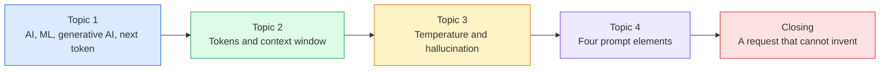
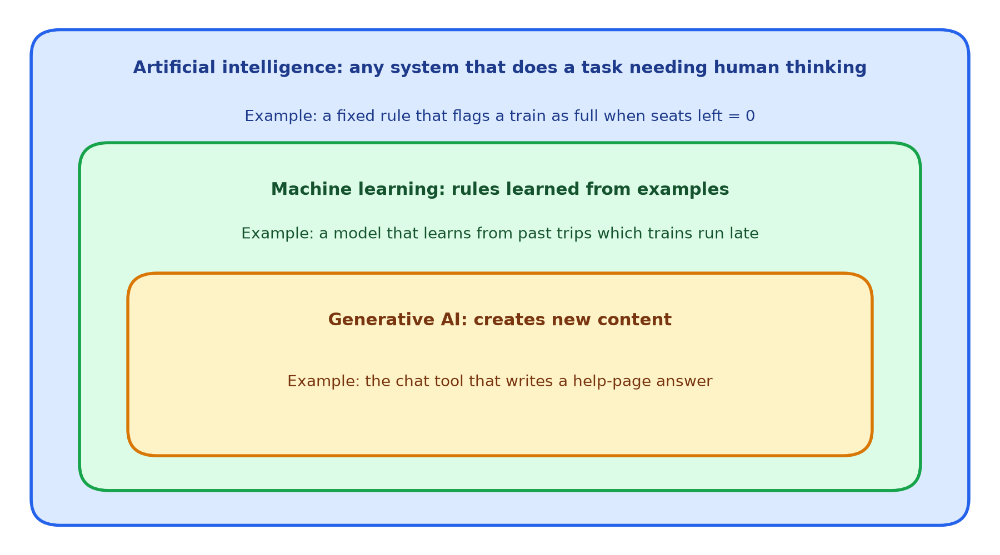
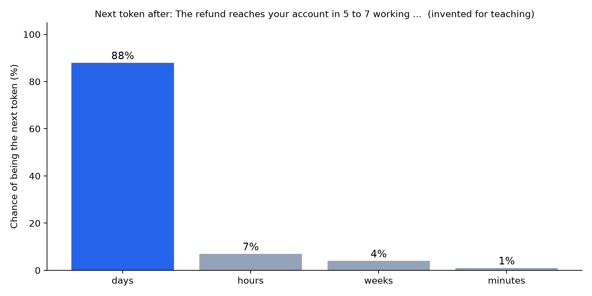
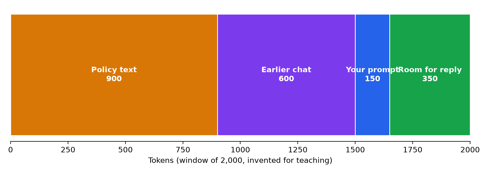
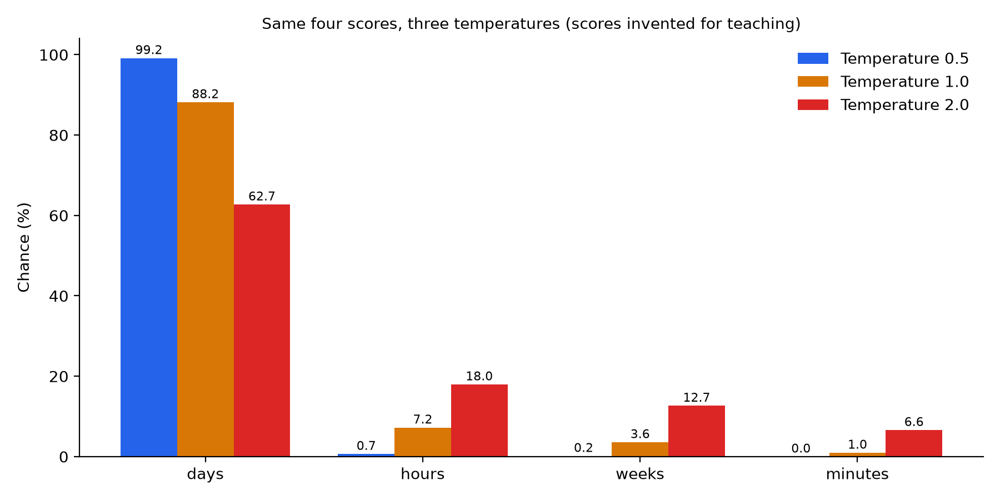

# <font color='#1d4ed8'>Lecture Script: How AI and LLMs Work with Prompts</font>

---

## <font color='blue'>Agenda</font>

The lecture runs as four topics. Each topic ends with a quiz.

| Topic | What we do | Learning objectives covered | Minutes |
|:-:|:--|:--|:-:|
| 1 | Place AI, ML and generative AI, then see how a reply is built | Compare AI, machine learning and generative AI by what each term covers<br>Describe next-token prediction as the mechanism that produces an LLM response | 25 |
| 2 | See how text is cut up and how much fits | Describe how a tokenizer splits text into subword tokens<br>Explain what a context window limits and what counts against it | 25 |
| 3 | Understand why answers vary and why some are wrong | Predict how raising temperature changes the variability of an output<br>Explain why a model can produce fluent text that is factually wrong | 30 |
| 4 | Write a prompt that gives a usable reply | State the four elements of a well-formed prompt: task, context, format and constraints | 25 |
| — | Closing: Outcome & Summary | | 15 |
| | **Total** | | **120** |

> <font color="red">**🎯 Instructor Note**</font> Pace: keep the three-term picture in Topic 1 quick. Spend the extra minutes on the live fluent-but-false check in Topic 3 and on the prompt rewrite in Topic 4.
> Learners need one free chat tool open: ChatGPT, Claude or Gemini. Model replies are never pasted in this script, because they change on every run. Run each live step and read the real reply. Numbers in tables and charts are invented for teaching.

---

## <font color='blue'>Scenario</font>

**One sentence, one risk.** Meera writes the help pages for an IRCTC-style train booking app. One evening she asks a free chat tool: "Write a help answer about cancelling a waitlisted ticket."

The answer reads smoothly. Inside it sits this line:

> "Your refund reaches your account within 2 hours, and a Rs 40 fee applies."

Nobody on Meera's team gave the tool a refund time or a fee.

> <font color="red">**🎯 Instructor Note**</font> The company is only the setting. Do not claim it works this way. The app, the help page, the refund time and the fee are all invented for teaching.

---

## <font color='blue'>Problem Statement</font>

Meera pastes the answer onto the help page without checking it. By the next morning, 300 customers have read "2 hours". The real refund takes 5 to 7 working days, and the fee is different. The support inbox fills with angry messages, and Meera spends a day correcting the page.

> <font color='purple'>**Why did a smooth answer carry a refund time and a fee that nobody supplied, and how should Meera write her request so the tool has no room to invent them?**</font>

> <font color="red">**🎯 Instructor Note**</font> Poll: "Does the chat tool look up the refund rule before it writes the answer?" Options: yes or no. Give learners 30 seconds to respond in chat. Reveal the answer in the Closing.

---

## <font color='blue'>What We Will Use</font>

One free chat tool: ChatGPT, Claude or Gemini. Today you learn how it works, then you write prompts in it.

| Topic | Ideas | In one line |
|:-:|:--|:--|
| 1 | AI, ML, generative AI, next-token prediction | An LLM builds a reply one small piece at a time by picking a likely next piece |
| 2 | Token, tokenizer, context window | Text is cut into pieces, and a chat has a fixed room for them |
| 3 | Temperature, hallucination | Randomness changes how much replies vary, and fluent text can still be false |
| 4 | Prompt: task, context, format, constraints | Four parts that make a reply specific and checkable |

---

## <font color='blue'>How: Walking Through Meera's Help Page</font>



---

## <font color='blue'>Topic 1: Place AI, ML and generative AI, then see how a reply is built</font> `25 min`

> <font color='purple'>**Meera typed one sentence and got a page of text back. What kind of system is on the other side?**</font>

### <font color='green'>Example: Three terms, three sizes</font>

> <font color='purple'>**How do AI, machine learning and generative AI relate to each other?**</font>

| Term | What it covers | In Meera's app |
|:--|:--|:--|
| Artificial intelligence (AI) | Any computer system that does a task that normally needs human thinking | A fixed rule that shows "Full" when seats left are 0 |
| Machine learning (ML) | AI that learns its rules from examples instead of being given them | A model that learns from past trips which trains tend to run late |
| Generative AI | ML that creates new content: text, images, audio or code | The chat tool that wrote the help answer |

A **large language model (LLM)** is a generative AI model trained on very large amounts of text. ChatGPT, Claude and Gemini are chat tools built on LLMs.

<p align="center"></p>

#### <font color='#c2410c'>Logic Explanation</font>

- Every ML system is AI, but not every AI system learns. The "Full" rule is AI with no learning at all.
- Every generative AI model is ML, but not every ML model creates content. The late-train model only predicts a label.

> <font color='green'>**Result**</font> AI is the widest term, ML sits inside it, and generative AI sits inside ML.

### <font color='green'>Extending it: How the answer is built</font>

> <font color='purple'>**How does a tool write a whole help answer from one sentence?**</font>

An LLM does not look up an answer. It predicts the next **token**, a small piece of text, then the next one, and the next. At each position it scores many candidates and picks one.

> <font color="red">**🎯 Instructor Note**</font> Ask learners to type the likeliest next word after "The refund reaches your account in 5 to 7 working". Expected: "days". The chances below are invented for teaching.

| Text so far | Next token | Chance |
|:--|:-:|:-:|
| The refund reaches your account in 5 to 7 working | days | $88\%$ |
| | hours | $7\%$ |
| | weeks | $4\%$ |
| | minutes | $1\%$ |

The chances add up to $88\% + 7\% + 4\% + 1\% = 100\%$.

<p align="center"></p>

> <font color='green'>**Result**</font> An answer is a chain of likely next tokens. Nothing in the chain checks whether a refund rule is real.

> <font color='#b45309'>**Common mistake**</font> Thinking the tool searches a store of ready-made answers. Fix: remember that it continues text with likely tokens.

### <font color='purple'>Quiz 1</font>

**Question:** A model learns from 50,000 past trips which trains run late, and it only outputs "late" or "on time". Which description fits best?

**Options:**
- A) A rule-based system, because it is not AI
- B) Machine learning, which sits inside AI but is not generative AI
- C) Generative AI, because it uses data
- D) A large language model, because it makes a prediction

**Correct Answer:** B

**Explanation:**
- **A)** It learns from examples, so it is ML. ML is a kind of AI.
- **B)** Correct. It learns its rules from data and outputs a label, so it does not create new content.
- **C)** Using data is not enough. Generative AI creates new text, images, audio or code.
- **D)** An LLM works with language and writes text. This model outputs two labels.

---

## <font color='blue'>Topic 2: See how text is cut up and how much fits</font> `25 min`

> <font color='purple'>**The tool read Meera's one sentence. What did it actually read?**</font>

### <font color='green'>Example: Tokens are pieces, not words</font>

> <font color='purple'>**How does a tokenizer cut a sentence?**</font>

A **tokenizer** cuts text into tokens. A token can be a whole word, part of a word, a space with a word, or a punctuation mark. Long or rare words are often split into **subword** pieces.

> <font color="red">**🎯 Instructor Note**</font> The splits below are one possible split for teaching. Real tokenizers differ between tools, so counts differ. Never quote these as real counts.

| Text | One possible split | Pieces |
|:--|:--|:-:|
| refund | refund | 1 |
| waitlisted | wait / listed | 2 |
| cancellation | cancel / lation | 2 |
| reimbursement | re / imb / urse / ment | 4 |

> <font color='green'>**Result**</font> Common words are often one token. Long or rare words are split into smaller pieces the model has seen before.

#### <font color='#c2410c'>Logic Explanation</font>

- The model works with tokens, not letters or words. That is one reason a tool can miscount the letters in a word.
- Length limits and usage limits are counted in tokens, not words.

> <font color='#b45309'>**Common mistake**</font> Assuming one word equals one token. Fix: expect long and rare words to cost more pieces.

### <font color='green'>Extending it: The context window</font>

> <font color='purple'>**How much can the tool hold in view at one time?**</font>

The **context window** is the most tokens a model can use at one time. Your prompt, the earlier messages and the model's own reply all count against it.

Suppose a window of 2,000 tokens (invented for teaching). Meera has pasted a 900-token policy text. The earlier chat uses 600 tokens. Her new prompt uses 150.

$$\boxed{ \text{room for reply} = \text{window} - \text{policy text} - \text{earlier chat} - \text{prompt} }$$

$$2000 - 900 - 600 - 150 = 350 \text{ tokens}$$

<p align="center"></p>

> <font color='green'>**Result**</font> Only 350 tokens remain for the reply. If it needs more, the tool must stop or drop earlier text.

### <font color='green'>Extending it: Paste a second document</font>

> <font color='purple'>**What happens if Meera pastes a second 500-token document into the same chat?**</font>

> <font color="red">**🎯 Instructor Note**</font> Ask learners to type "fits" or "does not fit" in chat first. Give learners 30 seconds to respond in chat. Expected: it does not fit.

$$350 - 500 = -150 \text{ tokens}$$

> <font color='green'>**Result**</font> The new text is 150 tokens too large. The tool must cut something, and the earliest text is often the first to go.

### <font color='purple'>Quiz 2</font>

**Question:** What counts against the context window?

**Options:**
- A) Only your latest prompt
- B) Only the model's reply
- C) Your prompt, the earlier messages and the model's reply
- D) Only the number of words in the first message

**Correct Answer:** C

**Explanation:**
- **A)** Earlier messages and the reply count too.
- **B)** Your prompt and the earlier chat use the window as well.
- **C)** Correct. Everything the model must read or write sits in one shared window.
- **D)** The window is measured in tokens, not words, and covers the whole chat.

---

## <font color='blue'>Topic 3: Understand why answers vary and why some are wrong</font> `30 min`

> <font color='purple'>**Meera got one answer. Would the tool write the same thing again, and could she trust the "2 hours" in it?**</font>

### <font color='green'>Example: Temperature changes the spread</font>

> <font color='purple'>**What happens to the chances when temperature goes up?**</font>

**Temperature** is a setting that controls how random the choice of the next token is. A low temperature lets the top choice win more often. A high temperature gives the lower choices a better chance.

> <font color="red">**🎯 Instructor Note**</font> Most free chat tools do not show a temperature setting. The table uses invented scores for the same four tokens. Ask first: at a higher temperature, does "days" go up or down?

The scores below are invented. The chance of each token at temperature $T$ is:

$$\boxed{ p_i = \frac{e^{s_i / T}}{\sum_j e^{s_j / T}} }$$

| Next token | Score | Chance at $T=0.5$ | Chance at $T=1.0$ | Chance at $T=2.0$ |
|:--|:-:|:-:|:-:|:-:|
| days | 5.0 | $99.2\%$ | $88.2\%$ | $62.7\%$ |
| hours | 2.5 | $0.7\%$ | $7.2\%$ | $18.0\%$ |
| weeks | 1.8 | $0.2\%$ | $3.6\%$ | $12.7\%$ |
| minutes | 0.5 | $0.0\%$ | $1.0\%$ | $6.6\%$ |

<p align="center"></p>

> <font color='green'>**Result**</font> Raising temperature lowers the top choice's chance and raises the others. Replies become more varied.

#### <font color='#c2410c'>Logic Explanation</font>

- At $T=0.5$ the top token holds $99.2\%$. Repeated runs give almost the same text.
- At $T=2.0$ it holds $62.7\%$. One run in about three picks something else, so repeated runs differ more.

### <font color='green'>Extending it: Live check, ask twice</font>

> <font color='purple'>**Do two runs of the same prompt give the same wording?**</font>

> <font color="red">**🎯 Instructor Note**</font> Learners type "Write a one-line notice that a train is delayed" in their tool, then use Regenerate or open a new chat and repeat. Give learners 30 seconds to respond in chat. Expected: the wording usually differs.

> <font color='green'>**Result**</font> The same prompt can give different wording, because each token is chosen with some randomness.

### <font color='green'>Extending it: Fluent but false</font>

> <font color='purple'>**Why did the tool write "within 2 hours" and "Rs 40"?**</font>

A **hallucination** is fluent text that is not true. The model predicts tokens that sound right. It has no built-in check for truth, and Meera never gave it her real rule. A figure that looks normal in a refund sentence is a likely next token.

> <font color="red">**🎯 Instructor Note**</font> Live check: ask the tool, "What is the refund fee on my train app?" with no other context. Read the reply, then ask learners where the tool could have found the figure. Expected: nowhere.

> <font color='#b45309'>**Common mistake**</font> Treating a confident tone as proof. Fix: check every time, fee, name and rule against your own records.

### <font color='purple'>Quiz 3</font>

**Question:** Meera lowers the temperature and asks the same question 5 times. What is most likely?

**Options:**
- A) The replies are more alike than at a high temperature
- B) Every reply is guaranteed to be true
- C) Each reply is completely different
- D) The tool stops giving replies

**Correct Answer:** A

**Explanation:**
- **A)** Correct. A low temperature favours the top choice, so replies repeat more.
- **B)** Temperature changes variety, not truth. A repeated false claim is still false.
- **C)** That is more likely at a high temperature.
- **D)** Temperature does not stop replies.

---

## <font color='blue'>Topic 4: Write a prompt that gives a usable reply</font> `25 min`

> <font color='purple'>**The tool predicts from whatever it is given. What should Meera give it?**</font>

### <font color='green'>Example: Rebuild the request</font>

> <font color='purple'>**Which four parts make Meera's request specific?**</font>

A well-formed prompt has four elements.

| Element | What it says | Meera's version |
|:--|:--|:--|
| Task | What to do | Write a help answer on cancelling a waitlisted ticket |
| Context | Facts the tool cannot know | Our policy text is pasted below. Refund time and fee are in it |
| Format | What the output looks like | 4 short bullet points, plain words |
| Constraints | Limits and things to avoid | Use only the pasted policy. If a figure is missing, write "not stated" |

The four parts as one prompt:

```
1. Task: Write a help answer on cancelling a waitlisted ticket.
2. Context: Our policy text is pasted below. It holds the refund time and the fee.
3. Format: 4 short bullet points in plain words.
4. Constraints: Use only the pasted policy. If a figure is missing, write "not stated".
```

> <font color="red">**🎯 Instructor Note**</font> Learners paste a 3-line invented policy, then this prompt, into their tool and read the reply against the policy. Do not predict the reply. Ask whether any figure appears that is not in the pasted text.

> <font color='green'>**Result**</font> The context supplied the real facts, and the constraint told the tool what to do when a fact is missing.

#### <font color='#c2410c'>Logic Explanation</font>

- **Task** answers "what do I do". **Context** answers "what do I need to know". **Format** answers "what should it look like". **Constraints** answer "what must I avoid".
- A prompt can be short and still carry all four.

### <font color='green'>Extending it: Find the missing element</font>

> <font color='purple'>**Which elements are present in each prompt?**</font>

> <font color="red">**🎯 Instructor Note**</font> Ask learners to type the missing elements for each row before you reveal the last column.

| Prompt | Present | Missing |
|:--|:--|:--|
| "Write a help answer on cancelling a ticket." | Task | Context, format, constraints |
| "Write a help answer on cancelling a ticket. Keep it under 60 words." | Task, a format hint | Context, constraints |
| "Using the policy below, write 4 bullets on cancelling a ticket. Do not add figures." | Task, context, format, constraints | None |

> <font color='green'>**Result**</font> Naming what is missing tells you what to add.

### <font color='purple'>Quiz 4</font>

**Question:** "Do not add any figure that is not in the policy text" is which prompt element?

**Options:**
- A) Task
- B) Format
- C) Context
- D) Constraints

**Correct Answer:** D

**Explanation:**
- **A)** The task says what to do, such as write a help answer.
- **B)** Format describes the shape of the output, such as 4 bullets.
- **C)** Context supplies facts, such as the pasted policy.
- **D)** Correct. A constraint limits what the tool may say or do.

---

## <font color='blue'>Closing: Outcome & Summary</font> `15 min`

Back to Meera. We answer the Problem Statement using each topic once.

> <font color='purple'>**1. What was on the other side of the chat? (Topic 1)**</font>

A generative AI tool built on an LLM. It predicts the next token. It does not look rules up.

> <font color='purple'>**2. What did it read, and how much fit? (Topic 2)**</font>

Tokens from her one sentence. With no policy text in the window, there was nothing real to read.

> <font color='purple'>**3. Why was the answer smooth and still false? (Topic 3)**</font>

It chose likely-sounding tokens, and "within 2 hours" sounds likely. Temperature changes the variety, not the truth.

> <font color='purple'>**4. What request would have prevented it? (Topic 4)**</font>

One with task, context, format and constraints, as built in Topic 4.

### <font color='green'>Outcome</font>

| | "Write a help answer on cancelling a ticket." | Four-element prompt |
|:--|:-:|:-:|
| Real facts supplied | None | The pasted policy |
| Missing figure handled | Invented | Written as "not stated" |
| Length and shape set | No | Yes |
| Still needs a human check | Yes | Yes |

> <font color='green'>**Therefore,**</font> Meera's answer went wrong because the tool continued text with likely tokens and she gave it no facts. A prompt with task, context, format and constraints closes the gaps. She must still compare every figure with her own policy before publishing.

> <font color="red">**🎯 Instructor Note**</font> Reveal the poll: no. The tool does not look the rule up. It predicts tokens that look like one.

### <font color='green'>Summary</font>

| Learning objective | Takeaway |
|:--|:--|
| AI, ML, generative AI | AI is widest, ML sits inside it, generative AI sits inside ML |
| Next-token prediction | An answer is built one likely token at a time |
| Tokenizer | Text is cut into word and subword pieces |
| Context window | Prompt, earlier chat and reply all count against it |
| Temperature | Higher temperature spreads the chances and varies the replies |
| Hallucination | Fluent text can be false, so check every fact |
| Four prompt elements | Task, context, format and constraints |
| **Practical value** | A four-part prompt and a quick fact check make AI answers safe to use at work |

---

# <font color='red'>Launch the Feedback Poll</font>

> <font color="red">**🎯 Instructor Note**</font> Reminder: launch the feedback poll now to collect learner feedback.
