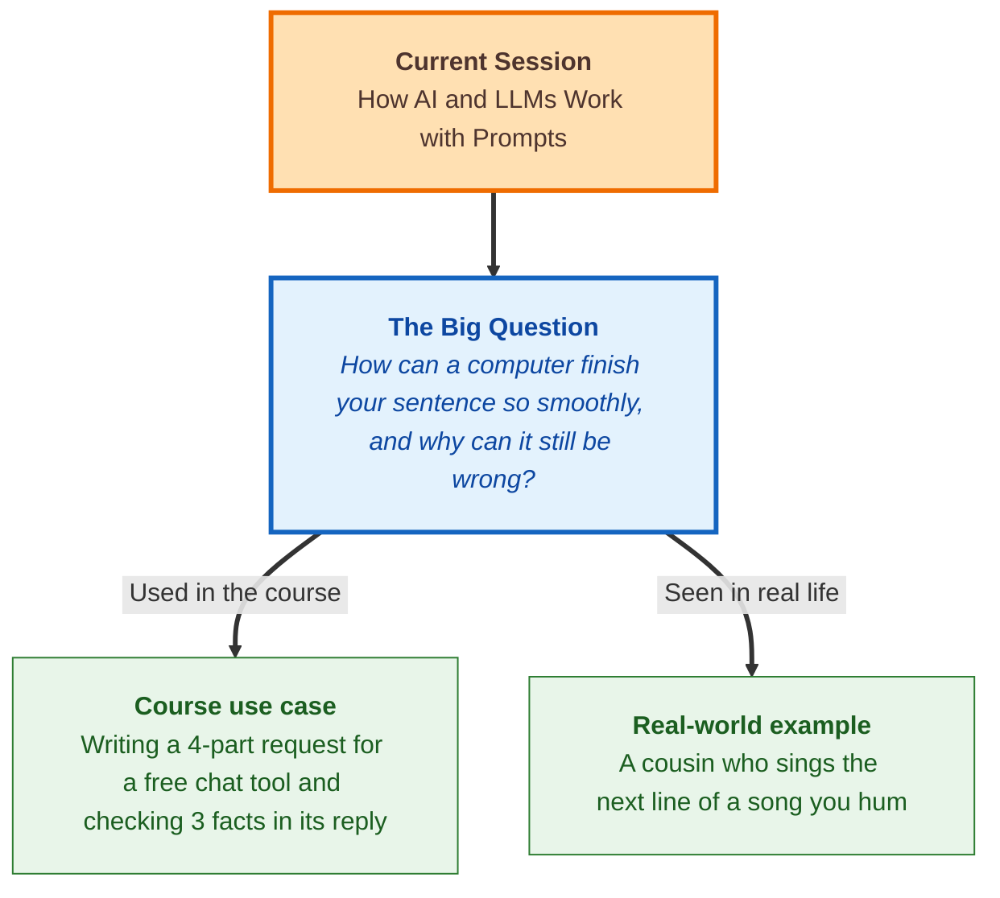

## How AI and LLMs Work with Prompts

### Mental Map

---

### What You'll Learn

Have you ever wondered how your cousin knows the next word after you hum one line?

By the end of this session, you will be able to:

- **Name** the 4 parts of a clear request to a helper.
- **Describe** how your cousin sings one word at a time, and how a long word gets cut into pieces.
- **Explain** why your cousin can hold only the last 3 or 4 lines in mind.
- **Predict** how a bolder guess changes the next word he picks.
- **Compare** a fixed rulebook, a learner and a composer by what each one covers.
- **Justify** why a confident singer can still sing a wrong line.

> **Topics you will meet:** AI vs ML vs GenAI, next-token prediction, tokens, context and temperature, hallucination, four elements of a prompt.
>
> Join the session to learn each of these in detail.

---

### Why You Are Learning This Topic

Neha and her cousin Arjun play a song game on a long train ride. Neha hums one line. Arjun sings the next word, then the next, until the verse ends.

For old songs, he is right 3 times out of 3. For a song Neha made up, he sings a confident line she never wrote.

A **token** means one small piece of text, such as a short word or part of a long word.

Chat tools in this course continue text in a similar way, one token at a time.

> **Think about it:** Why did Arjun sound as sure about the made-up song as about the old ones?

---

### The Song Game Puzzle

Here are 4 rounds from the train ride.

| Line Neha hums | Next word Arjun sings | Matches the real song? |
|:----------:|:----------:|:----------:|
| Twinkle, twinkle, little | star | Yes |
| Happy birthday to | you | Yes |
| Row, row, row your | boat | Yes |
| Neha's new song: Blue moon over the | river | No, she wrote "tower" |

**What you want to happen:**

- Arjun sings the right word for every round.
- Arjun says "I do not know this one" when he has never heard it.
- Neha asks in a way that leaves him no room to guess.

> **Wonder about this:**
>
> - What would change if Neha hummed 10 lines instead of 1 before pausing?
> - What would change if she asked him to sing only songs she names?

---

### Think It Through

There is no wrong first try. Keep your guesses for the session.

**1. In round 4, Arjun picked "river". Why might it feel like a safe guess to him?**
Hint: Think about which words usually follow "Blue moon over the".

**2. If Arjun can remember only the last 4 lines, what happens when Neha sings line 5?**
Hint: Count the lines that fit in his head.

**3. Neha says: "Sing the next 2 lines. Say 'unknown' if you have not heard it." What 2 parts did she add?**
Hint: One part limits what he may do. One part shapes the answer.

---

### One Question to Carry Into the Session

> **How does a helper that only continues patterns end up sounding certain about something it never knew?**
>
> What would you tell the helper before the first word to stop that?
