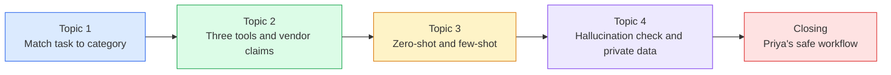

# <font color='#1d4ed8'>Lecture Script: Your AI Toolkit: What to Use When</font>

---

## <font color='blue'>Agenda</font>

The lecture runs as four topics. Each topic ends with a quiz.

| Topic | What we do | Learning objectives covered | Minutes |
|:-:|:--|:--|:-:|
| 1 | Match work tasks to AI tool categories | Classify a work task into the AI tool category that suits it: writing, research, images, presentations or productivity | 25 |
| 2 | Run one task in three tools and judge vendor claims | Compare the output of one task run through three AI tools and name the trade-off of each<br>Classify an AI vendor's claim as backed by verifiable evidence or as an unverifiable superlative | 30 |
| 3 | Ask with and without examples | Compare zero-shot and few-shot prompting by the task types each suits | 25 |
| 4 | Catch a hallucination and protect private data | Analyze a generated answer to identify hallucinated entities and citations<br>Identify information unsafe to paste into a public AI chatbot | 25 |
| — | Closing: Outcome & Summary | | 15 |
| | **Total** | | **120** |

> <font color="red">**🎯 Instructor Note**</font> Pace: keep Topic 1 quick. Spend the extra minutes on the three-tool comparison in Topic 2 and on the citation check in Topic 4.
> Learners need free accounts for ChatGPT, Claude, Gemini and Perplexity, and a Notion account with the Notion AI trial. Model replies are never pasted in this script, because they change on every run. Run each live step and read the real reply.

---

## <font color='blue'>Scenario</font>

Priya is a marketing executive at a Nykaa-style beauty retailer. One Monday her to-do list has five items.

| # | Task |
|:-:|:--|
| 1 | Write a 3-line Diwali sale push notification |
| 2 | Find out what competitors charge for a 50 ml sunscreen |
| 3 | Make a banner picture for the sale |
| 4 | Build a 5-slide update for her manager |
| 5 | Turn Friday's meeting notes into a task list |

> <font color="red">**🎯 Instructor Note**</font> The company is only the setting. Do not claim it works this way. The company, the vendor names and all numbers are invented for teaching. Today is a Monday in October 2026.

---

## <font color='blue'>Problem Statement</font>

Priya opens one chat tool and uses it for everything. For the research task she pastes in a spreadsheet of 200 customer phone numbers to "see who buys sunscreen". She reads a vendor page that says "The world's best AI". She puts a source she has never opened into her manager's slides. The manager asks for the source, and it does not exist.

Last session you learned that a model predicts the next token and can state false facts fluently. Today we decide which tool fits each task and how to check the answer.

> <font color='purple'>**How does Priya choose the right AI tool for each task, check what it says, and keep private data out of it?**</font>

> <font color="red">**🎯 Instructor Note**</font> Poll: "Is it safe to paste a list of customer phone numbers into a public chatbot?" Options: yes or no. Give learners 30 seconds to respond in chat. Reveal the answer in the Closing.

---

## <font color='blue'>What We Will Use</font>

Five free tools, each for a different job.

| Topic | Tools | In one line |
|:-:|:--|:--|
| 1 | Tool categories, Notion AI | Pick the category that fits the task: writing, research, images, presentations, productivity |
| 2 | ChatGPT, Claude, Gemini | Run one prompt in three tools and compare the replies |
| 3 | Zero-shot and few-shot prompts | Ask with no examples, or with 2 to 3 examples |
| 4 | Perplexity, a search engine | Check a reply against a trusted source |

---

## <font color='blue'>How: Walking Through Priya's Monday</font>



---

## <font color='blue'>Topic 1: Match work tasks to AI tool categories</font> `25 min`

> <font color='purple'>**Priya has five different tasks. Does she need five different tools?**</font>

### <font color='green'>Example: Five categories</font>

> <font color='purple'>**Which category fits each of Priya's five tasks?**</font>

AI tools are grouped by the job they do. One category can have many tools.

| Category | The job | Priya's task |
|:--|:--|:-:|
| Writing | Draft, shorten or rewrite text | 1 |
| Research | Find sources and answer questions with links | 2 |
| Images | Make a picture from a text description | 3 |
| Presentations | Turn an outline into slides | 4 |
| Productivity | Work inside your notes and tasks | 5 |

Notion AI is a productivity example. It works inside a Notion page, so it can turn your own meeting notes into a task list without copying them elsewhere.

> <font color="red">**🎯 Instructor Note**</font> Live check: open Notion, paste three lines of invented meeting notes, and ask Notion AI for "action items". Read the reply to the class. Use only invented notes, never real ones.

> <font color='green'>**Result**</font> Priya's five tasks fall into five categories. A single chat tool is not the best fit for all five.

#### <font color='#c2410c'>Logic Explanation</font>

- Ask "what is the output?" Text for a message is writing. A picture is images. A list of sources is research.
- A task can touch two categories. "Summarise my notes into slides" is productivity first, then presentations.

### <font color='green'>Extending it: Classify new tasks</font>

> <font color='purple'>**Which category fits each new task?**</font>

> <font color="red">**🎯 Instructor Note**</font> Read the three tasks and ask learners to type a category in chat. Expected: "Make a logo sketch" is images, "Find three articles on sunscreen sales" is research, "Rewrite this email to sound friendlier" is writing.

> <font color='green'>**Result**</font> A task is matched by its output, not by the name of the tool.

### <font color='purple'>Quiz 1</font>

**Question:** Priya wants a banner picture for the Diwali sale. Which category fits?

**Options:**
- A) Research
- B) Images
- C) Productivity
- D) Presentations

**Correct Answer:** B

**Explanation:**
- **A)** Research finds sources and answers questions. It does not make a banner.
- **B)** Correct. Images tools turn a text description into a picture.
- **C)** Productivity tools work inside your notes and tasks.
- **D)** Presentation tools build slides. The banner is a single picture.

---

## <font color='blue'>Topic 2: Run one task in three tools and judge vendor claims</font> `30 min`

> <font color='purple'>**Priya picked the writing category. ChatGPT, Claude and Gemini all write. Do they write the same thing?**</font>

### <font color='green'>Example: One prompt, three tools</font>

> <font color='purple'>**How do the three replies differ, and what trade-off does each one show?**</font>

Use one four-part prompt (task, context, format, constraints) in all three tools.

```
1. Task: Write a push notification for our Diwali sale.
2. Context: We sell skincare. The sale runs 18 to 22 October.
3. Format: 3 lines, friendly, under 15 words per line.
4. Constraints: Do not state a discount percentage. Do not invent offers.
```

> <font color="red">**🎯 Instructor Note**</font> Learners paste this same prompt into ChatGPT, Claude and Gemini and copy each reply into the table. Do not predict which is best. Read each reply and fill the table from what is on screen.

Learners fill this table from their own screens.

| Check | ChatGPT | Claude | Gemini |
|:--|:-:|:-:|:-:|
| Exactly 3 lines? | | | |
| Each line under 15 words? | | | |
| Invented a discount or offer? | | | |
| Tone you would send? | | | |

> <font color='green'>**Result**</font> Fill the last row of the table with one sentence per tool, "Best at ... , weaker at ...". That sentence is the trade-off.

#### <font color='#c2410c'>Logic Explanation</font>

- The same prompt gives different replies because each tool uses a different model and sampling.
- A trade-off is what you give up. A tool may follow the length rule well and sound plainer, or sound warmer and miss the length rule.
- Read each reply against the Constraints line. An invented offer is a failed constraint, however good it sounds.

> <font color='#b45309'>**Common mistake**</font> Picking the reply that sounds nicest. Fix: tick the checks first, then judge tone.

### <font color='green'>Extending it: Is the vendor's claim evidence or a slogan?</font>

> <font color='purple'>**Which of these vendor claims can Priya check?**</font>

A claim is **backed by verifiable evidence** when it names a number, a method or a source you can open. It is an **unverifiable superlative** when it uses words like "best", "fastest" or "number one" with nothing to check.

> <font color="red">**🎯 Instructor Note**</font> "FastWrite AI" and "ReplyBot" are invented vendors for teaching. Ask learners to classify each claim in chat before revealing the answer.

| Claim | Class | Why |
|:--|:--|:--|
| "FastWrite AI is the world's best writing assistant." | Unverifiable superlative | "Best" has no measure or source |
| "In a study of 200 users, report drafting time fell from 50 to 35 minutes. Method and data are on our site." | Backed by verifiable evidence | Numbers, sample size and a method to open |
| "Trusted by millions." | Unverifiable superlative | No count, no source, no date |
| "ReplyBot 2.0 answered 92 of 100 test questions correctly on the public benchmark, and the test set is linked here." | Backed by verifiable evidence | A count, a named test and a link |

> <font color='green'>**Result**</font> A claim you can open and recheck is evidence. A claim with only a superlative is advertising.

The drop in the second claim is $50 - 35 = 15$ minutes, a fall of $\frac{15}{50} = 30\%$.

### <font color='purple'>Quiz 2</font>

**Question:** Which vendor claim is backed by verifiable evidence?

**Options:**
- A) "The smartest AI ever built."
- B) "Everyone is switching to us."
- C) "Number one in customer love."
- D) "Cut email time from 40 to 28 minutes in a 150-user study with the method published."

**Correct Answer:** D

**Explanation:**
- **A)** "Smartest" has no measure.
- **B)** "Everyone" has no count or source.
- **C)** "Number one in love" has no ranking, list or date to check.
- **D)** Correct. It gives numbers, a sample size and a published method.

---

## <font color='blue'>Topic 3: Ask with and without examples</font> `25 min`

> <font color='purple'>**Priya's notification worked once. How does she get the same shape every time?**</font>

### <font color='green'>Example: Zero-shot and few-shot</font>

> <font color='purple'>**What is the difference between asking with no examples and asking with examples?**</font>

A **zero-shot** prompt gives the task and no example. A **few-shot** prompt gives 2 to 3 examples of the wanted output, then the new input.

> <font color="red">**🎯 Instructor Note**</font> Learners run both prompts in one tool and compare the replies. Do not predict the replies. Ask which reply matched the labels exactly.

Zero-shot:

```
Label this review as Positive, Negative or Mixed:
"Cream smells nice but the pump broke."
```

Few-shot:

```
Label each review as Positive, Negative or Mixed.
"Loved it, will buy again." -> Positive
"Arrived broken." -> Negative
"Great colour, slow delivery." -> Mixed
"Cream smells nice but the pump broke." ->
```

> <font color='green'>**Result**</font> The few-shot prompt shows the label words and the format. A reply that ends with exactly one label word is easier to use.

#### <font color='#c2410c'>Logic Explanation</font>

- The examples show the pattern. The tool continues the pattern, which is next-token prediction from last session.
- Zero-shot suits common tasks that the tool already does well, such as summarising or translating a paragraph.
- Few-shot suits tasks where you need your own labels, tone or layout, such as tagging reviews in your own categories.

### <font color='green'>Extending it: Choose the style for each task</font>

> <font color='purple'>**Zero-shot or few-shot?**</font>

| Task | Better fit | Reason |
|:--|:-:|:--|
| Summarise a long email in 2 lines | Zero-shot | A common task with no special format |
| Tag 50 reviews with labels the team invented | Few-shot | The labels and format need examples |
| Write captions in a brand's exact voice | Few-shot | Examples show the voice |
| Translate a paragraph to Hindi | Zero-shot | A common task |

> <font color="red">**🎯 Instructor Note**</font> Ask learners to type their choice before showing the Better fit column.

> <font color='#b45309'>**Common mistake**</font> Adding 10 examples when 2 or 3 would do. Fix: start with 2 to 3 clear examples and add more only if the format still drifts.

### <font color='purple'>Quiz 3</font>

**Question:** Which task suits a few-shot prompt best?

**Options:**
- A) Tagging reviews with the team's own 3 custom labels
- B) Summarising a paragraph
- C) Translating a sentence
- D) Fixing a typo

**Correct Answer:** A

**Explanation:**
- **A)** Correct. Examples teach the tool the exact labels and format.
- **B)** Summarising is common, so zero-shot usually works.
- **C)** Translation is common, so zero-shot usually works.
- **D)** A typo fix is a small common task.

---

## <font color='blue'>Topic 4: Catch a hallucination and protect private data</font> `25 min`

> <font color='purple'>**The slide source did not exist. How does Priya catch that before her manager does, and what should she never paste?**</font>

### <font color='green'>Example: Check a reply against a trusted source</font>

> <font color='purple'>**Which parts of this reply can be checked, and do they exist?**</font>

> <font color="red">**🎯 Instructor Note**</font> The reply below is invented for teaching. Every name, title and number in it is made up. Learners practise the checking steps on it. Do not search for a real match to claim it is real.

> "According to the 2024 Indian Sunscreen Market Report by Dr. Meena Rao (Journal of Retail Insights, pp. 45 to 60), SPF 50 sunscreen sales grew 38% in Tier 2 cities."

Pull out every entity and citation, then check each one.

| Item in the reply | What to check | Where |
|:--|:--|:--|
| "2024 Indian Sunscreen Market Report" | Does a report with this exact title exist? | A search engine or Perplexity, then open the link |
| "Dr. Meena Rao" | Does this author exist and write on this topic? | The publisher page or a profile page |
| "Journal of Retail Insights, pp. 45 to 60" | Does this journal exist, and does that article sit on those pages? | The journal website |
| "grew 38% in Tier 2 cities" | Does the source itself say 38%? | The opened report |

> <font color='green'>**Result**</font> A reply is only as good as what you can open and confirm. If a title, author or journal cannot be found, treat it as hallucinated and do not use it.

#### <font color='#c2410c'>Logic Explanation</font>

- A model predicts text that sounds like a citation. A real-looking name, journal and page range are likely next tokens, so they appear even when they do not exist.
- Perplexity shows source links next to its answer, so you can open them. Open every link and check that the page says what the answer says.

> <font color='#b45309'>**Common mistake**</font> Checking that a link loads, not that it supports the claim. Fix: read the line on the page that backs the number.

### <font color='green'>Extending it: What never goes into a public chatbot</font>

> <font color='purple'>**Which of Priya's items are safe to paste?**</font>

Anything you paste may be stored or used by the vendor, depending on its settings. Treat a public chatbot as a place outside your company.

> <font color="red">**🎯 Instructor Note**</font> Ask learners to type "safe" or "unsafe" for each row before you reveal the column.

| Item | Safe or unsafe | Why |
|:--|:-:|:--|
| 200 customer phone numbers | Unsafe | Personal data about real people |
| A password or login code | Unsafe | Gives access to an account |
| A signed supplier contract | Unsafe | Confidential agreement |
| Next quarter's unreleased sale plan | Unsafe | Internal strategy |
| A public sunscreen ingredient list from a brand's website | Safe | Already public |
| A made-up customer name and order, with no real details | Safe | Contains no real person or company data |

> <font color='green'>**Result**</font> Before pasting, ask: is this personal, secret, or not mine to share? If yes to any, leave it out or replace it with invented data.

### <font color='purple'>Quiz 4</font>

**Question:** An AI reply cites a "2023 Retail Pulse Study" you cannot find after two searches. What should you do?

**Options:**
- A) Keep it, because it sounds official
- B) Add a second invented source to support it
- C) Treat it as hallucinated and drop or replace it
- D) Ask the same tool to confirm it exists and trust the answer

**Correct Answer:** C

**Explanation:**
- **A)** A formal tone is not proof.
- **B)** Adding another invented source makes the problem worse.
- **C)** Correct. A source you cannot find after searching should not be used.
- **D)** The tool that produced it may confirm it again. Check outside the tool.

---

## <font color='blue'>Closing: Outcome & Summary</font> `15 min`

Back to Priya. We answer the Problem Statement using each topic once.

> <font color='purple'>**1. Which tool for each task? (Topic 1)**</font>

Writing for the notification, research for competitor prices, images for the banner, presentations for the update, productivity for the meeting notes.

> <font color='purple'>**2. How does she compare tools and claims? (Topic 2)**</font>

She runs one four-part prompt in three tools, ticks the checks and writes a trade-off per tool. She ignores superlatives and trusts claims she can open.

> <font color='purple'>**3. How does she get a repeatable shape? (Topic 3)**</font>

A few-shot prompt with 2 to 3 examples when she needs her own format or labels. Zero-shot for common tasks.

> <font color='purple'>**4. How does she check and protect? (Topic 4)**</font>

She opens every source, confirms every name and number, and keeps customer data out of a public chatbot.

### <font color='green'>Outcome</font>

| | Priya on Monday morning | Priya's new workflow |
|:--|:--|:--|
| Tool choice | One chat tool for all 5 tasks | A category per task |
| Vendor claims | Believed "world's best" | Checks for evidence |
| Sources | Pasted unchecked | Opened and confirmed |
| Customer data | 200 phone numbers pasted | Never pasted |

> <font color='green'>**Therefore,**</font> Priya picks a tool by the task's output, tests claims and replies before trusting them, and keeps private data out of public chatbots. The slide source would have been caught at the check, and the phone numbers would never have left her laptop.

> <font color="red">**🎯 Instructor Note**</font> Reveal the poll: no. Customer phone numbers are personal data and should not be pasted into a public chatbot.

### <font color='green'>Summary</font>

| Learning objective | Takeaway |
|:--|:--|
| Tool category | Match the task by its output: writing, research, images, presentations or productivity |
| Compare three tools | Same prompt, tick the checks, write one trade-off per tool |
| Vendor claims | Evidence names a number, method or source. A superlative does not |
| Zero-shot and few-shot | Zero-shot for common tasks. Few-shot for your own format or labels |
| Hallucination check | Open every title, author, journal and number |
| Unsafe information | No personal data, passwords, contracts or unreleased plans |
| **Practical value** | A short checklist makes everyday AI use faster and safer at work |

---

# <font color='red'>Launch the Feedback Poll</font>

> <font color="red">**🎯 Instructor Note**</font> Reminder: launch the feedback poll now to collect learner feedback.
