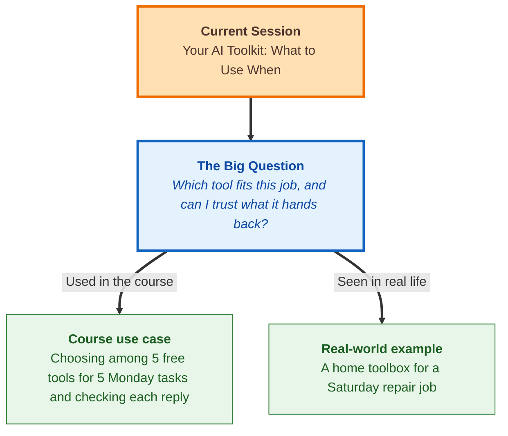

## Your AI Toolkit: What to Use When

### Mental Map

---

### What You'll Learn

Have you ever wondered how a carpenter knows which tool to pick before touching the wood?

By the end of this session, you will be able to:

- **Identify** the items you should never hand to a stranger who offers to help out.
- **Classify** 5 household jobs by the tool that suits each, and a box slogan as proof or boast.
- **Demonstrate** how showing 2 sample results changes what a helper hands back.
- **Compare** the same job done with 3 tools and name what each one gives up.
- **Examine** a helper's answer line by line to spot names that do not exist.

> **Topics you will meet:** Tool categories, matching a tool to the task, one task in four tools, sizing up a tool you have never seen, zero-shot and few-shot prompts, catching a hallucination, what never to share with ChatGPT or Gemini.
>
> Join the session to learn each of these in detail.

---

### Why You Are Learning This Topic

Rahul has a free Saturday and a loose shelf. He opens his toolbox and finds a hammer, a saw and a screwdriver.

He grabs the hammer for a screw. The screw bends. The shelf is still loose.

A **tool category** means a group of tools built for the same type of job, such as writing or research.

In this course, you will pick the right AI tool for each work task, then check its answer.

> **Think about it:** What did Rahul need to know about the screw before he picked a tool?

---

### The Home Toolbox Puzzle

Here is Rahul's Saturday list.

| Job | Tool in his hand | Note |
|:----------:|:----------:|:----------:|
| Tighten a loose screw | Hammer | Screw bent |
| Cut a plank | Screwdriver | No cut |
| Buy glue | Box says "World's strongest glue" | No test shown |
| Neighbour asks for help | Offers to hold his house keys | Keys handed over |

**What you want to happen:**

- Each job gets the tool built for it.
- Rahul checks whether a box slogan can be proved.
- Rahul keeps private items to himself.

> **Wonder about this:**
>
> - What proof would turn "strongest glue" into something Rahul can trust?
> - Which item on the list should never leave his hand?

---

### Think It Through

There is no wrong first try. Keep your guesses for the session.

**1. Rahul needs a 30 cm cut in a plank. Which of his 3 tools fits, and which 2 do not?**
Hint: Match the tool to the job, not to what is nearest.

**2. Glue A says "world's best". Glue B says "holds 5 kg, tested on 100 shelves". Which can he check?**
Hint: Look for a number he can test.

**3. A helper tells Rahul to call "Sharma Hardware, Lane 9" for parts. How can he confirm it exists?**
Hint: Think of one place outside the helper to look.

---

### One Question to Carry Into the Session

> **How do you pick the right helper for a job and still check its work?**
>
> Which of your belongings would you never hand to a helper you met today?
