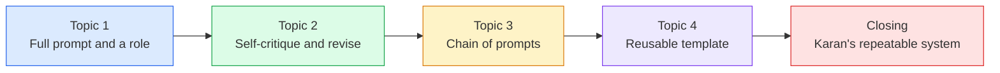

# <font color='#1d4ed8'>Lecture Script: Prompt Chaining with Critique and Personas</font>

---

## <font color='blue'>Agenda</font>

The lecture runs as four topics. Each topic ends with a quiz.

| Topic | What we do | Learning objectives covered | Minutes |
|:-:|:--|:--|:-:|
| 1 | Write a full prompt and give the AI a role | State the four elements of a well-formed prompt: task, context, format and constraints<br>Apply role prompting to set the vocabulary and depth of an answer | 30 |
| 2 | Ask the AI to check and revise its own draft | Apply self-correction by asking the model to critique and revise its own output | 25 |
| 3 | Chain prompts so one output feeds the next | Apply prompt chaining so one prompt's output becomes the next prompt's input | 25 |
| 4 | Turn a working prompt into a reusable template | Build a reusable prompt template with named placeholders for the variable inputs | 25 |
| — | Closing: Outcome & Summary | | 15 |
| | **Total** | | **120** |

> <font color="red">**🎯 Instructor Note**</font> Pace: Topic 1 revisits the four elements quickly, so spend the time on role prompting. Give the most time to the live chain in Topic 3.
> Learners need free accounts for ChatGPT, Claude and Gemini. Model replies are never pasted in this script, because they change on every run. Run each step live and fill the tables from the real screen.

---

## <font color='blue'>Scenario</font>

**Before and after.** Karan runs promotions at a Lenskart-style eyewear chain. For 23 to 29 November 2026, the chain offers a second pair at 50% off in 12 stores. He must announce it to customers.

| | Karan's first attempt | Karan's second attempt |
|:--|:--|:--|
| How he asks | One long prompt that asks for research, a plan and a message at once | Small prompts in a chain, with a check between them |
| What he gets | A cheerful message that promises free eye tests for life | A short message that states only the real offer |
| Who checks | Nobody | The AI checks a draft, then Karan checks the AI |

> <font color="red">**🎯 Instructor Note**</font> The company is only the setting. Do not claim it works this way. The offer, the stores and every number are invented for teaching. Today is Monday 16 November 2026.

---

## <font color='blue'>Problem Statement</font>

Karan sends the first message as the tool wrote it. It says "free eye tests for life with every second pair". The offer never included that. Within two days, 60 customers walk into stores asking for it, and the store staff have to refuse.

Earlier sessions taught the four parts of a prompt and the habit of checking a reply. Today Karan uses them as a repeatable system.

> <font color='purple'>**How does Karan turn one risky, all-in-one prompt into a short chain that sets the right voice, checks itself, passes work forward and can be reused for the next offer?**</font>

> <font color="red">**🎯 Instructor Note**</font> Poll: "Is one long prompt that asks for everything the safest way to get a good email?" Options: yes or no. Give learners 30 seconds to respond in chat. Reveal the answer in the Closing.

---

## <font color='blue'>What We Will Use</font>

Three free chat tools: ChatGPT, Claude and Gemini. Learners use one tool for most steps and a second tool where the script says so.

| Topic | Ideas | In one line |
|:-:|:--|:--|
| 1 | Four prompt elements, role prompting | A full prompt, plus a role line that sets how the answer sounds |
| 2 | Self-critique | Ask the model to check its draft against your rules and fix it |
| 3 | Prompt chaining | The output of one prompt becomes the input of the next |
| 4 | Prompt template | A saved prompt with named blanks for the parts that change |

---

## <font color='blue'>How: Walking Through Karan's Offer Message</font>



---

## <font color='blue'>Topic 1: Write a full prompt and give the AI a role</font> `30 min`

> <font color='purple'>**Earlier you learned that a prompt carries task, context, format and constraints. What does Karan's one long prompt leave out?**</font>

### <font color='green'>Example: The full prompt for the supplier email</font>

> <font color='purple'>**Which four elements turn "announce the offer" into a prompt that can be checked?**</font>

| Element | What it says | Karan's version |
|:--|:--|:--|
| Task | What to do | Write a customer message announcing our second-pair offer |
| Context | Facts the tool cannot know | 23 to 29 November, 12 stores, second pair 50% off if equal or lower in price, sunglasses excluded |
| Format | The shape of the output | A subject line, the offer in the first line, then 3 bullets, under 60 words |
| Constraints | Limits and things to avoid | Friendly and clear. Use only these facts. Do not promise free eye tests or any other extra |

```
1. Task: Write a customer message announcing our second-pair offer.
2. Context: Runs 23 to 29 November in 12 stores. Second pair 50% off if it costs the same or less. Sunglasses excluded.
3. Format: Subject line, the offer in the first line, 3 bullets, under 60 words.
4. Constraints: Friendly and clear. Use only these facts. Do not promise free eye tests or any other extra.
```

> <font color="red">**🎯 Instructor Note**</font> Learners paste this prompt into one tool and read the reply against the four rows. Do not predict the reply. Ask: does the first line state the offer, and did it add an extra promise?

> <font color='green'>**Result**</font> A prompt with all four elements gives you a list of things to check in the reply.

### <font color='green'>Extending it: Give the AI a role</font>

> <font color='purple'>**What changes if the same task starts with "You are ..."?**</font>

**Role prompting** means telling the model who it is for this answer. The role sets the vocabulary, the depth and the tone.

Learners run the same task with two role lines and fill the table from their screens.

| Role line added at the top | Words you expect | Check on screen |
|:--|:--|:--|
| "You are a retail copywriter with 10 years in eyewear marketing." | Promotion terms | Does it use terms such as limited period or eligible frames? |
| "You are a friendly store associate explaining the offer to a first-time customer." | Plain words and short sentences | Does it explain each term in simple words? |

> <font color="red">**🎯 Instructor Note**</font> Ask learners which role fits a promotional message and which fits a note for a first-time customer. Read two real replies aloud and compare word choice. Give learners 30 seconds to respond in chat.

> <font color='green'>**Result**</font> The same task gives a different vocabulary and depth for each role. Pick the role by who will read the answer.

#### <font color='#c2410c'>Logic Explanation</font>

- A role is a shortcut for many small style choices. It steers the likely next tokens toward words that fit that role.
- A role does not add facts. Karan still supplies the offer details in the context.

> <font color='#b45309'>**Common mistake**</font> Writing "You are the best expert in the world". Fix: name a real job, its years or its reader, such as "retail copywriter for eyewear".

### <font color='purple'>Quiz 1</font>

**Question:** Karan wants the answer in simple words for a first-time customer. Which role line fits best?

**Options:**
- A) "You are a lawyer writing a contract clause."
- B) "You are the best AI in the world."
- C) "You are a friendly store associate explaining to a first-time customer."
- D) "Answer quickly."

**Correct Answer:** C

**Explanation:**
- **A)** A lawyer role pushes toward formal legal wording, not simple words.
- **B)** A boast gives no reader or job to match, so it sets no vocabulary or depth.
- **C)** Correct. It names a job and a reader, which sets simple vocabulary and depth.
- **D)** Speed is not a role. It sets no vocabulary or reader.

---

## <font color='blue'>Topic 2: Ask the AI to check and revise its own draft</font> `25 min`

> <font color='purple'>**The first draft may break one of Karan's rules. Can the tool catch that before Karan reads it?**</font>

### <font color='green'>Example: A critique prompt with a checklist</font>

> <font color='purple'>**What must a critique prompt contain so the model checks against a standard?**</font>

**Self-correction** means asking the model to critique its own output against a standard and then revise it. The standard is your checklist, not the model's opinion.

```
Check your message against this list:
1. The offer is in the first line.
2. It uses only the facts I gave.
3. It promises no extra, such as free eye tests.
4. It is under 60 words.
For each item write Pass or Fail with a reason. Then rewrite the message, fixing every Fail.
```

> <font color="red">**🎯 Instructor Note**</font> Learners paste this right after Topic 1's reply, in the same chat. Do not predict the Pass or Fail marks. Read the real reply and fill the table.

| Check | Pass or Fail from the tool | Do you agree? |
|:--|:-:|:-:|
| Offer in the first line | | |
| Only the facts given | | |
| No extra promise | | |
| Under 60 words | | |

> <font color='green'>**Result**</font> The model returns a marked list and a revised message. The "Do you agree?" column is Karan's own check of the tool's check.

#### <font color='#c2410c'>Logic Explanation</font>

- The checklist gives the model a standard to compare against. Without it, "improve this" can change the wrong things.
- The model can mark an item Pass when it is not. Count the words yourself and read the first line yourself.

### <font color='green'>Extending it: One round or two?</font>

> <font color='purple'>**What if the revised message still fails one item?**</font>

> <font color="red">**🎯 Instructor Note**</font> If the live revision still has a Fail, paste back: "Item 2 still fails. Fix only that item and keep everything else." Read the new reply together.

> <font color='green'>**Result**</font> Name the exact failing item and ask for a fix to that item only. A narrow request keeps the parts that already pass.

> <font color='#b45309'>**Common mistake**</font> Trusting "All items Pass" without reading. Fix: check at least the first line and the word count yourself.

### <font color='purple'>Quiz 2</font>

**Question:** Which prompt asks for self-correction?

**Options:**
- A) "Check your message against these 4 rules, mark each Pass or Fail, then fix every Fail."
- B) "Write the message again."
- C) "Make it better."
- D) "Write the same message in a different tool."

**Correct Answer:** A

**Explanation:**
- **A)** Correct. It names a standard, asks for a judgement per item and asks for a revision.
- **B)** A rewrite with no standard may change anything.
- **C)** "Better" has no measure, so the model cannot check against it.
- **D)** A second tool is a different check, not the model critiquing its own output.

---

## <font color='blue'>Topic 3: Chain prompts so one output feeds the next</font> `25 min`

> <font color='purple'>**The message is checked. Karan also needs the three key facts and a 3-line in-store poster. Does it all belong in one prompt?**</font>

### <font color='green'>Example: A three-prompt chain</font>

> <font color='purple'>**How does the output of one prompt become the input of the next?**</font>

**Prompt chaining** means splitting a job into small prompts, each with its own scope, where the checked output of one is pasted into the next.

| Prompt | Scope | Input | Output carried forward |
|:-:|:--|:--|:--|
| 1 | Pull out the facts | Karan's offer sheet | A list of 3 facts a customer must know |
| 2 | Write the message | The 3 facts from prompt 1 | A short customer message |
| 3 | Make a short version | The message from prompt 2 | A 3-line in-store poster |

```
Prompt 1: From the offer sheet below, list the 3 facts a customer must know. Sheet: [paste sheet]
Prompt 2: Using only these 3 facts, write a friendly message under 60 words. Facts: [paste output 1]
Prompt 3: Turn this message into a 3-line in-store poster. Message: [paste output 2]
```

> <font color="red">**🎯 Instructor Note**</font> Learners write 4 lines of invented offer details first, then run the chain. They carry prompt 2's message into a second tool for prompt 3. Read each real output and check it before it moves forward.

> <font color='green'>**Result**</font> Each step has one job and one check. A wrong fact is caught at prompt 1, before it reaches the email.

#### <font color='#c2410c'>Logic Explanation</font>

- Each prompt starts fresh with the pasted text, so it only needs the input that step requires.
- Checking after each step keeps an early error from spreading into every later step.

### <font color='green'>Extending it: Carry the output to a second tool</font>

> <font color='purple'>**Does the chain still work if prompt 3 runs in a different tool?**</font>

> <font color="red">**🎯 Instructor Note**</font> Learners paste the checked message into a second tool for prompt 3 and compare the poster with the message. Give learners 30 seconds to respond in chat on whether any fact changed.

> <font color='green'>**Result**</font> A chain moves by pasted text, so any tool can take the next step. Compare the final poster with the checked message for changed facts.

> <font color='#b45309'>**Common mistake**</font> Pasting an unchecked output forward. Fix: read each output once before it becomes the next input.

### <font color='purple'>Quiz 3</font>

**Question:** Which is an example of prompt chaining?

**Options:**
- A) Asking one prompt for the facts, the message and the poster together
- B) Asking the same prompt three times in a row
- C) Adding a role line to the first prompt
- D) Pasting the message from one prompt into a second prompt that asks for a 3-line poster

**Correct Answer:** D

**Explanation:**
- **A)** That is one big prompt, not a chain.
- **B)** Repeating a prompt does not pass an output to a different step.
- **C)** A role shapes style but does not link two prompts.
- **D)** Correct. One output becomes the next prompt's input, and the second prompt has a different scope.

---

## <font color='blue'>Topic 4: Turn a working prompt into a reusable template</font> `25 min`

> <font color='purple'>**Next week brings a different offer. Does Karan retype the whole chain?**</font>

### <font color='green'>Example: Name the blanks</font>

> <font color='purple'>**Which parts of Karan's offer prompt change each time, and which stay fixed?**</font>

A **prompt template** is a saved prompt with named placeholders for the parts that change. A placeholder is a name in curly braces, such as `{SUPPLIER}`.

```
1. Role: You are a retail copywriter with 10 years in eyewear marketing.
2. Task: Write a customer message announcing {OFFER_NAME}.
3. Context: {DISCOUNT_RULE}. Runs {DATES} in {STORES} stores. Not included: {EXCLUSION}.
4. Format: Subject line, the offer in the first line, 3 bullets, under {WORDS} words.
5. Constraints: Friendly and clear. Use only these facts. Promise no extras.
```

| Placeholder | Karan's value this week |
|:--|:--|
| `{OFFER_NAME}` | the second-pair offer |
| `{DISCOUNT_RULE}` | Second pair 50% off if it costs the same or less |
| `{DATES}` | 23 to 29 November |
| `{STORES}` | 12 |
| `{EXCLUSION}` | sunglasses |
| `{WORDS}` | 60 |

> <font color="red">**🎯 Instructor Note**</font> Learners copy the template into a note, replace each placeholder by hand and paste the result into a chat tool. Check that no curly braces are left before sending.

> <font color='green'>**Result**</font> The fixed words stay in the template. Only the six named blanks change from week to week.

### <font color='green'>Extending it: Reuse the template on a new job</font>

> <font color='purple'>**Next week the offer is "kids' frames 20% off" in 8 stores from 1 to 7 December, with contact lenses excluded. What changes?**</font>

> <font color="red">**🎯 Instructor Note**</font> Learners fill the table from the template and write the new values. Ask them to type one value in chat. Give learners 30 seconds to respond in chat.

| Placeholder | New value |
|:--|:--|
| `{OFFER_NAME}` | the kids' frames offer |
| `{DISCOUNT_RULE}` | 20% off any kids' frame |
| `{DATES}` | 1 to 7 December |
| `{STORES}` | 8 |
| `{EXCLUSION}` | contact lenses |

> <font color='green'>**Result**</font> Changing 5 values reuses a prompt that already works, and the role, format and constraints stay the same.

> <font color='#b45309'>**Common mistake**</font> Leaving a placeholder such as `{STORES}` unfilled. Fix: search the pasted prompt for curly braces before you send it.

### <font color='purple'>Quiz 4</font>

**Question:** Which line is a reusable template, not a one-off prompt?

**Options:**
- A) "Write about the second-pair offer in 12 stores."
- B) "Write about {OFFER_NAME} in {STORES} stores."
- C) "Write a polite email."
- D) "You are a procurement manager."

**Correct Answer:** B

**Explanation:**
- **A)** It names fixed values, so it cannot be reused for another offer.
- **B)** Correct. Named placeholders mark the parts that change each time.
- **C)** It has no placeholders, so nothing is marked as variable.
- **D)** A role line alone has no variable inputs.

---

## <font color='blue'>Closing: Outcome & Summary</font> `15 min`

Back to Karan. We answer the Problem Statement using each topic once.

> <font color='purple'>**1. What should the first prompt hold? (Topic 1)**</font>

Task, context, format and constraints, plus a role line that fits the reader. The constraint "promise no extras" would have blocked the line that caused the trouble.

> <font color='purple'>**2. How does he catch a broken rule? (Topic 2)**</font>

He asks the model to check its message against a four-item list and fix each Fail. Then he checks the first line and the word count himself.

> <font color='purple'>**3. How does the work move forward? (Topic 3)**</font>

Facts first, then the message, then the poster. Each output is read before it becomes the next input.

> <font color='purple'>**4. How does he reuse it? (Topic 4)**</font>

He saves one template with six named placeholders and fills them in for each offer.

### <font color='green'>Outcome</font>

| | One long prompt | A chain with a template |
|:--|:-:|:-:|
| Voice and depth | Not set | Set by a role |
| Rule check | None | Self-critique, then Karan |
| Where an error is caught | After sending | At the step where it appears |
| Next offer | Retype everything | Fill 6 blanks |

> <font color='green'>**Therefore,**</font> Karan builds a role, a checklist, a chain and a template. The model drafts and checks, and Karan checks the model before anything is sent.

> <font color="red">**🎯 Instructor Note**</font> Reveal the poll: no. One long prompt hides errors until the end. A short chain checks each step.

### <font color='green'>Summary</font>

| Learning objective | Takeaway |
|:--|:--|
| Four prompt elements | Task, context, format and constraints make a reply checkable |
| Role prompting | A named job and reader set vocabulary and depth |
| Self-correction | Give a checklist, ask for Pass or Fail, then a revision |
| Prompt chaining | One checked output becomes the next prompt's input |
| Prompt template | Named placeholders mark what changes each time |
| **Practical value** | A small chain and a saved template make repeated work tasks faster and safer |

---

# <font color='red'>Launch the Feedback Poll</font>

> <font color="red">**🎯 Instructor Note**</font> Reminder: launch the feedback poll now to collect learner feedback.
