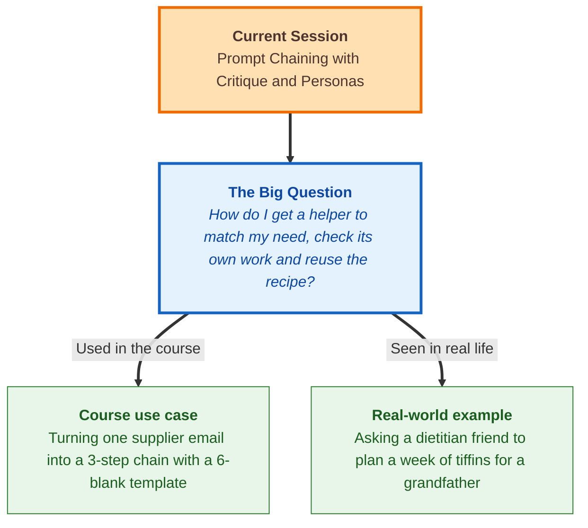

## Prompt Chaining with Critique and Personas

### Mental Map

---

### What You'll Learn

Have you ever wondered why the same friend gives a different menu when you say who will eat it?

By the end of this session, you will be able to:

- **List** the 4 parts of a clear request to your dietitian friend.
- **Apply** a "plan it like a dietitian for a 78-year-old" line to change the words and depth of her answer.
- **Demonstrate** how you ask her to check her own menu against 3 rules and fix it.
- **Use** one answer, the 5-day menu, as the start of the next request, a shopping list.
- **Build** a request card with 5 blanks you fill in for each new week.

> **Topics you will meet:** A full prompt with role, context, constraints and format, role-based prompting, self-critique, prompt chaining, reusable prompt templates, worked examples for email, research and planning.
>
> Join the session to learn each of these in detail.

---

### Why You Are Learning This Topic

Anaya wants a week of tiffin menus for her grandfather. He is 78 and eats soft food with little salt.

She texts her friend Neel, a dietitian: "Plan his tiffins." Neel sends 5 days of menus. Two items are fried and one roti is hard.

A short text hides the rules. A clear request names the person, the limits and the shape of the plan.

A **prompt chain** means a set of small requests where the answer to one becomes the start of the next.

You will ask a chat tool for email, research and planning work in the same way.

> **Think about it:** Which 2 rules about grandfather's food were missing from Anaya's first text?

---

### The Tiffin Menu Puzzle

Here is Anaya's week, with what each request needs.

| Request | What Anaya tells Neel | What she gets |
|:----------:|:----------:|:----------:|
| 1. Plan 5 days | Eater: age 78, soft food | A day-by-day menu |
| 2. Check the menu | Rules: low salt, no fried food, soft | A marked list |
| 3. Shop for the menu | Use the menu from request 1 | A shopping list |

**What you want to happen:**

- Neel writes in words a family member can follow.
- Neel spots a dish that breaks one of your 3 rules.
- You can reuse the same request card for next week.

> **Wonder about this:**
>
> - What would change if Anaya asked for a menu for a 10-year-old cousin?
> - Why ask Neel to check the menu before you buy any food?

---

### Think It Through

There is no wrong first try. Keep your guesses for the session.

**1. Which 2 facts would you add to "Plan his tiffins" so Neel cannot send fried items?**
Hint: Think about who eats and what he must avoid.

**2. Anaya asks Neel to check the menu against the 3 rules. How can she tell the check was honest?**
Hint: Pick one dish and test it yourself.

**3. Next month Anaya plans tiffins for her cousin. Which 3 parts of her request card change?**
Hint: Look at the person, the days and the rules.

---

### One Question to Carry Into the Session

> **How do small, checked requests beat one big request?**
>
> Which parts of your own weekly requests could become blanks on a card?
