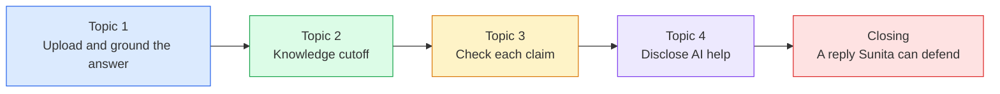
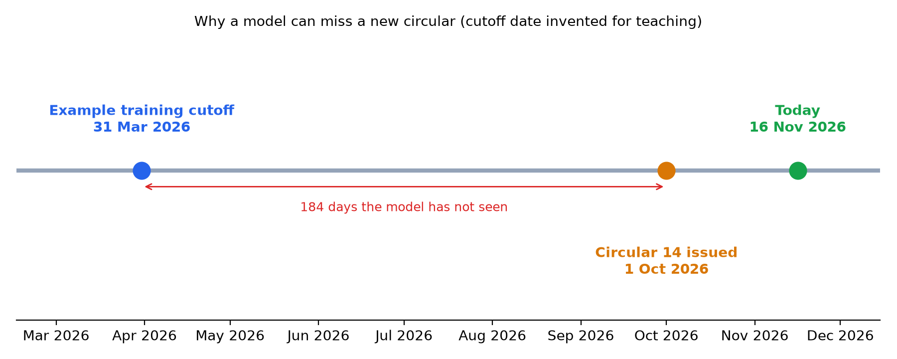
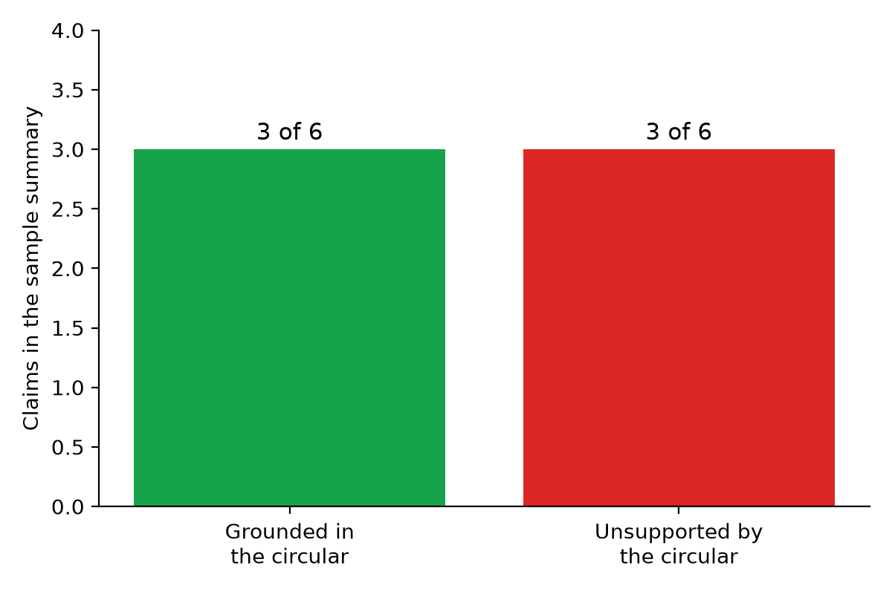

# <font color='#1d4ed8'>Lecture Script: AI for Documents and Research</font>

---

## <font color='blue'>Agenda</font>

The lecture runs as four topics. Each topic ends with a quiz.

| Topic | What we do | Learning objectives covered | Minutes |
|:-:|:--|:--|:-:|
| 1 | Upload a document and make the AI answer only from it | Write a prompt that instructs the model to answer only from supplied reference text | 30 |
| 2 | See why a model can be out of date | Describe a model's knowledge cutoff and its effect on recent-fact questions | 20 |
| 3 | Check every claim against the source | Classify a generated claim as grounded in or unsupported by the provided context | 30 |
| 4 | Decide when to say that AI helped | State when the use of AI assistance must be disclosed to a reader, client or assessor | 25 |
| — | Closing: Outcome & Summary | | 15 |
| | **Total** | | **120** |

> <font color="red">**🎯 Instructor Note**</font> Pace: Topic 2 is a short concept with one live test. Spend the extra minutes on the claim check in Topic 3.
> Learners need a free account for ChatGPT, Claude or Gemini and the file `data/safelife_circular_14.txt`. Model replies are never pasted in this script. Run each step live and read the real reply.

---

## <font color='blue'>Scenario</font>

**Two ways to answer.** Sunita works on the policy-servicing desk of an LIC-style life insurer. A customer asks how long a late premium can wait. The company's rule sits in a one-page note, Circular 14, for an invented product called SafeLife Plan.

| | Ask from the tool's memory | Ask from the circular |
|:--|:--|:--|
| What Sunita gives the tool | One question | The circular and the question |
| Where the answer comes from | Patterns learned in training | The pasted text |
| Can Sunita check it? | Only by searching elsewhere | Against numbered paragraphs |

> <font color="red">**🎯 Instructor Note**</font> The company is only the setting. Do not claim it works this way. SafeLife Plan, Circular 14 and every figure are invented for teaching. Today is a Monday in November 2026.

---

## <font color='blue'>Problem Statement</font>

Sunita asks the tool without the circular. The reply names a grace period of 30 days and a late fee of Rs 200. She sends it to the customer. The circular says 20 days and Rs 150. The customer pays on day 25 and is charged a fee he was told he would not owe.

Earlier sessions showed that a model can state false facts fluently and that a reply must be checked against a trusted source. Today Sunita fixes that with the document in hand.

> <font color='purple'>**How does Sunita make the tool answer only from Circular 14, know when its memory is out of date, check each claim in the reply, and say honestly that AI helped?**</font>

> <font color="red">**🎯 Instructor Note**</font> Poll: "If the tool sounds sure, can you skip checking the figures against the circular?" Options: yes or no. Give learners 30 seconds to respond in chat. Reveal the answer in the Closing.

---

## <font color='blue'>What We Will Use</font>

One free chat tool (ChatGPT, Claude or Gemini) and one short text file. Check the tool's current screen for how to attach a file. If a file cannot be attached, paste the text into the message.

| Topic | Ideas | In one line |
|:-:|:--|:--|
| 1 | Upload, summarise, grounding | Give the tool the text and tell it to answer only from that text |
| 2 | Knowledge cutoff | A model's training data stops at a date, so newer facts are unknown to it |
| 3 | Fact-checking claims | Mark each claim as grounded in the document or unsupported by it |
| 4 | Disclosure | Say when AI helped if a rule, contract or reader expects it |

---

## <font color='blue'>How: Walking Through Circular 14</font>



---

## <font color='blue'>Topic 1: Upload a document and make the AI answer only from it</font> `30 min`

> <font color='purple'>**The first answer came from the tool's memory. How does Sunita point it at the circular instead?**</font>

### <font color='green'>Example: Summarise the circular</font>

> <font color='purple'>**What does an uploaded document let the tool do that a bare question cannot?**</font>

Here is the full text of Circular 14, also saved in `data/safelife_circular_14.txt`.

> **SafeLife Plan, Circular 14** (invented for teaching), issued 1 October 2026
>
> 1. The grace period for a monthly premium is 20 days after the due date.
> 2. A one-time late fee of Rs 150 applies when a premium is paid after the grace period.
> 3. A lapsed policy can be revived within 2 years of the first unpaid premium.
> 4. A death claim must be reported to the claims desk within 10 days of the event.
> 5. A claim of up to Rs 50,000 is paid within 7 working days of the complete papers.
> 6. This circular replaces Circular 9.

> <font color="red">**🎯 Instructor Note**</font> Learners attach the file or paste the text, then type: "Summarise this circular in 3 bullets and give the paragraph number for each." Read one real reply and compare it with the six paragraphs.

> <font color='green'>**Result**</font> A summary with paragraph numbers can be checked line by line. A summary with no numbers cannot.

### <font color='green'>Extending it: Ground the prompt</font>

> <font color='purple'>**How do we stop the tool from filling gaps with its own knowledge?**</font>

**Grounding** means telling the model to answer only from the text you supply. You say where the text starts and ends, and what to write when the text has no answer.

```
1. Task: Answer the customer's question about the grace period.
2. Context: Use only the circular between the two lines of dashes.
3. Format: One sentence, then the paragraph number you used.
4. Constraints: If the circular does not say, write "Not stated in the circular".
```

> <font color="red">**🎯 Instructor Note**</font> Learners paste the circular between two lines of dashes, add this prompt and ask: "How long is the grace period for a yearly premium?" Expected: "Not stated in the circular". If the tool gives a number, read it out and tighten the constraint.

> <font color='green'>**Result**</font> A grounded prompt gives the answer with its source, or says the text is silent. An answer with a number the circular does not hold has escaped the grounding.

#### <font color='#c2410c'>Logic Explanation</font>

- The text goes inside marked lines so the tool can tell your reference from your instruction.
- The fallback phrase gives the tool a safe way out. Without it, a gap is filled with likely tokens.

> <font color='#b45309'>**Common mistake**</font> Saying "use the document" and nothing else. Fix: also say what to write when the document is silent.

### <font color='purple'>Quiz 1</font>

**Question:** Which instruction best grounds a model in a pasted circular?

**Options:**
- A) "Answer only from the text between the dashes. If it is not there, write 'Not stated'."
- B) "Answer as an expert in insurance."
- C) "Be accurate and do not make mistakes."
- D) "Use your best knowledge and the circular."

**Correct Answer:** A

**Explanation:**
- **A)** Correct. It limits the source to the supplied text and gives a fallback for gaps.
- **B)** A role sets style. It does not limit the source of the facts.
- **C)** A wish for accuracy gives no rule to follow.
- **D)** It invites the tool's own knowledge, which is what grounding avoids.

---

## <font color='blue'>Topic 2: See why a model can be out of date</font> `20 min`

> <font color='purple'>**The circular is dated 1 October 2026. Would the tool know it without being given the text?**</font>

### <font color='green'>Example: The knowledge cutoff</font>

> <font color='purple'>**What does a knowledge cutoff mean for a question about a recent change?**</font>

A **knowledge cutoff** is the date after which a model's training data stops. The model has not seen events after that date, unless the tool also searches the web or you give it text.

> <font color="red">**🎯 Instructor Note**</font> The dates below are invented for teaching. Do not state any real tool's cutoff. Learners read the cutoff on their own tool's current screen or ask the tool, then treat the answer as a clue, not proof.

| Date | Event | Does the model know it? |
|:--|:--|:-:|
| 31 Mar 2026 (example cutoff) | Training data ends | Yes, up to here |
| 1 Oct 2026 | Circular 14 is issued | No, it is 184 days later |
| 16 Nov 2026 | Today | No |

<p align="center"></p>

> <font color='green'>**Result**</font> A model with this cutoff cannot know Circular 14. It may answer from an older rule and sound sure.

#### <font color='#c2410c'>Logic Explanation</font>

- The gap is $1\ \text{Oct} - 31\ \text{Mar} = 184$ days, so any rule changed in that window is invisible to the model.
- The model does not say "I may be out of date" on its own. It continues text with likely tokens.

### <font color='green'>Extending it: Test it live</font>

> <font color='purple'>**How can learners see the effect themselves?**</font>

> <font color="red">**🎯 Instructor Note**</font> Learners ask their tool: "What happened in the news yesterday?" and read the reply. Note whether it admits a limit, searches, or invents. Give learners 30 seconds to respond in chat.

> <font color='green'>**Result**</font> Different tools react differently. Any answer about a recent fact needs a dated source, such as the circular itself.

> <font color='#b45309'>**Common mistake**</font> Trusting the tool's "latest" rule. Fix: supply the current text and ground the answer in it.

### <font color='purple'>Quiz 2</font>

**Question:** A rule changed after a model's training data ended. What is the likely effect?

**Options:**
- A) The model updates itself and gives the new rule
- B) The model may answer with the older rule and sound confident
- C) The model refuses every question about rules
- D) The model asks the company for the new rule

**Correct Answer:** B

**Explanation:**
- **A)** A model does not update itself from the news while you chat.
- **B)** Correct. It knows the world up to its cutoff and can state an old rule fluently.
- **C)** It does not refuse by default. It often answers.
- **D)** A model does not contact the company on its own.

---

## <font color='blue'>Topic 3: Check every claim against the source</font> `30 min`

> <font color='purple'>**Sunita's grounded reply came back with six claims. How does she know each one is safe to send?**</font>

### <font color='green'>Example: Grounded or unsupported?</font>

> <font color='purple'>**Which claims can Sunita point to in the circular?**</font>

A claim is **grounded** when a paragraph of the supplied text says it. A claim is **unsupported** when no paragraph says it, even if it sounds right.

> <font color="red">**🎯 Instructor Note**</font> The six claims below were written for teaching, as a tool might produce them. Ask learners to type G or U for each in chat before you reveal the last column.

| # | Claim in a sample summary | Verdict | Where in the circular |
|:-:|:--|:-:|:--|
| a | "The grace period is 20 days." | Grounded | Paragraph 1 |
| b | "The late fee is Rs 150 for every extra week." | Unsupported | Paragraph 2 says one time, not weekly |
| c | "A lapsed policy can be revived within 2 years." | Grounded | Paragraph 3 |
| d | "Claims above Rs 1 lakh need a hospital letter." | Unsupported | No paragraph mentions a hospital letter |
| e | "A claim of up to Rs 50,000 is paid in 7 working days." | Grounded | Paragraph 5 |
| f | "This matches standard industry practice." | Unsupported | The circular makes no such statement |

$$\boxed{ \text{unsupported share} = \frac{\text{unsupported claims}}{\text{all claims}} = \frac{3}{6} = 50\% }$$

<p align="center"></p>

> <font color='green'>**Result**</font> Half of the sample claims have no source. Only the three grounded claims are safe to send.

#### <font color='#c2410c'>Logic Explanation</font>

- Find the paragraph, then compare the number or condition word for word. Claim b changes "one time" into "every extra week".
- A claim can be unsupported and still be true in the real world. Sunita can only send what the circular backs.

### <font color='green'>Extending it: Check a live summary</font>

> <font color='purple'>**What does the check look like on a real reply?**</font>

> <font color="red">**🎯 Instructor Note**</font> Learners ask their tool for a 6-bullet summary of the circular, number each bullet, and mark each G or U with a paragraph number. Pair learners to compare marks. Give learners 30 seconds to respond in chat with their count of U.

> <font color='green'>**Result**</font> Learners report their own count of unsupported claims. Any U goes back to the tool with: "Remove claims not in the circular."

> <font color='#b45309'>**Common mistake**</font> Checking only the numbers. Fix: also check the conditions, such as "one-time" or "within".

### <font color='purple'>Quiz 3</font>

**Question:** The circular says "one-time late fee of Rs 150". A summary says "Rs 150 every week". How should the claim be classified?

**Options:**
- A) Grounded, because Rs 150 appears in the circular
- B) Grounded, because the tone is confident
- C) Unsupported, because the circular says one time, not every week
- D) Grounded, because the number is correct

**Correct Answer:** C

**Explanation:**
- **A)** One matching number is not enough. The condition changed.
- **B)** Confidence says nothing about the source.
- **C)** Correct. A claim is grounded only when the paragraph says it, including the condition.
- **D)** The number matches, but the claim as a whole does not.

---

## <font color='blue'>Topic 4: Decide when to say that AI helped</font> `25 min`

> <font color='purple'>**Sunita's checked reply is ready. Does she tell the customer, her manager or an auditor that AI helped write it?**</font>

### <font color='green'>Example: Who expects to be told?</font>

> <font color='purple'>**In which situations must AI help be disclosed?**</font>

Disclosure means telling the reader, client or assessor that an AI tool helped. It is **required** when a rule, contract or policy says so, or when staying silent would mislead the reader about who did the work.

> <font color="red">**🎯 Instructor Note**</font> The rule always comes from the reader's own policy, not from this script. Tell learners to read the policy that applies to them. When it is unclear, ask and disclose.

| Situation | Disclose? | Why |
|:--|:-:|:--|
| A college report where the course rules say AI use must be declared | Yes | The assessor's rule requires it |
| A client report where the contract asks for a note on AI use | Yes | The client's contract requires it |
| A draft that the company policy says to label when AI helped | Yes | The employer's policy requires it |
| A reply that Sunita rewrote and fully checked, with no rule asking | Check the policy | No rule may apply, so confirm before staying silent |
| Work where the rule bans AI use | Do not use AI | A ban means disclosure does not fix it |

> <font color='green'>**Result**</font> Disclosure follows the reader's rule. When no rule is clear, ask the person who owns it.

### <font color='green'>Extending it: Write the disclosure line</font>

> <font color='purple'>**What does a clear disclosure line say?**</font>

> <font color="red">**🎯 Instructor Note**</font> Learners write their own line in chat using the three parts below. Give learners 30 seconds to respond in chat. Read two out loud.

A disclosure line names the tool, the task and what the human did.

| Part | Example for Sunita |
|:--|:--|
| Tool | A free AI chat tool |
| Task | Drafted a summary of Circular 14 |
| Human check | Every figure was checked against the circular on 16 November 2026 |

> <font color='green'>**Result**</font> A short line of three parts is enough: tool, task and human check.

> <font color='#b45309'>**Common mistake**</font> Hiding AI use because the work was edited. Fix: editing does not remove the rule, so read the policy.

### <font color='purple'>Quiz 4</font>

**Question:** A client's contract says AI-assisted reports must carry a note. Sunita used a chat tool for the draft. What should she do?

**Options:**
- A) Skip it, because she edited the text
- B) Skip it, because the tool is free
- C) Hide it, because the client might object
- D) Add a note, because the contract requires it

**Correct Answer:** D

**Explanation:**
- **A)** Editing does not cancel a disclosure rule.
- **B)** Whether the tool is free is irrelevant to the rule.
- **C)** Hiding AI use breaks the contract and misleads the client.
- **D)** Correct. The contract is the rule, so she follows it.

---

## <font color='blue'>Closing: Outcome & Summary</font> `15 min`

Back to Sunita. We answer the Problem Statement using each topic once.

> <font color='purple'>**1. How does she make the tool use the circular? (Topic 1)**</font>

She attaches or pastes Circular 14 and writes a grounded prompt: use only this text, give the paragraph, write "Not stated in the circular" when it is silent.

> <font color='purple'>**2. Why did the first reply go wrong? (Topic 2)**</font>

It came from the tool's memory, and a circular issued after the cutoff is not in that memory.

> <font color='purple'>**3. How does she check the reply? (Topic 3)**</font>

She marks each claim grounded or unsupported against a numbered paragraph and removes the 3 of 6 that are unsupported.

> <font color='purple'>**4. What does she tell the reader? (Topic 4)**</font>

She follows the reader's rule on disclosure and writes a short line: the tool, the task and the human check.

### <font color='green'>Outcome</font>

| | From memory | Grounded in the circular |
|:--|:-:|:-:|
| Source of the answer | Training patterns | Paragraph 1 and 2 |
| Grace period and fee stated | 30 days, Rs 200 | 20 days, Rs 150 |
| Checkable? | No | Yes |
| Disclosure | None | A short line |

> <font color='green'>**Therefore,**</font> Sunita gets reliable answers by supplying the text, limiting the tool to it, checking every claim against a paragraph and telling readers when AI helped. A confident tone is never the proof.

> <font color="red">**🎯 Instructor Note**</font> Reveal the poll: no. A confident tone is not evidence, so each figure is checked against the circular.

### <font color='green'>Summary</font>

| Learning objective | Takeaway |
|:--|:--|
| Grounded prompt | Supply the text, limit the answer to it and give a fallback phrase |
| Knowledge cutoff | Training data stops at a date, so recent facts may be missing or stale |
| Grounded or unsupported | A claim is grounded only if a paragraph says it, conditions included |
| Disclosure | Follow the reader's, client's or assessor's rule, and ask when unsure |
| **Practical value** | Grounded prompts and a claim check make AI summaries of documents safe to rely on |

---

# <font color='red'>Launch the Feedback Poll</font>

> <font color="red">**🎯 Instructor Note**</font> Reminder: launch the feedback poll now to collect learner feedback.
