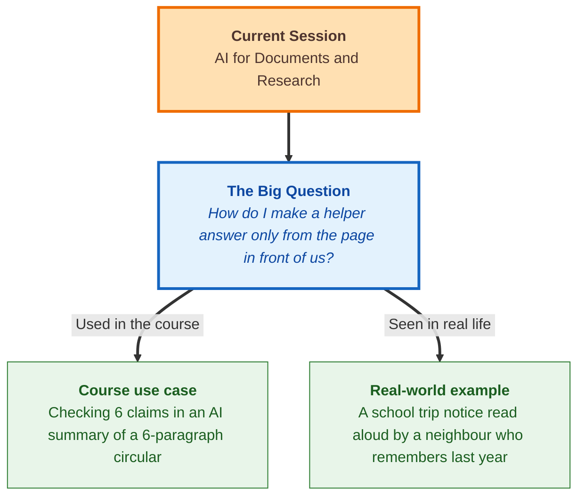

## AI for Documents and Research

### Mental Map

---

### What You'll Learn

Have you ever wondered which part of a neighbour's advice came from the notice and which from memory?

By the end of this session, you will be able to:

- **Identify** the situations in which you must tell the school that a friend helped you fill a form.
- **Describe** why last year's trip details miss a change the school made in March.
- **Classify** 6 lines of your neighbour's advice as backed by the notice or not backed by it.
- **Write** an instruction that tells a helper to answer only from the notice.

> **Topics you will meet:** Uploading and summarising a document, grounding a prompt, knowledge cutoff, fact-checking claims against the source, disclosing AI assistance.
>
> Join the session to learn each of these in detail.

---

### Why You Are Learning This Topic

Tara receives a notice for her son's school trip. Her neighbour Mr Joshi sent his own child on the same trip last year.

She asks him the departure time. He says 7:00 am, then adds "fee is Rs 400". He sounds sure.

The notice says 7:30 am and Rs 450. The school changed both details this year.

A **source** means the page or file where a fact can be found and checked.

In this course, you will give a chat tool a document and make it answer from that source.

> **Think about it:** What should Tara have asked Mr Joshi before she wrote "7:00 am" on her calendar?

---

### The School Trip Notice Puzzle

Here are 4 answers from Mr Joshi and what the notice says.

| Question | Mr Joshi said | The notice says |
|:----------:|:----------:|:----------:|
| 1. Departure time | 7:00 am | 7:30 am |
| 2. Fee | Rs 400 | Rs 450 |
| 3. Return time | 5:00 pm | 5:00 pm |
| 4. Packed lunch | Bring your own | Not mentioned |

**What you want to happen:**

- Every answer points to a line of the notice.
- A missing answer says "not in the notice".
- The school knows which help you used.

> **Wonder about this:**
>
> - Which of the 4 answers can Tara defend with a line of the notice?
> - Should Tara tell the school that Mr Joshi helped?

---

### Think It Through

There is no wrong first try. Keep your guesses for the session.

**1. Which answer of Mr Joshi's matches the notice exactly?**
Hint: Compare each time and each fee.

**2. Why did last year's memory give the wrong fee?**
Hint: Think about when he heard it and when the school changed it.

**3. Question 4 is not in the notice. What is the safest sentence for Tara to write?**
Hint: The sentence should name the notice, not his memory.

---

### One Question to Carry Into the Session

> **How can you prove that an answer came from the page and not from memory?**
>
> Who needs to know when you used help to write it?
