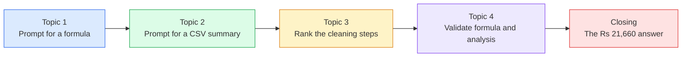
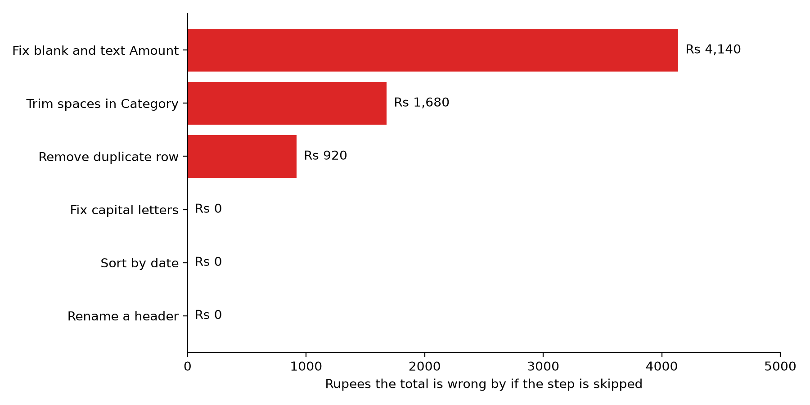
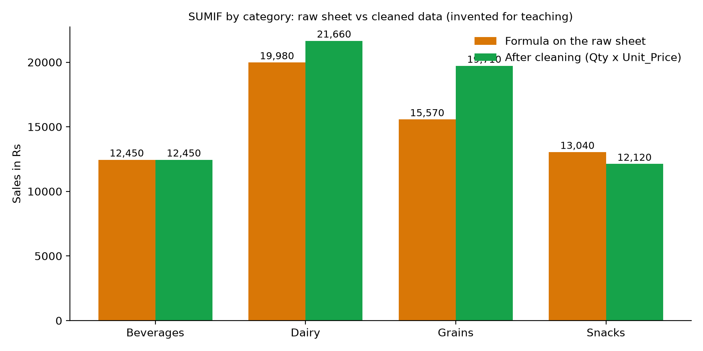

# <font color='#1d4ed8'>Lecture Script: AI for Spreadsheets and Data</font>

---

## <font color='blue'>Agenda</font>

The lecture runs as four topics. Each topic ends with a quiz.

| Topic | What we do | Learning objectives covered | Minutes |
|:-:|:--|:--|:-:|
| 1 | Ask AI for a formula and test it on the sheet | Write a prompt that produces a spreadsheet formula for a stated calculation | 30 |
| 2 | Ask AI to summarise a CSV | Write a prompt that returns a stated summary from a CSV attached in a chat tool | 25 |
| 3 | Rank a data-cleaning plan | Prioritize the steps in an AI-generated data-cleaning plan by which would break downstream calculations if skipped | 25 |
| 4 | Validate the formula and the written analysis | Validate an AI-suggested spreadsheet formula against the stated calculation before using it<br>Validate every claim or assumption in a written analysis, draft or forecast against its source facts or figures | 25 |
| — | Closing: Outcome & Summary | | 15 |
| | **Total** | | **120** |

> <font color="red">**🎯 Instructor Note**</font> Pace: Topic 1 and Topic 2 are the live prompts. Spend the extra minutes on the cleaning ranking in Topic 3 and on the claim check in Topic 4.
> Learners need ChatGPT or Gemini, Google Sheets and the file `data/store_sales.csv`. Check each tool's current screen for how to attach a file. Model replies are never pasted here. Run each step live.

---

## <font color='blue'>Scenario</font>

Suresh manages a D-Mart-style supermarket cluster with stores in Pune, Nagpur and Surat. Head office asks for one number by Friday: total Dairy sales for 1 to 14 October 2026.

He exports 41 rows from the billing system, opens them in a sheet and asks an AI tool for a formula. The formula returns Rs 19,980. It looks right, so he sends it.

> <font color="red">**🎯 Instructor Note**</font> The company is only the setting. Do not claim it works this way. The stores, the 41 rows and every figure are invented for teaching. Expected values were computed by a separate check of the CSV, and learners confirm them in Sheets.

---

## <font color='blue'>Problem Statement</font>

Head office plans next fortnight's Dairy stock from Suresh's number. The true Dairy total is Rs 21,660. Suresh's figure is Rs 1,680 too low, about 7.8% of the real sales, so the Nagpur shelves run short of milk on the weekend.

The formula was valid. The data under it was not, and Suresh never tested the answer.

> <font color='purple'>**How does Suresh get a formula and a summary from AI, clean the data in the right order, and check every figure against the real rows before he sends it?**</font>

> <font color="red">**🎯 Instructor Note**</font> Poll: "If a formula returns a number with no error, is the number right?" Options: yes or no. Give learners 30 seconds to respond in chat. Reveal the answer in the Closing.

---

## <font color='blue'>What We Will Use</font>

A free chat tool (ChatGPT or Gemini) and Google Sheets. The sheet has 41 rows in columns A to G: Row, Date, Store, Category, Qty, Unit_Price, Amount. A second table of margins sits in `data/margins.csv`. Formulas use commas; if your Sheets locale uses semicolons, swap them.

| Topic | Tools | In one line |
|:-:|:--|:--|
| 1 | Chat tool, Google Sheets: SUMIF, VLOOKUP | Ask for a formula, paste it, test it |
| 2 | Chat tool with a CSV attached | Ask for a stated summary from the file |
| 3 | Chat tool, Google Sheets | Rank cleaning steps by what breaks if skipped |
| 4 | Sheets: sort, COUNTIF | Test a formula and every written claim against the rows |

---

## <font color='blue'>How: Walking Through Suresh's Dairy Number</font>



---

## <font color='blue'>Topic 1: Ask AI for a formula and test it on the sheet</font> `30 min`

> <font color='purple'>**Suresh typed "give me the dairy total" and pasted what came back. What should he have told the tool first?**</font>

### <font color='green'>Example: A SUMIF prompt</font>

> <font color='purple'>**What must a formula prompt state so the tool cannot guess the columns?**</font>

Earlier you wrote prompts with task, context, format and constraints. A formula prompt names the sheet layout in the context.

```
1. Task: Write a spreadsheet formula for total Amount of Dairy sales.
2. Context: Data is in A1:G42. Category is column D. Amount is column G.
3. Format: One formula only, then one line saying what each part does.
4. Constraints: Google Sheets. Use my real ranges. Do not use columns I did not name.
```

> <font color="red">**🎯 Instructor Note**</font> Learners open the CSV in Sheets, paste this prompt into their tool and paste the formula into an empty cell. Do not predict the formula. Compare it with `=SUMIF(D2:D42,"Dairy",G2:G42)` and read which columns it uses.

> <font color='green'>**Result**</font> A good reply points at column D for the test and column G for the numbers. The sheet should show Rs 19,980, the same figure Suresh reported.

#### <font color='#c2410c'>Logic Explanation</font>

- `SUMIF(range, test, sum_range)` adds the cells in `sum_range` whose matching cell in `range` equals the test.
- Naming the columns in the prompt is what lets you check the formula's ranges by eye.

### <font color='green'>Extending it: A lookup formula</font>

> <font color='purple'>**How do we pull each category's margin into the sales rows?**</font>

Each category has a margin in the table `data/margins.csv`. Paste that table into columns I and J, rows 1 to 5.

| I | J |
|:--|:-:|
| Category | Margin_Percent |
| Dairy | 8 |
| Snacks | 18 |
| Grains | 12 |
| Beverages | 15 |

```
1. Task: Write a formula for H2 that returns the margin for the category in D2.
2. Context: The margin table is in I1:J5. Category is in column I.
3. Format: One formula that I can fill down, plus one line of explanation.
4. Constraints: Exact match only. Google Sheets.
```

> <font color="red">**🎯 Instructor Note**</font> Expected shape: `=VLOOKUP(D2,I2:J5,2,FALSE)`. Learners fill it down to row 42 and scan column H for a value that is not a number.

> <font color='green'>**Result**</font> Most rows show 8, 18, 12 or 15. The line with Row 13, whose category is "Dairy " with a trailing space, shows `#N/A`, because an exact match fails on the extra space.

> <font color='#b45309'>**Common mistake**</font> Letting the tool pick the ranges. Fix: write the ranges in the prompt and compare them with the formula.

### <font color='purple'>Quiz 1</font>

**Question:** Category is in column D, Amount in column G, data in rows 2 to 42. Which formula gives total Dairy Amount?

**Options:**
- A) `=SUMIF(G2:G42,"Dairy",D2:D42)`
- B) `=SUMIF(D2:D42,"Dairy",E2:E42)`
- C) `=COUNTIF(D2:D42,"Dairy")`
- D) `=SUMIF(D2:D42,"Dairy",G2:G42)`

**Correct Answer:** D

**Explanation:**
- **A)** The test range and the sum range are swapped.
- **B)** Column E holds Qty, so this adds quantities, not rupees.
- **C)** COUNTIF counts rows. It does not add Amount.
- **D)** Correct. Column D is tested and column G is added.

---

## <font color='blue'>Topic 2: Ask AI to summarise a CSV</font> `25 min`

> <font color='purple'>**Suresh also needs totals by category and store. Can the tool read the file and summarise it?**</font>

### <font color='green'>Example: A summary prompt with a stated output</font>

> <font color='purple'>**What must the prompt say so the summary is stated, not improvised?**</font>

A **CSV** is a plain-text table: one row per line, values separated by commas. In the documents session you told a tool to use only the text you gave it. Do the same with the attached file.

```
1. Task: Summarise the attached CSV: total Amount per Category and per Store.
2. Context: Each row is one sale. Dates run from 1 to 14 October 2026.
3. Format: Two small tables, then one sentence naming the top Category.
4. Constraints: Use only the file. List any row with a blank or non-number Amount.
```

> <font color="red">**🎯 Instructor Note**</font> Learners attach `store_sales.csv`, or paste the rows if attaching is not offered, and run this prompt. Do not predict the totals. Learners record the tool's numbers in the table below.

| Category | Tool's total (learners fill) | Raw sheet total | Cleaned total |
|:--|:-:|:-:|:-:|
| Beverages | | 12,450 | 12,450 |
| Dairy | | 19,980 | 21,660 |
| Grains | | 15,570 | 19,710 |
| Snacks | | 13,040 | 12,120 |

> <font color='green'>**Result**</font> A tool that skips a blank or text Amount gives the raw figures. A tool that works out Qty x Unit_Price can give the cleaned figures. Learners compare their column with the other two.

#### <font color='#c2410c'>Logic Explanation</font>

- The format line fixes the shape, so each table cell can be compared with a known number.
- The last constraint asks the tool to name rows it could not use, rather than hide them.

### <font color='green'>Extending it: Read the tool's own notes</font>

> <font color='purple'>**Did the tool list the rows with a blank or non-number Amount?**</font>

> <font color="red">**🎯 Instructor Note**</font> Rows 21 (blank) and 31 ("n/a") in the Row column are the two planned cases. Ask learners to type the numbers the tool listed. Give learners 30 seconds to respond in chat.

> <font color='green'>**Result**</font> A reply that names Rows 21 and 31 has read the file closely. A reply that names none has missed them, and its Grains total cannot be trusted.

> <font color='#b45309'>**Common mistake**</font> Accepting a clean-looking table. Fix: compare at least one total with a formula in the sheet.

### <font color='purple'>Quiz 2</font>

**Question:** Which prompt returns a stated summary from the attached CSV?

**Options:**
- A) "Summarise it."
- B) "Tell me about the sales."
- C) "Using only the attached file, return total Amount per Category in a two-column table and list rows with a blank Amount."
- D) "Make the data look nice."

**Correct Answer:** C

**Explanation:**
- **A)** It states no measure, grouping or format.
- **B)** The tool must guess what to report.
- **C)** Correct. It names the file, the measure, the grouping, the format and a rule for odd rows.
- **D)** It asks for appearance, not for a summary.

---

## <font color='blue'>Topic 3: Rank a data-cleaning plan</font> `25 min`

> <font color='purple'>**The raw numbers and the cleaned numbers differ. Which cleaning step matters most?**</font>

### <font color='green'>Example: Rank by what breaks</font>

> <font color='purple'>**Which steps would break the totals if skipped, and by how much?**</font>

> <font color="red">**🎯 Instructor Note**</font> The plan below was written for teaching, as a tool might produce it. Ask learners to type their ranking in chat first. We rank by the rupees the total is wrong by if the step is skipped.

| Step in the plan | What it fixes | If skipped, the total is wrong by |
|:--|:--|:-:|
| Fix blank and text Amount (Rows 21 and 31) | Two Grains sales are not added | Rs 4,140 too low |
| Trim spaces in Category (Row 13) | "Dairy " is not matched as Dairy | Rs 1,680 too low |
| Remove the duplicate row (Row 41) | Row 9 is counted twice | Rs 920 too high |
| Fix capital letters ("dairy" in Row 8) | Cosmetic here, because SUMIF ignores case | Rs 0 |
| Sort rows by date | Looks tidy | Rs 0 |
| Rename a header | Looks tidy | Rs 0 |

$$4140 = 1080 + 3060 \qquad \text{(Row 21 and Row 31)}$$

<p align="center"></p>

> <font color='green'>**Result**</font> Rank 1 is the Amount fix, rank 2 the space trim, rank 3 the duplicate. The three cosmetic steps come last.

#### <font color='#c2410c'>Logic Explanation</font>

- A step breaks a downstream calculation when a formula reads the damaged cell. Rows 21, 31, 13 and 41 (the Row column) each feed a total.
- Case does not matter to `SUMIF`, so Row 8 changes nothing. A different tool might treat case as a difference.

<p align="center"></p>

### <font color='green'>Extending it: Totals that do not reconcile</font>

> <font color='purple'>**The four category totals should add up to the grand total. Do they?**</font>

> <font color="red">**🎯 Instructor Note**</font> Learners add the four raw category totals, then type `=SUM(G2:G42)` in a spare cell. Give learners 30 seconds to respond in chat with the gap. Expected: 1,680.

$$12450 + 19980 + 15570 + 13040 = 61040$$

$$62720 - 61040 = 1680$$

> <font color='green'>**Result**</font> The gap of Rs 1,680 is exactly the row with "Dairy " and a trailing space. A gap between parts and a whole points to rows that no category formula caught.

> <font color='#b45309'>**Common mistake**</font> Fixing the total by adding the gap in by hand. Fix: find the row that causes the gap and clean it.

### <font color='purple'>Quiz 3</font>

**Question:** Using the rupee measure, which skipped step leaves the grand total most wrong?

**Options:**
- A) Sort rows by date
- B) Fix the blank and text Amount cells
- C) Rename a header
- D) Trim spaces in Category

**Correct Answer:** B

**Explanation:**
- **A)** Sorting changes no total, so it is Rs 0.
- **B)** Correct. Skipping it leaves the total Rs 4,140 too low.
- **C)** A header name changes no total, so it is Rs 0.
- **D)** It matters, at Rs 1,680, but it is smaller than the Amount fix.

---

## <font color='blue'>Topic 4: Validate the formula and the written analysis</font> `25 min`

> <font color='purple'>**Suresh has a formula, a summary and a cleaned sheet. How does he check each before sending it?**</font>

### <font color='green'>Example: Test a formula against the stated calculation</font>

> <font color='purple'>**Does `=SUMIF(D2:D42,"Dairy",G2:G42)` really give "total Dairy Amount"?**</font>

The stated calculation is: add the Amount of every Dairy row. Three tests check the formula against it.

| Test | How | Result on the raw sheet |
|:--|:--|:--|
| 1. Read the ranges | D is Category, G is Amount | Correct columns |
| 2. Count the rows | `=COUNTIF(D2:D42,"Dairy")` against a by-eye count of Dairy rows in a copy sorted by Category | Formula counts 14, the eye counts 15 |
| 3. Check by hand | Add the Amount of those 15 Dairy rows | Rs 21,660, not Rs 19,980 |

> <font color="red">**🎯 Instructor Note**</font> Learners run the three tests in Sheets. Ask which test found the problem. Expected: tests 2 and 3. The formula was valid. The data had a trailing space.

> <font color='green'>**Result**</font> A formula can read the right columns and still miss rows. Tests 2 and 3 caught the 15th Dairy row.

#### <font color='#c2410c'>Logic Explanation</font>

- Reading the formula checks the logic. Counting and adding by hand check it against the real rows.
- If the wrong column is used, the symptom is different. `=SUMIF(D2:D42,"Dairy",E2:E42)` returns 333, a quantity, where rupees were expected.

### <font color='green'>Extending it: Validate every claim in a written analysis</font>

> <font color='purple'>**An AI draft says five things. Which can Suresh keep?**</font>

> <font color="red">**🎯 Instructor Note**</font> The draft below was written for teaching. Ask learners to type K for keep or C for change for each line before you reveal the checks. Cleaned total is Rs 65,940.

| Claim in the draft | Check against the cleaned data | Verdict |
|:--|:--|:--|
| "Nagpur sold the most, Rs 32,630 of the Rs 65,940 total." | Nagpur Rs 32,630, Pune Rs 21,190, Surat Rs 12,120, total Rs 65,940 | Keep |
| "Grains sold Rs 15,570." | Cleaned Grains is Rs 19,710. The draft used the raw sheet | Change |
| "Total sales were Rs 62,720." | Cleaned total is Rs 65,940, and 62,720 is the raw sum | Change |
| "Pune sold Rs 21,190." | Matches the cleaned store total | Keep |
| "Dairy sales will double next fortnight." | No figure in the sheet supports it. It is an assumption, not a fact | Remove or label as a guess |

$$\frac{32630}{65940} \approx 0.495 = 49.5\%$$

> <font color='green'>**Result**</font> Two claims are kept. Two figures came from the raw sheet and must change. The assumption is removed or labelled as a guess.

> <font color='#b45309'>**Common mistake**</font> Checking numbers but not assumptions. Fix: ask of each claim, "which cell or row says this?"

### <font color='purple'>Quiz 4</font>

**Question:** `=SUMIF(D2:D42,"Dairy",E2:E42)` returns 333 where Suresh expected rupees. What is the most likely cause?

**Options:**
- A) The formula adds column E, which holds Qty, instead of column G
- B) The category is spelled wrong in every row
- C) Row 41 is a duplicate
- D) The tool rounded the answer

**Correct Answer:** A

**Explanation:**
- **A)** Correct. Column E is Qty, so the result is a quantity count of Dairy units.
- **B)** A wrong spelling would shrink the result, not change its type.
- **C)** One duplicate changes a total by one row, not from rupees to a small count.
- **D)** Rounding cannot turn Rs 19,980 into 333.

---

## <font color='blue'>Closing: Outcome & Summary</font> `15 min`

Back to Suresh. We answer the Problem Statement using each topic once.

> <font color='purple'>**1. How should he ask for the formula? (Topic 1)**</font>

He names the layout: the sheet range, the test column and the sum column. Then he compares the tool's ranges with his own.

> <font color='purple'>**2. How should he ask for the summary? (Topic 2)**</font>

He attaches the CSV and states the measure, the grouping, the format and a rule for rows that cannot be used.

> <font color='purple'>**3. Which cleaning comes first? (Topic 3)**</font>

The Amount fix (Rs 4,140), then the space trim (Rs 1,680), then the duplicate (Rs 920). The cosmetic steps last.

> <font color='purple'>**4. How does he check before sending? (Topic 4)**</font>

He counts rows in a sorted copy, adds by hand, and checks each claim against a cell. The answer he sends is Rs 21,660.

### <font color='green'>Outcome</font>

| | What Suresh sent | What he should send |
|:--|:-:|:-:|
| Dairy total | Rs 19,980 | Rs 21,660 |
| Grand total | Rs 62,720 | Rs 65,940 |
| Test run before sending | None | Row count, hand total and claim check |

> <font color='green'>**Therefore,**</font> Suresh gets AI help for the formula and the summary, cleans the damaged rows in order of impact, and checks every figure against the rows. A number with no error message is not the same as a correct number.

> <font color="red">**🎯 Instructor Note**</font> Reveal the poll: no. The formula ran without an error and was still Rs 1,680 short.

### <font color='green'>Summary</font>

| Learning objective | Takeaway |
|:--|:--|
| Formula prompt | Name the layout, the ranges and the sheet tool in the prompt |
| CSV summary prompt | State the file, the measure, the grouping, the format and a rule for odd rows |
| Rank cleaning steps | Rank by how much the total is wrong if the step is skipped |
| Validate a formula | Read the ranges, count the rows by eye and add by hand |
| Validate a written analysis | Match every claim to a cell, and label assumptions |
| **Practical value** | Testing every AI formula and summary against the real rows keeps reports to head office correct |

---

# <font color='red'>Launch the Feedback Poll</font>

> <font color="red">**🎯 Instructor Note**</font> Reminder: launch the feedback poll now to collect learner feedback.
