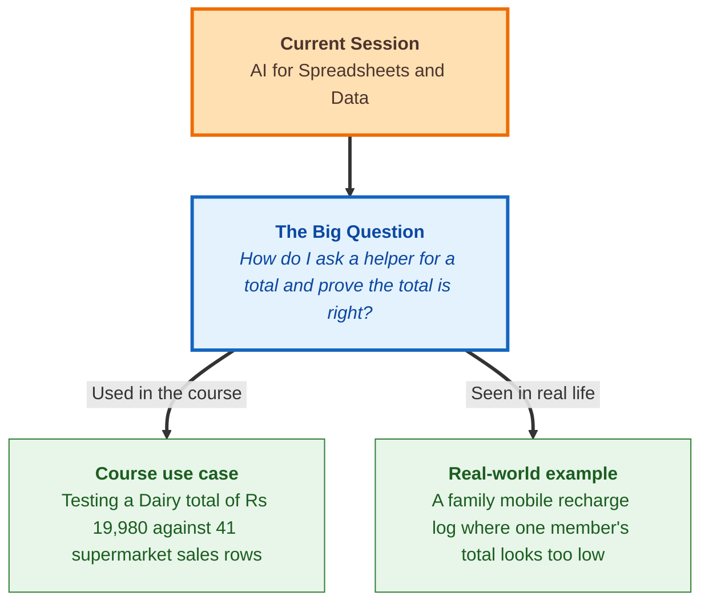

## AI for Spreadsheets and Data

### Mental Map

---

### What You'll Learn

Have you ever wondered why a total in a list of payments never matches what you remember paying?

By the end of this session, you will be able to:

- **Use** a short, clear request to get Dad's total from a recharge log.
- **Check** that total by counting the lines yourself.
- **Judge** which of 3 log fixes matters most to the final total.
- **Critique** a 4-line note about the month against the log lines.
- **Write** a request for totals per member with a rule for lines the helper cannot read.

> **Topics you will meet:** Asking AI for a lookup or SUMIF formula, summarising a CSV, ranking data-cleaning steps, validating AI formulas and summaries against real data, common failure patterns.
>
> Join the session to learn each of these in detail.

---

### Why You Are Learning This Topic

Farah keeps a log of the family's mobile recharges, one line per recharge. At month end, her cousin Dev totals Dad's payments.

Dev says Rs 299. Farah remembers paying more.

She finds that Dad's second recharge was typed as "Dad " with an extra space. Dev added only what matched the name exactly.

A **CSV** means a plain-text table where each line is one row and commas separate the columns.

You will ask a chat tool to add up a table like this, then prove the answer.

> **Think about it:** What should Dev have told Farah along with the number Rs 299?

---

### The Recharge Log Puzzle

Here are 6 lines from Farah's log.

| Member | Plan | Amount in Rs |
|:----------:|:----------:|:----------:|
| Dad | Monthly | 299 |
| Dad (with a space) | Top-up | 100 |
| Mom | Monthly | 299 |
| Mom | Monthly | 299 |
| Riya | Data pack | blank |
| Riya | Monthly | 239 |

**What you want to happen:**

- Dad's total counts both of his recharges.
- Every line with a missing amount is named, not guessed.
- You can show how you checked the total.

> **Wonder about this:**
>
> - Which line made Dev's total for Dad too low, and which line may be a repeat?
> - How could you check his total in under 1 minute?

---

### Think It Through

There is no wrong first try. Keep your guesses for the session.

**1. Dev adds only the line that reads exactly "Dad". What total does he get?**
Hint: Look at the first line only.

**2. Which fix changes the grand total most: removing Mom's repeated line or filling in Riya's blank amount?**
Hint: Riya's data pack costs Rs 98. Compare 98 with 299.

**3. Dev writes: "Mom paid the most this month." Which lines of the log would prove it?**
Hint: Compare the totals for Dad, Mom and Riya.

---

### One Question to Carry Into the Session

> **How can you tell a total that looks right from a total that is right?**
>
> Which line in your own notes could hide a mistake like the extra space?
