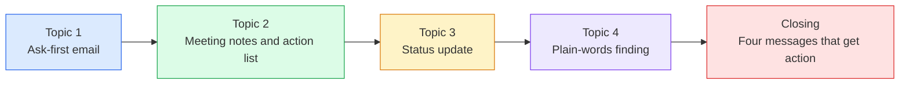
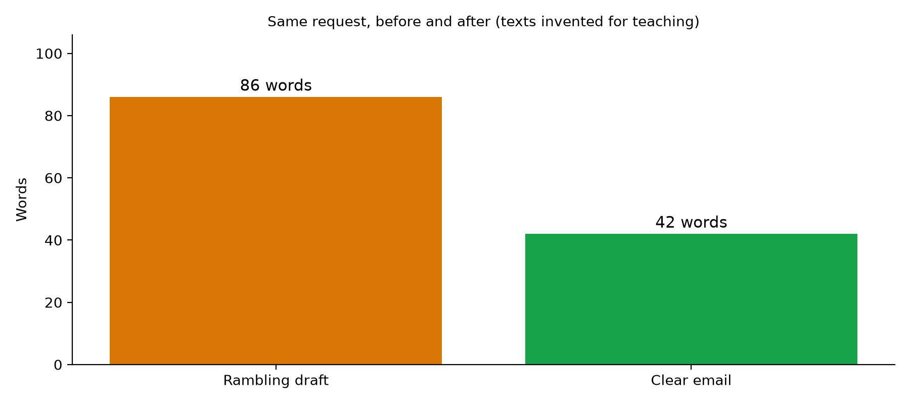
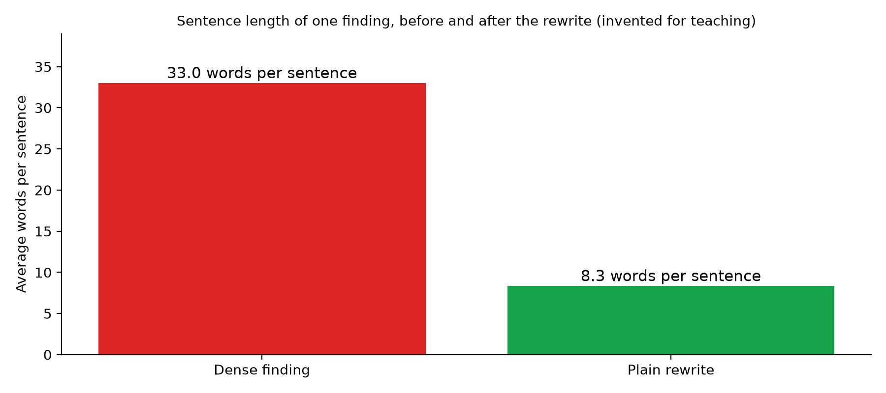

# <font color='#1d4ed8'>Lecture Script: AI for Writing and Meeting Communication</font>

---

## <font color='blue'>Agenda</font>

The lecture runs as four topics. Each topic ends with a quiz.

| Topic | What we do | Learning objectives covered | Minutes |
|:-:|:--|:--|:-:|
| 1 | Turn a rambling draft into an ask-first email | Write an email that states the ask in the first line and the supporting detail below | 30 |
| 2 | Turn rough meeting notes into decisions, owners and next steps | Write meeting notes recording each decision taken, its owner and the next step | 30 |
| 3 | Write a status update | Write a status update stating progress, blockers and the help needed | 20 |
| 4 | Rewrite a technical finding for a non-specialist | Rewrite a technical finding in language a non-specialist reader can act on | 25 |
| — | Closing: Outcome & Summary | | 15 |
| | **Total** | | **120** |

> <font color="red">**🎯 Instructor Note**</font> Pace: the email and the meeting notes carry the most live work. Keep the status update quick, since it reuses the same three-part idea.
> Learners need free accounts for ChatGPT, Claude and Gemini, and Notion with the Notion AI trial. Model replies are never pasted here. Run each step live and fill the tables from the real screen.

---

## <font color='blue'>Scenario</font>

**One day, four messages.** Meena leads a service centre at an Ather-style electric scooter brand. After a festival offer, 38 scooters wait for battery checks. Her Monday has four writing jobs.

| Time | What is due | The risk |
|:-:|:--|:--|
| 9:30 | Team meeting at the service bay | Notes that nobody can act on |
| 11:00 | Email to the regional manager, Mr Joshi | The request is buried in the middle |
| 15:00 | Weekly status update | Progress is told as a story |
| 17:00 | Written finding for a customer about a battery fault | A technical sentence the customer cannot follow |

> <font color="red">**🎯 Instructor Note**</font> The company is only the setting. Do not claim it works this way. The centre, the people, the 38 scooters and every figure are invented for teaching. Today is Monday 16 November 2026.

---

## <font color='blue'>Problem Statement</font>

Meena pastes her rough thoughts into a chat tool and sends whatever comes back. Mr Joshi reads half of the email and does not see the request for 2 temporary technicians. Nobody owns the roster after the meeting. The customer does not understand the battery message and cancels the visit.

Earlier sessions taught prompts with four parts, a role line, a check step and a template. Today Meena applies them to the four kinds of workplace writing.

> <font color='purple'>**How does Meena use AI to write an email that leads with the ask, meeting notes with owners, a status update with a clear request, and a finding the customer can act on?**</font>

> <font color="red">**🎯 Instructor Note**</font> Poll: "Should an email put the request in the first line or build up to it?" Options: first line or build up. Give learners 30 seconds to respond in chat. Reveal the answer in the Closing.

---

## <font color='blue'>What We Will Use</font>

ChatGPT, Claude and Gemini for drafting, and Notion AI for the action list. Check each tool's current screen for where to type the prompt.

| Topic | Tools | In one line |
|:-:|:--|:--|
| 1 | Any of the three chat tools | Draft an email with the ask first |
| 2 | Chat tool, Notion AI | Turn notes into decisions, owners and next steps |
| 3 | Any chat tool | Write progress, blockers and help needed |
| 4 | Any chat tool | Rewrite a technical line in plain words, then in your own voice |

---

## <font color='blue'>How: Walking Through Meena's Monday</font>



---

## <font color='blue'>Topic 1: Turn a rambling draft into an ask-first email</font> `30 min`

> <font color='purple'>**Meena's first draft has 86 words and the request sits in the middle. What does the reader need to see first?**</font>

### <font color='green'>Example: The rambling draft</font>

> <font color='purple'>**Where is the ask in this draft?**</font>

> <font color="red">**🎯 Instructor Note**</font> The draft below is invented for teaching. Ask learners to mark the first word of the real request before you tell them. The request starts at "wondering", word 57 of 86.

> "Hi sir, hope you are well. So I was thinking about the backlog and, you know, we have been getting a lot of scooters since the festival offer and the team is tired and a few people are on leave, and I checked and the battery checks take about 2 hours each, so anyway I was wondering if maybe we could possibly think about getting extra hands for a bit, maybe 2 people, maybe 4 weeks, if that is okay with you. Let me know, thanks."

> <font color='green'>**Result**</font> A reader who stops after 3 lines never sees the request. It starts at word 57.

### <font color='green'>Extending it: Prompt for an ask-first email</font>

> <font color='purple'>**How does Meena tell the tool to lead with the ask?**</font>

An **ask-first email** states what you need in the first line. The supporting detail goes below it.

```
1. Task: Turn my draft into an email to Mr Joshi.
2. Context: I need 2 temporary technicians for 4 weeks from 23 November. 38 scooters wait for battery checks of 2 hours each. 3 technicians are on leave until 30 November.
3. Format: Subject line, the ask in the first line, then 3 bullets, under 60 words.
4. Constraints: Use only these facts. Ask for a reply by Wednesday 18 November.
```

> <font color="red">**🎯 Instructor Note**</font> Learners paste the draft and this prompt into a tool and read the reply. Do not predict the wording. Check the first line, the 3 bullets and the word count.

The target email has 42 words.

> Mr Joshi, please approve 2 temporary technicians for 4 weeks from 23 November.
> - 38 scooters are waiting for battery checks.
> - Each check takes about 2 hours.
> - 3 technicians are on leave until 30 November.
>
> I need your reply by Wednesday 18 November.

<p align="center"></p>

> <font color='green'>**Result**</font> The ask sits in the first line, and the email is 42 words instead of 86. Learners count the words in their own reply and tick the first-line check.

#### <font color='#c2410c'>Logic Explanation</font>

- The first line decides whether the reader acts. Detail below it supports the ask, not the other way round.
- The prompt supplies the facts. Without them, the tool may invent a reason or a date.

> <font color='#b45309'>**Common mistake**</font> Pasting a rough draft with no facts and no rule for length. Fix: supply the facts, the format and a word limit.

### <font color='purple'>Quiz 1</font>

**Question:** Which first line follows the ask-first rule?

**Options:**
- A) "Hope you are doing well and had a nice weekend."
- B) "I wanted to give you some background on the festival offer."
- C) "Please approve 2 temporary technicians for 4 weeks from 23 November."
- D) "As you know, the team has been very busy lately."

**Correct Answer:** C

**Explanation:**
- **A)** It is a greeting. It does not state what Meena needs.
- **B)** It starts with background, so the reader must wait for the request.
- **C)** Correct. It states the action, the number and the dates in one line.
- **D)** It is context, not the ask.

---

## <font color='blue'>Topic 2: Turn rough meeting notes into decisions, owners and next steps</font> `30 min`

> <font color='purple'>**The 9:30 meeting is over. What did the team actually decide, and who does what?**</font>

### <font color='green'>Example: Notes that record decisions</font>

> <font color='purple'>**What three things must every decision in the notes show?**</font>

Good meeting notes record each **decision**, its **owner** and the **next step**. Here are Meena's rough notes, invented for teaching (65 words).

> "Backlog is 38 scooters. Ravi said evening shift can take battery checks, everyone ok with that, he will send the roster Friday. Meena asks about temp techs, Mr Joshi not here so she will email him, wants answer by Wednesday. Diagnostic kit, Priya says costs Rs 45,000, nobody decided, park it until next week. Customer calls: Priya will call the 5 oldest waiting customers today."

```
1. Task: Turn these notes into a table of decisions.
2. Context: Notes are pasted below. Today is Monday 16 November 2026.
3. Format: A table with Decision, Owner, Next step and Due date.
4. Constraints: Use only the notes. If an owner or date is missing, write "not stated".
```

> <font color="red">**🎯 Instructor Note**</font> Learners run this in a chat tool. Do not predict the table. Compare each row with the expected table below.

| Decision | Owner | Next step | Due |
|:--|:--|:--|:-:|
| Move battery checks to the evening shift | Ravi | Send the roster | Friday 20 Nov |
| Ask for 2 temporary technicians | Meena | Email Mr Joshi | Wednesday 18 Nov |
| Call the 5 oldest waiting customers | Priya | Make the calls | Today |
| Diagnostic kit at Rs 45,000: no decision | Not stated | Park until next week | Not stated |

> <font color='green'>**Result**</font> Three decisions have an owner and a date. The fourth is a parked item with no owner, and the notes say so.

#### <font color='#c2410c'>Logic Explanation</font>

- "Not stated" tells the team what is still open. A guessed owner would hide the gap.
- A decision with no owner will not happen. Naming the owner is what makes it an action.

### <font color='green'>Extending it: Notes to an action list in Notion</font>

> <font color='purple'>**How does Meena turn the notes into tasks the team can tick off?**</font>

> <font color="red">**🎯 Instructor Note**</font> Learners paste the invented notes into a new Notion page and ask Notion AI for action items with owners. Check Notion's current screen for where the AI option sits. Never paste real notes.

| Check on the Notion result | Yes or No (learners fill) |
|:--|:-:|
| Every action has an owner | |
| Priya's customer calls are listed | |
| The Rs 45,000 kit is not shown as approved | |
| No action appears that is not in the notes | |

> <font color='green'>**Result**</font> A list that matches the notes is ready to share. Any row learners mark No goes back to the tool with "Use only the notes."

> <font color='#b45309'>**Common mistake**</font> Letting the tool fill a missing owner. Fix: tell it to write "not stated" and ask the meeting.

### <font color='purple'>Quiz 2</font>

**Question:** Which line records a decision correctly?

**Options:**
- A) "Ravi will send the evening-shift roster by Friday 20 November."
- B) "We talked about the evening shift."
- C) "Someone should look at the roster soon."
- D) "The team felt positive about the idea."

**Correct Answer:** A

**Explanation:**
- **A)** Correct. It names the owner, the next step and the date.
- **B)** It records a topic, not a decision.
- **C)** "Someone" has no owner and "soon" has no date.
- **D)** It records a mood, not an action.

---

## <font color='blue'>Topic 3: Write a status update</font> `20 min`

> <font color='purple'>**At 15:00 Mr Joshi expects an update. What are the three things he looks for?**</font>

### <font color='green'>Example: Progress, blockers and help needed</font>

> <font color='purple'>**How does Meena turn her day into three labelled parts?**</font>

A status update has three parts: **progress** (what is done), **blockers** (what stops the work) and **help needed** (what you ask the reader to do).

```
1. Task: Write a status update for Mr Joshi.
2. Context: 12 of 38 scooters are cleared. 3 technicians are on leave until 30 November. One diagnostic kit is shared by 2 bays.
3. Format: Three labelled lines: Progress, Blockers, Help needed.
4. Constraints: Under 50 words. The help line asks for a decision by Wednesday 18 November.
```

> <font color="red">**🎯 Instructor Note**</font> Learners run the prompt and read the reply against the three parts. Do not predict the wording. Check that the figures match the context exactly.

$$\frac{12}{38} \approx 0.316 = 31.6\% \text{ cleared}, \qquad 38 - 12 = 26 \text{ still waiting}$$

> <font color='green'>**Result**</font> A good update shows 12 of 38 done, 26 waiting, the two blockers and one clear request.

#### <font color='#c2410c'>Logic Explanation</font>

- The three labels let a busy reader find the part they need in seconds.
- The "help needed" line is the ask. It follows the same first-line rule as the email.

### <font color='green'>Extending it: Spot the missing part</font>

> <font color='purple'>**Which part is missing from this update?**</font>

> <font color="red">**🎯 Instructor Note**</font> Ask learners to type the missing part. Give learners 30 seconds to respond in chat. Expected: help needed.

> "Progress: 12 of 38 scooters cleared. Blockers: 3 technicians on leave."

> <font color='green'>**Result**</font> It has progress and a blocker but asks the reader for nothing. Add a "Help needed" line.

> <font color='#b45309'>**Common mistake**</font> Writing "all good" under blockers. Fix: name each blocker, or write "none" when there is none.

### <font color='purple'>Quiz 3</font>

**Question:** Which line belongs under "Help needed"?

**Options:**
- A) "12 of 38 scooters are cleared."
- B) "3 technicians are on leave."
- C) "We worked hard today."
- D) "Please approve 2 temporary technicians by Wednesday 18 November."

**Correct Answer:** D

**Explanation:**
- **A)** It reports progress.
- **B)** It names a blocker.
- **C)** It is not progress, a blocker or a request.
- **D)** Correct. It asks the reader for a specific action with a date.

---

## <font color='blue'>Topic 4: Rewrite a technical finding for a non-specialist</font> `25 min`

> <font color='purple'>**At 17:00 a technician hands Meena a finding for a customer. Can the customer act on it?**</font>

### <font color='green'>Example: From dense to plain</font>

> <font color='purple'>**What makes this finding hard to act on?**</font>

> <font color="red">**🎯 Instructor Note**</font> The finding below is invented for teaching. Do not treat it as real battery guidance. Ask learners which word they could not explain to a customer.

> "Battery pack B-2 shows a cell voltage imbalance above 80 mV across the series string, indicating degraded balancing-circuit performance, and replacement of the management board is recommended prior to the next charge cycle."

It is one sentence of 33 words.

```
1. Task: Rewrite this finding for a scooter owner with no technical background.
2. Context: The finding is pasted below. The owner must decide whether to book a repair.
3. Format: 3 short sentences. Sentence 3 says what to do and by when.
4. Constraints: No jargon. Do not add facts that are not in the finding.
```

> <font color="red">**🎯 Instructor Note**</font> Learners run the prompt and read the result. Do not predict it. Check that sentence 3 tells the owner what to do and that no new fact appears.

A rewrite with the same facts and no jargon, written for teaching (3 sentences, 25 words):

> "Your scooter's battery cells are charging unevenly. This can shorten the battery's life. We recommend replacing its small control board before your next full charge."

<p align="center"></p>

> <font color='green'>**Result**</font> The sentence length falls from 33 words to an average of 8.3, and the owner now has one action.

#### <font color='#c2410c'>Logic Explanation</font>

- A non-specialist needs three things: what is wrong, why it matters and what to do.
- Every technical term is either replaced by a plain phrase or explained in a few words.

### <font color='green'>Extending it: Put it in your own voice</font>

> <font color='purple'>**The tool's version sounds stiff. How does Meena make it sound like her?**</font>

> <font color="red">**🎯 Instructor Note**</font> Learners rewrite one sentence of the plain version in their own words, then compare it with the tool's wording. Give learners 30 seconds to respond in chat with the word they changed.

> <font color='green'>**Result**</font> Your own version keeps the facts and sounds like a person you know. Read it aloud once before sending.

> <font color='#b45309'>**Common mistake**</font> Sending the tool's version without reading it. Fix: check the facts against the finding and adjust the tone.

### <font color='purple'>Quiz 4</font>

**Question:** Which rewrite is best for a customer with no technical background?

**Options:**
- A) "The BMS shows a voltage imbalance across the series string."
- B) "Your battery cells are charging unevenly. We recommend replacing the control board before your next full charge."
- C) "Battery degraded."
- D) "Please contact an engineer for an assessment of the electrochemical system."

**Correct Answer:** B

**Explanation:**
- **A)** It keeps the technical terms, so the customer cannot act on it.
- **B)** Correct. It states the problem in plain words and the action to take.
- **C)** It is too short to say what to do.
- **D)** It swaps one jargon phrase for another and names no action.

---

## <font color='blue'>Closing: Outcome & Summary</font> `15 min`

Back to Meena. We answer the Problem Statement using each topic once.

> <font color='purple'>**1. How does the email get read? (Topic 1)**</font>

The ask comes first and the detail follows: 42 words instead of 86, with the request in line 1.

> <font color='purple'>**2. How do the meeting notes get acted on? (Topic 2)**</font>

Each decision has an owner, a next step and a date, and a missing owner is written as "not stated".

> <font color='purple'>**3. How does Mr Joshi read the status? (Topic 3)**</font>

He sees progress (12 of 38), blockers and one request, in three labelled lines.

> <font color='purple'>**4. How does the customer act? (Topic 4)**</font>

The finding is in plain sentences of about 8 words with one action, and Meena has put it in her own voice.

### <font color='green'>Outcome</font>

| | Meena's first versions | Meena's versions after today |
|:--|:--|:--|
| Email | 86 words, ask at word 57 | 42 words, ask in line 1 |
| Meeting notes | A paragraph | Decision, owner, next step and date |
| Status update | A story | Progress, blockers, help needed |
| Customer finding | 1 sentence of 33 words | 3 sentences of about 8 words |

> <font color='green'>**Therefore,**</font> Meena uses AI to draft all four messages. She supplies the facts, asks for a fixed shape, checks the draft against her own facts and adds her own voice.

> <font color="red">**🎯 Instructor Note**</font> Reveal the poll: first line. A reader acts on what they see first.

### <font color='green'>Summary</font>

| Learning objective | Takeaway |
|:--|:--|
| Ask-first email | The request is in the first line, and detail sits below it |
| Meeting notes | Each decision shows an owner, a next step and a date |
| Status update | Progress, blockers and the help needed |
| Plain-words finding | State what is wrong, why it matters and what to do |
| **Practical value** | A fixed shape for each message makes AI drafts quick to check and easy for others to act on |

---

# <font color='red'>Launch the Feedback Poll</font>

> <font color="red">**🎯 Instructor Note**</font> Reminder: launch the feedback poll now to collect learner feedback.
