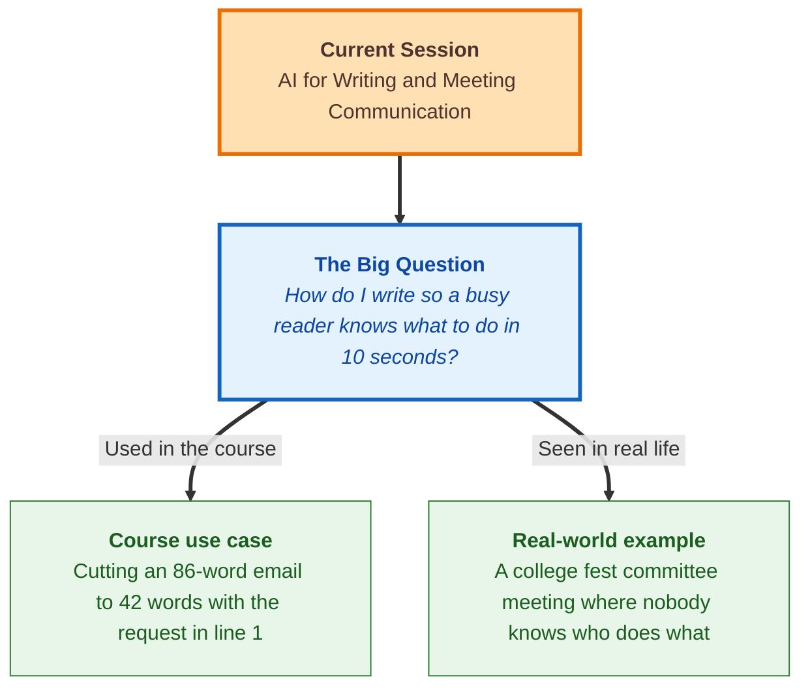

## AI for Writing and Meeting Communication

### Mental Map

---

### What You'll Learn

Have you ever wondered why a long group message gets 12 replies and still leaves everyone confused?

By the end of this session, you will be able to:

- **Apply** plain words to a technician's sentence so every member can act on it.
- **Write** the first line of a message that states the request.
- **Build** a meeting notice that shows each decision, its owner and the next step.
- **Plan** a 3-line update that shows progress, blockers and the help you need.

> **Topics you will meet:** Drafting a work email with the ask first, writing meeting notes with decisions, owners and next steps, writing a status update, rewriting a dense draft in your own voice, turning a rambling draft into a clear email, turning meeting notes into an action list in Notion.
>
> Join the session to learn each of these in detail.

---

### Why You Are Learning This Topic

Lata is the cultural secretary of her college fest committee. After Sunday's meeting, she sends a long message with the news.

The sound-system booking date is buried in line 9. Nobody knows who will call the supplier.

Three days later, the stage still has no speakers and 40 performers are waiting.

A **status update** means a short message that says what is done, what is stuck and what help you need.

You will use a chat tool to draft such messages, then check them.

> **Think about it:** Which single line should Lata have put first on Sunday evening?

---

### The Fest Committee Puzzle

Here is what the Sunday meeting decided.

| Decision | Who | By when |
|:----------:|:----------:|:----------:|
| Book the sound system | Imran | Saturday |
| Call the printing shop | Not decided | Not decided |
| Collect Rs 200 from each team | Lata | Next Sunday |
| Technician's note: "Amplifier output stage faulty, replace before the next load-in" | Technician | Not decided |

**What you want to happen:**

- The first line of the message states what you need.
- Each decision shows a name and a date.
- The technician's note is clear to a first-year student.

> **Wonder about this:**
>
> - Which row of the table has no owner, and what happens to it?
> - What would the technician's note say in words a classmate understands?

---

### Think It Through

There is no wrong first try. Keep your guesses for the session.

**1. Write Lata's first line in under 15 words. What does it ask for?**
Hint: Name the action, the person and the day.

**2. What should Lata write in the "Who" column for the printing shop call?**
Hint: Do not guess a name. Say what is still open.

**3. After 2 days, 3 of the 4 decisions are done. Which 3 parts belong in her update?**
Hint: One part is what is done, one is what is stuck, one is a request.

---

### One Question to Carry Into the Session

> **What does a reader need to see first to act on your message?**
>
> Which message of yours last week would you shorten to one line?
