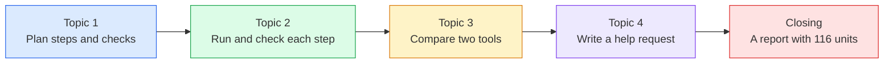
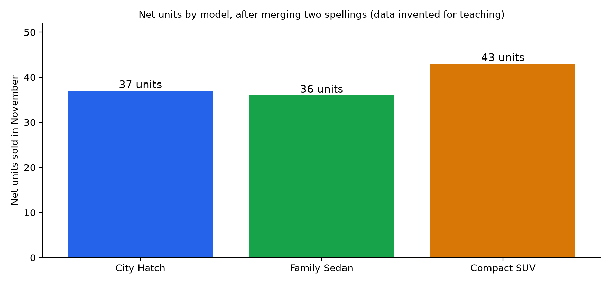
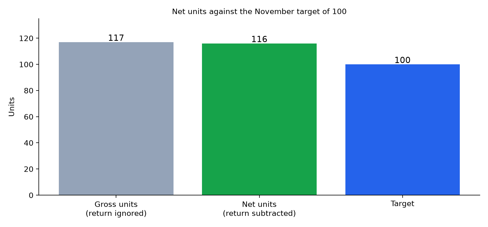

# <font color='#1d4ed8'>Lecture Script: Applied Mini-Project: A Day's Work With AI</font>

---

## <font color='blue'>Agenda</font>

The lecture runs as four topics. Each topic ends with a quiz.

| Topic | What we do | Learning objectives covered | Minutes |
|:-:|:--|:--|:-:|
| 1 | Plan the day's workflow with a check after every step | Design a multi-step generative AI workflow for an analysis or reporting task with a validation check after each step | 30 |
| 2 | Run the document, spreadsheet and writing steps in one tool | Applies the workflow designed in Topic 1 | 30 |
| 3 | Run one prompt in two tools and find the gaps | Compare one prompt's output across two models to identify model-specific instruction gaps | 20 |
| 4 | Write a help request when AI cannot finish | Write a help request stating what was attempted, what was expected and what happened | 25 |
| — | Closing: Outcome & Summary | | 15 |
| | **Total** | | **120** |

> <font color="red">**🎯 Instructor Note**</font> Pace: Topic 1 sets the plan and Topic 2 is mostly live work. Topic 3 is short, so keep each tool's table quick.
> Learners need free accounts for ChatGPT, Claude and Gemini, plus the files `data/incentive_note.txt` and `data/november_sales.csv`. Model replies are never pasted here. Run each step live and fill the tables.

---

## <font color='blue'>Scenario</font>

**One report, four steps.** Harpreet manages sales at a Maruti-style car dealership. By 30 November she must send her general manager one report.

1. Read the incentive note (a document task).
2. Total units and revenue by model from the sales file (a spreadsheet task).
3. Work out her bonus (a small analysis).
4. Write the email to the general manager (a writing task).

The risk is that a wrong number in step 2 flows into steps 3 and 4 and ends up in the email.

> <font color="red">**🎯 Instructor Note**</font> The company is only the setting. Do not claim it works this way. The dealership, the note, the 31 rows and every figure are invented for teaching. Today is a Monday in November 2026.

---

## <font color='blue'>Problem Statement</font>

Harpreet asks one tool to do the whole report in a single prompt. The tool counts the returned car as a sale and treats "compact suv" as a fourth model. The email states 117 units and a bonus of Rs 34,000. The real figures are 116 units and Rs 32,000. The general manager approves the wrong payout and asks why the numbers changed.

Earlier sessions taught chaining, grounding and spreadsheet checks. Today Harpreet combines them into one day's workflow.

> <font color='purple'>**How does Harpreet design a workflow with a check after each step, compare two tools to find where an instruction was missed, and ask for help when AI cannot finish?**</font>

> <font color="red">**🎯 Instructor Note**</font> Poll: "If step 2 gives a wrong total, will the email in step 4 still be right?" Options: yes or no. Give learners 30 seconds to respond in chat. Reveal the answer in the Closing.

---

## <font color='blue'>What We Will Use</font>

One free chat tool for the main run and a second free tool for the comparison. Check each tool's current screen for how to attach a file, or paste the text.

| Topic | Tools | In one line |
|:-:|:--|:--|
| 1 | Chat tool | Plan ordered steps and the check that follows each one |
| 2 | Chat tool, the CSV and the note | Run each step and apply its check |
| 3 | Two chat tools | Run the same prompt twice and list where the outputs differ |
| 4 | Chat tool | Write a help request with three parts |

---

## <font color='blue'>How: Walking Through Harpreet's Report</font>



---

## <font color='blue'>Topic 1: Plan the day's workflow with a check after every step</font> `30 min`

> <font color='purple'>**One giant prompt hid the error. What does the workflow look like when every step has its own check?**</font>

### <font color='green'>Example: Four steps, four checks</font>

> <font color='purple'>**What must each step produce, and how do we know it is right before the next step uses it?**</font>

A **workflow** is a list of ordered steps. Each step takes the output of the one before it. A **validation check** is a test you run on a step's output before it moves on.

| Step | Task | Prompt asks for | Validation check |
|:-:|:--|:--|:--|
| 1 | Document | Summarise the incentive note in 4 bullets | Each bullet matches a numbered line of the note |
| 2 | Spreadsheet | Net units and revenue by model from the CSV | Model units add up to the sum of the Units column |
| 3 | Analysis | Bonus from net units and the note's rules | Recompute by hand |
| 4 | Writing | An email under 80 words to the general manager | Every number appears in steps 2 or 3 |

> <font color="red">**🎯 Instructor Note**</font> Ask learners which step they trust least and why. Give learners 30 seconds to respond in chat. Expected: step 2, because the data has odd rows.

> <font color='green'>**Result**</font> A step is finished only when its check passes. The next step uses the checked output, never the raw reply.

#### <font color='#c2410c'>Logic Explanation</font>

- A check is written before the run. It states what a correct output looks like.
- Putting the check right after the step keeps one error from reaching the email.

### <font color='green'>Extending it: Run step 1 on the note</font>

> <font color='purple'>**Does the tool's summary match the note line by line?**</font>

> <font color="red">**🎯 Instructor Note**</font> Learners attach `incentive_note.txt`, or paste it, and ask: "Summarise this note in 4 bullets, one per numbered line. Use only the note." Compare each bullet with lines 1 to 4. Do not predict the wording.

| Bullet from the tool | Matches line | Pass or Fail (learners fill) |
|:--|:-:|:-:|
| | 1 | |
| | 2 | |
| | 3 | |
| | 4 | |

> <font color='green'>**Result**</font> Four Passes means the facts are safe to carry forward: target 100, bonus Rs 2,000 per extra unit, returns subtracted, report due 30 November.

> <font color='#b45309'>**Common mistake**</font> Running all four steps and checking only the email. Fix: check after each step, not only at the end.

### <font color='purple'>Quiz 1</font>

**Question:** Why does the workflow put a check after each step?

**Options:**
- A) To make the prompts longer
- B) To stop an error in one step from flowing into the next
- C) To avoid using the chat tool
- D) To replace the final email

**Correct Answer:** B

**Explanation:**
- **A)** Length is not the aim. Catching errors is.
- **B)** Correct. A checked output is safe to pass on.
- **C)** The tool is still used. The checks test its output.
- **D)** The check does not replace any step. It tests the step before it.

---

## <font color='blue'>Topic 2: Run the document, spreadsheet and writing steps in one tool</font> `30 min`

> <font color='purple'>**The plan is ready and step 1 has passed. What happens when the same chat takes on the CSV, the bonus and the email?**</font>

### <font color='green'>Example: step 2, the spreadsheet task</font>

> <font color='purple'>**What numbers should the check expect?**</font>

```
1. Task: Total net units and revenue by Model from the attached CSV.
2. Context: Each row is one sale. Units can be negative for a return. Price_Rs is per unit.
3. Format: One table with Model, Net units, Revenue in Rs, then the grand total.
4. Constraints: Use only the file. Treat "Compact SUV" and "compact suv" as one model.
```

> <font color="red">**🎯 Instructor Note**</font> Learners attach `november_sales.csv` and run the prompt. Do not predict the table. Compare it with the expected values and run the row-total check.

The expected values, worked out from the file by a separate check:

| Model | Net units | Revenue in Rs |
|:--|:-:|:-:|
| City Hatch | 37 | 2,40,50,000 |
| Family Sedan | 36 | 3,52,80,000 |
| Compact SUV | 43 | 4,81,60,000 |
| **Total** | **116** | **10,74,90,000** |

$$37 + 36 + 43 = 116$$

<p align="center"></p>

> <font color='green'>**Result**</font> The check passes if the model units add up to 116 and the file has 31 rows, with one return of one Family Sedan.

#### <font color='#c2410c'>Logic Explanation</font>

- The return row has Units of -1, so it lowers Family Sedan from 37 to 36 net units.
- If the tool treats "compact suv" as a separate model, it shows 4 models: Compact SUV with 39 units and a separate "compact suv" with 4.

### <font color='green'>Extending it: the bonus and the email</font>

> <font color='purple'>**How do the checked numbers flow into the bonus and the email?**</font>

The bonus follows the note: Rs 2,000 for each unit above 100.

$$\boxed{ \text{bonus} = (\text{net units} - 100) \times 2000 = (116 - 100) \times 2000 = 32{,}000 }$$

<p align="center"></p>

```
1. Task: Write an email to the general manager with the November result.
2. Context: Net units 116. Target 100. Bonus Rs 32,000. Report due 30 November.
3. Format: Subject line, the main number in the first line, 3 bullets, under 80 words.
4. Constraints: Use only these figures. Do not add any other number.
```

> <font color="red">**🎯 Instructor Note**</font> Learners run the email prompt in the same chat and check every number against the context line. Do not predict the email. Any number that is not in the context line is a Fail.

> <font color='green'>**Result**</font> A passing email uses 116, 100, Rs 32,000 and 30 November, and nothing else. The one fixed context line keeps step 4 tied to the checked steps.

> <font color='#b45309'>**Common mistake**</font> Ignoring the return and reporting 117 units. Fix: step 3's check recomputes the bonus by hand, so an ignored return shows as Rs 34,000 against Rs 32,000.

### <font color='purple'>Quiz 2</font>

**Question:** The gross units are 117 and one car was returned. What are the net units and the bonus?

**Options:**
- A) 117 units and Rs 34,000
- B) 116 units and Rs 34,000
- C) 117 units and Rs 32,000
- D) 116 units and Rs 32,000

**Correct Answer:** D

**Explanation:**
- **A)** It ignores the return, so units and bonus are both too high.
- **B)** The units are right but the bonus used 117.
- **C)** The bonus is right for 116, but 117 units is the gross figure.
- **D)** Correct. $117 - 1 = 116$ and $(116 - 100) \times 2000 = 32{,}000$.

---

## <font color='blue'>Topic 3: Run one prompt in two tools and find the gaps</font> `20 min`

> <font color='purple'>**step 2 passed in one tool. Would a second tool follow the same instructions?**</font>

### <font color='green'>Example: The same prompt, two tools</font>

> <font color='purple'>**Which instructions does each tool follow, and which does it miss?**</font>

An **instruction gap** is an instruction that one tool follows and another misses. A gap points to the instruction that needs to be clearer.

> <font color="red">**🎯 Instructor Note**</font> Learners run the Topic 2 step 2 prompt in two tools, for example ChatGPT and Gemini, and fill the table from the screen. Do not name a winner in advance.

| Instruction in the prompt | Tool A (learners fill) | Tool B (learners fill) |
|:--|:-:|:-:|
| Merged "compact suv" into Compact SUV | | |
| Subtracted the return (net 116) | | |
| One table with a grand total | | |
| Used only the file | | |

> <font color='green'>**Result**</font> A tick in one column and a cross in the other marks a model-specific gap. Both columns crossed means the instruction itself is unclear.

#### <font color='#c2410c'>Logic Explanation</font>

- Different tools use different models, so the same words can lead to different outputs.
- Fix a gap by naming the missed instruction more plainly, for example "Merge any two spellings of one model before counting."

### <font color='green'>Extending it: Close the gap</font>

> <font color='purple'>**How do we sharpen the prompt for the tool that missed an instruction?**</font>

> <font color="red">**🎯 Instructor Note**</font> Learners add one sentence to the prompt for the tool that missed a row, then rerun and tick again. Give learners 30 seconds to respond in chat with whether the gap closed.

> <font color='green'>**Result**</font> A gap that closes after one clearer sentence was a wording problem. A gap that stays open is a limit to report in a help request.

> <font color='#b45309'>**Common mistake**</font> Concluding that one tool is "better". Fix: say which instruction each tool missed on this task.

### <font color='purple'>Quiz 3</font>

**Question:** Tool A merges "compact suv" into Compact SUV and Tool B shows it as a fourth model. What is this?

**Options:**
- A) A model-specific instruction gap
- B) A mistake in the CSV that no prompt can fix
- C) Proof that Tool A is always better
- D) Proof that the instruction is unnecessary

**Correct Answer:** A

**Explanation:**
- **A)** Correct. One tool followed the instruction and the other missed it.
- **B)** The CSV is the same for both tools, and one handled it.
- **C)** One task cannot prove that. It shows one gap.
- **D)** The instruction was needed, since Tool B missed the merge without it.

---

## <font color='blue'>Topic 4: Write a help request when AI cannot finish</font> `25 min`

> <font color='purple'>**After one clearer sentence, Tool B still shows 4 models. Whom does Harpreet ask, and what does she tell them?**</font>

### <font color='green'>Example: Three parts of a help request</font>

> <font color='purple'>**What does a helper need to see to fix the problem quickly?**</font>

A help request states **what was attempted**, **what was expected** and **what happened**.

| Part | Weak version | Clear version |
|:--|:--|:--|
| Attempted | "I tried the tool." | "I attached november_sales.csv and asked for net units by Model, merging two spellings." |
| Expected | "A correct table." | "3 models and 116 net units." |
| Happened | "It is wrong." | "4 models and 117 net units. I added a sentence to merge spellings and the result stayed the same." |

> <font color="red">**🎯 Instructor Note**</font> The clear version is an example written for teaching. Learners write their own request from their Topic 3 table. Give learners 30 seconds to respond in chat with one part.

> <font color='green'>**Result**</font> A clear request lets the helper reproduce the problem without a second question.

#### <font color='#c2410c'>Logic Explanation</font>

- "Attempted" shows what has already been tried, so nobody repeats it.
- "Expected" and "happened" put the gap in numbers, which is easier to see than a feeling.

### <font color='green'>Extending it: Fix a weak request</font>

> <font color='purple'>**What is missing from "The tool gave me the wrong total. Please help."?**</font>

> <font color="red">**🎯 Instructor Note**</font> Ask learners to type the missing part. Expected: all three, since it names no file, no expected total and no result.

> <font color='green'>**Result**</font> Rewrite it with the three parts and a number in each.

> <font color='#b45309'>**Common mistake**</font> Sending a screenshot with no words. Fix: add the three parts in text so the helper knows what to look for.

### <font color='purple'>Quiz 4</font>

**Question:** Which sentence is the "what was expected" part of a help request?

**Options:**
- A) "I attached the CSV and asked for units by model."
- B) "It did not work."
- C) "I expected 3 models and 116 net units."
- D) "The tool showed 4 models and 117 units."

**Correct Answer:** C

**Explanation:**
- **A)** It describes what was attempted.
- **B)** It is vague and gives no expected result.
- **C)** Correct. It states the result the user expected, in numbers.
- **D)** It describes what happened.

---

## <font color='blue'>Closing: Outcome & Summary</font> `15 min`

Back to Harpreet. We answer the Problem Statement using each topic once.

> <font color='purple'>**1. How does she design the day? (Topic 1)**</font>

Four ordered steps, each with a check: bullets match the note, units add up, the bonus is recomputed, and every email number comes from earlier steps.

> <font color='purple'>**2. How does she run it? (Topic 2)**</font>

She runs each step in one tool and applies its check. The checked figures are 116 units and Rs 32,000.

> <font color='purple'>**3. How does she find a tool-specific problem? (Topic 3)**</font>

She runs the same prompt in two tools and lists the instruction one tool missed.

> <font color='purple'>**4. What does she do when AI cannot finish? (Topic 4)**</font>

She writes a help request with what she attempted, what she expected and what happened.

### <font color='green'>Outcome</font>

| | One giant prompt | Workflow with checks |
|:--|:-:|:-:|
| Units in the email | 117 | 116 |
| Bonus in the email | Rs 34,000 | Rs 32,000 |
| Where the error is found | After the email is sent | At step 2 or step 3 |
| If stuck | "It is wrong" | A three-part help request |

> <font color='green'>**Therefore,**</font> Harpreet splits the day into steps with checks, finds the gaps by running the same prompt in two tools, and asks for help in a way that can be answered. The email now carries 116 units and Rs 32,000.

> <font color="red">**🎯 Instructor Note**</font> Reveal the poll: no. A wrong total in step 2 flows into the email unless a check stops it.

### <font color='green'>Summary</font>

| Learning objective | Takeaway |
|:--|:--|
| Multi-step workflow | Order the steps and put a validation check after each one |
| Compare two tools | Run one prompt twice and list the instruction one tool missed |
| Help request | State what was attempted, what was expected and what happened |
| **Practical value** | A checked workflow and a clear help request save time and keep wrong numbers out of reports |

---

# <font color='red'>Launch the Feedback Poll</font>

> <font color="red">**🎯 Instructor Note**</font> Reminder: launch the feedback poll now to collect learner feedback.
