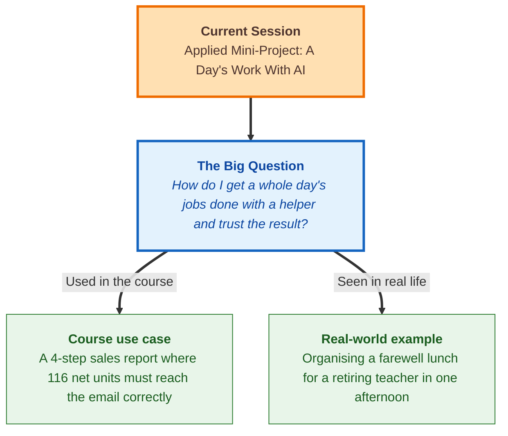

## Applied Mini-Project: A Day's Work With AI

### Mental Map

---

### What You'll Learn

Have you ever wondered how to finish an invitation, a budget and a caterer quote in one afternoon?

By the end of this session, you will be able to:

- **Use** one helper for 3 lunch jobs: a hall rules note, a budget sheet and an invitation.
- **Compare** the quotes from 2 caterers and spot what each one leaves out.
- **Design** an ordered plan for the afternoon with a check after every job.
- **Write** a short message that tells the tent supplier what you tried, what you expected and what happened.

> **Topics you will meet:** Running a document task, a spreadsheet task and a writing task through one tool, designing the day's workflow as ordered steps with a check after each, comparing one task across two tools, writing a help request.
>
> Join the session to learn each of these in detail.

---

### Why You Are Learning This Topic

Divya is organising a farewell lunch for a retiring teacher on Saturday. She has Rs 5,000 and one afternoon.

She asks a friend to help with everything at once. The friend sends back a caterer order, a budget and an invitation.

The budget adds up to Rs 5,400. The invitation says Sunday. Nobody checked any of it.

A **workflow** means a list of jobs in a set order, where each job uses the result before it.

In this course, you will run a whole day of work through a chat tool in this way.

> **Think about it:** At which job should Divya have stopped and checked first?

---

### The Farewell Lunch Puzzle

Here are Divya's 4 jobs and what she gets for each.

| Job | What the helper gives | Check Divya can run |
|:----------:|:----------:|:----------:|
| 1. Hall rules note | 4-line summary | Match each line to the note |
| 2. Budget | Total Rs 5,400 | Add the items by hand |
| 3. Invitation | Says Sunday | Compare with the date she told the helper |
| 4. Lunch | Caterer A Rs 1,200, Caterer B Rs 1,350 | Ask what each price includes |

**What you want to happen:**

- Each job gets a check before the next one starts.
- Two caterers answer the same question, so you can compare them.
- A tent supplier who cannot deliver gets a message that says what happened.

> **Wonder about this:**
>
> - Which job's result feeds the next job in this plan?
> - Why might the 2 caterers give different answers to the same question?

---

### Think It Through

There is no wrong first try. Keep your guesses for the session.

**1. The budget total is Rs 5,400 and Divya has Rs 5,000. What should she do before the invitation?**
Hint: Fix the number first. The invitation may quote it.

**2. Caterer A says Rs 1,200 and Caterer B says Rs 1,350. What one question makes the prices comparable?**
Hint: Think about delivery.

**3. The tent supplier did not arrive. Which 3 facts should her message hold?**
Hint: One fact is what she tried, one is what she expected, one is what happened.

---

### One Question to Carry Into the Session

> **What check would you place after each job so a mistake cannot travel to the next one?**
>
> Which job from your own week would you check twice?
