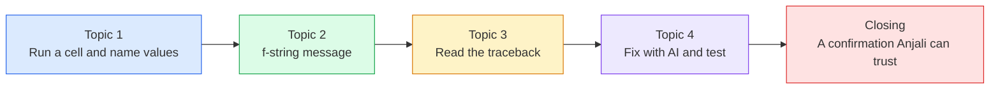
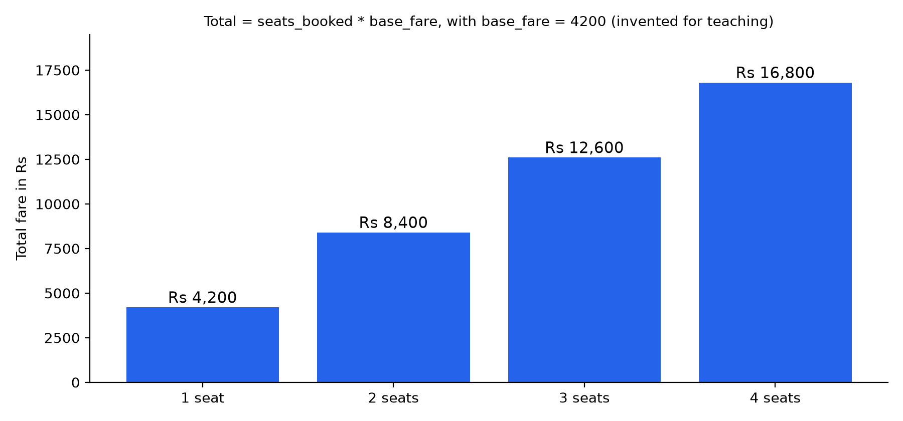
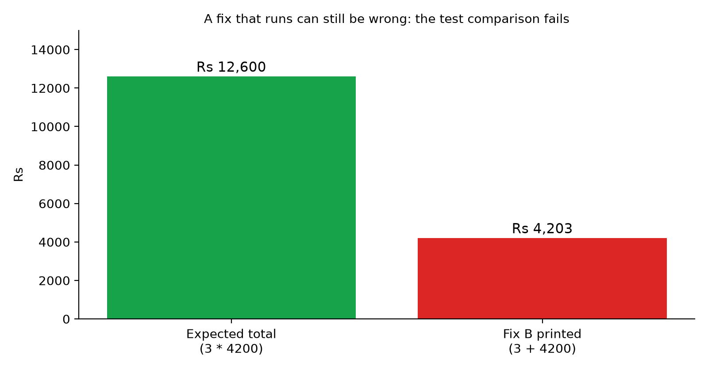

# <font color='#1d4ed8'>Lecture Script: Python Basics for Working With AI</font>

---

## <font color='blue'>Agenda</font>

The lecture runs as four topics. Each topic ends with a quiz.

| Topic | What we do | Learning objectives covered | Minutes |
|:-:|:--|:--|:-:|
| 1 | Run a cell in Colab and store values in variables | Write a script that stores values in named variables following Python naming conventions | 25 |
| 2 | Build messages with f-strings | Format a string using f-strings with embedded expressions | 25 |
| 3 | Read an error message | Interpret a Python traceback to locate the failing line | 30 |
| 4 | Fix an error with an AI tool and test the fix | Debug a failing script, query or formula with an AI tool's fix, testing it before accepting | 25 |
| — | Closing: Outcome & Summary | | 15 |
| | **Total** | | **120** |

> <font color="red">**🎯 Instructor Note**</font> Pace: Topics 1 and 2 are short code runs. Spend the extra minutes on reading tracebacks in Topic 3 and on the live fix and test in Topic 4.
> Learners need a Google account for Colab and one free chat tool. Every output below came from a real Python 3.14 run. Colab's error display adds its own file name text, but the error type, message and line number match.

---

## <font color='blue'>Scenario</font>

Anjali works at the booking desk of an IndiGo-style airline. At 6 pm she must send booking confirmations for flight IG-204. She copies a short Python script from a colleague to build each confirmation line.

The script crashes with a wall of red text. Anjali pastes the whole script into a chat tool and asks, "Fix this." The tool returns a version that no longer crashes. She runs it and sends 40 confirmations.

> <font color="red">**🎯 Instructor Note**</font> The company is only the setting. Do not claim it works this way. The airline, the flight, the fare and the passengers are invented for teaching. No real booking data is used.

---

## <font color='blue'>Problem Statement</font>

The next morning, passengers write that their confirmation says "Total: Rs 4203". The fare is Rs 4,200 a seat and each booking has 3 seats, so the total should be Rs 12,600. The fix removed the crash but also changed the arithmetic, and nobody tested the result.

Earlier sessions taught you to check an AI answer against a source. Today the check is running the code and comparing its output with a number you work out yourself.

> <font color='purple'>**How does Anjali store her booking values, build a clear message, read the crash report, and accept an AI's fix only after she has tested it?**</font>

> <font color="red">**🎯 Instructor Note**</font> Poll: "If an AI's fix runs without an error, is the output right?" Options: yes or no. Give learners 30 seconds to respond in chat. Reveal the answer in the Closing.

---

## <font color='blue'>What We Will Use</font>

Google Colab for Python and one free chat tool (ChatGPT, Claude or Gemini). A Colab notebook holds **cells**. You type code in a cell and run it, and the output appears below it. Check Colab's current screen for the run button and the keyboard shortcut.

| Topic | Tools | In one line |
|:-:|:--|:--|
| 1 | Colab cell, variables | Store values under names and print them |
| 2 | f-strings | Put values and calculations inside a sentence |
| 3 | Traceback | Read the last line, then the line number |
| 4 | Chat tool, a test | Ask for a fix, then test it against a number you know |

---

## <font color='blue'>How: Walking Through Anjali's Confirmation Script</font>



---

## <font color='blue'>Topic 1: Run a cell in Colab and store values in variables</font> `25 min`

> <font color='purple'>**Anjali's script starts with four values about one booking. How are values stored so the rest of the script can use them?**</font>

### <font color='green'>Example: Four variables in one cell</font>

> <font color='purple'>**How do we store a flight code, a name, a seat count and a fare?**</font>

A **variable** is a name that points to a value. You create one with `=`. A **cell** is one block of code in Colab. Run it and the output appears below.

**Predict before running: What will happen?**

> <font color="red">**🎯 Instructor Note**</font> Expected: one line with the four values separated by spaces. Common wrong guess: the variable names are printed. `print` shows the values.

```python
flight_code = "IG-204"
passenger_name = "Anjali Rao"
seats_booked = 3
base_fare = 4200
print(flight_code, passenger_name, seats_booked, base_fare)
```

**Output**

```
IG-204 Anjali Rao 3 4200
```

#### <font color='#c2410c'>Code Explanation</font>

- **Lines 1 to 2** Text values go inside quotes. Python calls them strings.
- **Lines 3 to 4** Numbers have no quotes. `seats_booked` is a whole number and `base_fare` is a whole number.
- **Line 5** `print` shows each value, with a space between them.

> <font color='green'>**Result**</font> Four names now hold four values, and later cells can use them.

### <font color='green'>Extending it: Which names are allowed?</font>

> <font color='purple'>**Why did the colleague's script use `base_fare` and not `Base Fare`?**</font>

Python names follow rules and a convention. The rules are enforced. The convention is what readers expect.

> <font color="red">**🎯 Instructor Note**</font> Ask learners to type "valid" or "invalid" for each of the five names before you run the cell. Expected: only `base_fare` and `BaseFare` are valid.

```python
import keyword
for name in ["base_fare", "1st_fare", "base fare", "class", "BaseFare"]:
    print(name, name.isidentifier() and not keyword.iskeyword(name))
```

**Output**

```
base_fare True
1st_fare False
base fare False
class False
BaseFare True
```

#### <font color='#c2410c'>Code Explanation</font>

- **Line 1** `keyword` is a built-in module that knows Python's reserved words.
- **Line 2** The loop checks each name in the list. Learners only need to read the results.
- **Line 3** `True` means Python accepts the name. It must not start with a digit, hold a space or be a reserved word such as `class`.

| Name | Allowed? | Follows the convention? |
|:--|:-:|:-:|
| `base_fare` | Yes | Yes: lowercase words joined by underscores |
| `BaseFare` | Yes | No: the convention is lowercase with underscores |
| `1st_fare` | No | Starts with a digit |
| `base fare` | No | Has a space |
| `class` | No | Reserved word |

> <font color='green'>**Result**</font> Use lowercase words joined by underscores, and pick a name that says what the value is, such as `seats_booked`.

> <font color='#b45309'>**Common mistake**</font> Short names such as `x` and `s`. Fix: a name should tell the next reader what the value means.

### <font color='purple'>Quiz 1</font>

**Question:** Which is a valid variable name that follows Python naming convention?

**Options:**
- A) `base fare`
- B) `1st_fare`
- C) `base_fare`
- D) `class`

**Correct Answer:** C

**Explanation:**
- **A)** A space is not allowed in a name.
- **B)** A name cannot start with a digit.
- **C)** Correct. It is valid, lowercase and joined by an underscore.
- **D)** `class` is a reserved word.

---

## <font color='blue'>Topic 2: Build messages with f-strings</font> `25 min`

> <font color='purple'>**Anjali's confirmation is a sentence with values inside it. How do we put values into a sentence without gluing pieces together by hand?**</font>

### <font color='green'>Example: An f-string with a calculation</font>

> <font color='purple'>**How does `f"..."` place values and an expression inside text?**</font>

An **f-string** starts with `f` before the opening quote. Anything inside `{ }` is worked out and placed in the text. The braces can hold a name or a calculation.

**Predict before running: What will happen?**

> <font color="red">**🎯 Instructor Note**</font> Expected: one sentence with the name, 3, IG-204 and 12600. Common wrong guess: the braces appear in the output. They do not.

```python
total_fare = seats_booked * base_fare
print(f"{passenger_name} booked {seats_booked} seats on {flight_code}. Total: Rs {total_fare}")
```

**Output**

```
Anjali Rao booked 3 seats on IG-204. Total: Rs 12600
```

#### <font color='#c2410c'>Code Explanation</font>

- **Line 1** Multiplies the two numbers and stores the result in `total_fare`. This cell reuses the variables from Topic 1.
- **Line 2** Each `{name}` is replaced by its value, so the sentence is built from the stored values.

> <font color='green'>**Result**</font> One f-string builds the whole confirmation line from the stored values.

### <font color='green'>Extending it: Format the number and add an expression</font>

> <font color='purple'>**How do we show Rs 12,600 with a comma and a fee with two decimals?**</font>

A colon inside the braces sets the format. `:,` adds thousands commas. `:.2f` shows two decimals.

> <font color="red">**🎯 Instructor Note**</font> The 5% service fee is invented for teaching. Ask learners to predict the grand total before the run. Expected: Rs 13,230.00.

```python
print(f"Total with commas: Rs {total_fare:,}")
service_fee = total_fare * 0.05
print(f"Service fee at 5%: Rs {service_fee:.2f}")
print(f"Grand total: Rs {total_fare + service_fee:,.2f}")
```

**Output**

```
Total with commas: Rs 12,600
Service fee at 5%: Rs 630.00
Grand total: Rs 13,230.00
```

#### <font color='#c2410c'>Code Explanation</font>

- **Line 1** `{total_fare:,}` formats the number with a comma.
- **Lines 2 to 3** The fee is 5% of the total, shown with two decimals.
- **Line 4** The braces hold a sum, `total_fare + service_fee`. Python works it out, then formats it.

### <font color='green'>Extending it: Change one variable and rerun</font>

> <font color='purple'>**What if Anjali's next booking has 4 seats?**</font>

```python
seats_booked = 4
print(f"{passenger_name} booked {seats_booked} seats. Total: Rs {seats_booked * base_fare:,}")
```

**Output**

```
Anjali Rao booked 4 seats. Total: Rs 16,800
```

<p align="center"></p>

> <font color='green'>**Result**</font> Changing one variable changes the whole message. The total grows by Rs 4,200 for each seat.

> <font color='#b45309'>**Common mistake**</font> Forgetting the `f` before the quote. Fix: without it, Python prints the braces as plain text.

### <font color='purple'>Quiz 2</font>

**Question:** With `seats_booked = 3` and `base_fare = 4200`, what does `print(f"Rs {seats_booked * base_fare:,}")` show?

**Options:**
- A) `Rs 12600`
- B) `Rs 12,600`
- C) `Rs {seats_booked * base_fare:,}`
- D) `Rs 3 * 4200`

**Correct Answer:** B

**Explanation:**
- **A)** It is missing the comma that `:,` adds.
- **B)** Correct. The braces work out $3 \times 4200 = 12600$ and `:,` adds the comma.
- **C)** That would print only if the `f` were missing.
- **D)** The expression is worked out, not printed as text.

---

## <font color='blue'>Topic 3: Read an error message</font> `30 min`

> <font color='purple'>**Anjali's script crashed with red text. Which part of that text matters first?**</font>

### <font color='green'>Example: A NameError</font>

> <font color='purple'>**What does the traceback say, and in what order do we read it?**</font>

A **traceback** is Python's report of where a script stopped. Read it from the bottom. The last line names the error type and the reason. The line above points to the failing line number.

**Predict before running: What will happen?**

> <font color="red">**🎯 Instructor Note**</font> Expected: an error on line 4 about a name that does not exist. The typo is `seat_booked` for `seats_booked`. Common wrong guess: that line 5 fails because it holds the `print`.

```python
flight_code = "IG-204"
seats_booked = 3
base_fare = 4200
total_fare = seat_booked * base_fare
print(f"Total: Rs {total_fare}")
```

**Output**

```
Traceback (most recent call last):
  File "cell.py", line 4, in <module>
    total_fare = seat_booked * base_fare
                 ^^^^^^^^^^^
NameError: name 'seat_booked' is not defined. Did you mean: 'seats_booked'?
```

#### <font color='#c2410c'>Code Explanation</font>

- **Last line** `NameError` is the type. The reason says `seat_booked` was never created.
- **Line above the arrows** shows the failing code. The `^` marks the name Python could not find.
- **`line 4`** is the line to open first. Lines 1 to 3 ran before it.

> <font color='green'>**Result**</font> The error is on line 4, and the name `seat_booked` has one letter too few.

### <font color='green'>Extending it: A TypeError</font>

> <font color='purple'>**What if the name is right but the value is the wrong kind?**</font>

> <font color="red">**🎯 Instructor Note**</font> Ask learners to find the line number and the error type in chat. Give learners 30 seconds to respond in chat. Expected: line 4, TypeError.

```python
seats_booked = 3
base_fare = 4200
total_fare = seats_booked * base_fare
print("Total: Rs " + total_fare)
```

**Output**

```
Traceback (most recent call last):
  File "cell.py", line 4, in <module>
    print("Total: Rs " + total_fare)
          ~~~~~~~~~~~~~^~~~~~~~~~~~
TypeError: can only concatenate str (not "int") to str
```

> <font color='green'>**Result**</font> The `+` tried to join text to a number. Python cannot add a string and an integer.

### <font color='green'>Extending it: A SyntaxError</font>

> <font color='purple'>**What if Python cannot even start the script?**</font>

```python
seats_booked = 3
base_fare = 4200
total_fare = seats_booked * base_fare
print(f"Total: Rs {total_fare:,}"
```

**Output**

```
  File "cell.py", line 4
    print(f"Total: Rs {total_fare:,}"
         ^
SyntaxError: '(' was never closed
```

> <font color='green'>**Result**</font> A SyntaxError stops the script before any line runs. Here the bracket on line 4 was never closed.

> <font color='#b45309'>**Common mistake**</font> Reading the top of the report first. Fix: start at the last line, then find the line number.

### <font color='purple'>Quiz 3</font>

**Question:** A traceback ends with `NameError: name 'seat_booked' is not defined` and shows `line 4`. What does it tell you?

**Options:**
- A) Line 5 has a bad `print`
- B) The notebook is not connected
- C) The number on line 4 is too large
- D) Line 4 uses a name that was never created, so check its spelling

**Correct Answer:** D

**Explanation:**
- **A)** The failing line is 4, and the script never reached line 5.
- **B)** A connection problem would show a different message.
- **C)** A NameError is about a missing name, not a large number.
- **D)** Correct. The type gives the kind of mistake, and the line gives where to look.

---

## <font color='blue'>Topic 4: Fix an error with an AI tool and test the fix</font> `25 min`

> <font color='purple'>**Anjali asked for a fix and sent 40 wrong totals. How should she have used the AI?**</font>

### <font color='green'>Example: Ask with the full evidence</font>

> <font color='purple'>**What should be in the message to the chat tool?**</font>

Use the four-part prompt you learned in the first session. Paste the code and the traceback.

```
1. Task: Fix the error in this script.
2. Context: Python in Google Colab. The script and the full error are pasted below.
3. Format: The fixed code in one block, then one sentence on the cause.
4. Constraints: Change only the failing line. Do not add new features.
```

> <font color="red">**🎯 Instructor Note**</font> Learners paste the TypeError script from Topic 3 plus its full traceback, then the prompt. Do not predict the fix. Read the real reply and note which line it changed.

> <font color='green'>**Result**</font> A prompt with the code, the full error and a limit on the change gets a narrow fix that can be tested.

### <font color='green'>Extending it: Test the fix before accepting it</font>

> <font color='purple'>**Two fixes both run without an error. Which one is right?**</font>

Anjali works out the expected line by hand: $3 \times 4200 = 12600$. Each candidate fix is compared with that expected text. The two candidates below are written for teaching, as a tool might suggest them.

**Predict before running: What will happen?**

> <font color="red">**🎯 Instructor Note**</font> Fix B changes the arithmetic from `*` to `+`. Expected: it prints Rs 4203 and the comparison says `False`. Ask learners to spot the changed symbol first.

```python
seats_booked = 3
base_fare = 4200
expected = "Total: Rs 12600"
message = "Total: Rs " + str(seats_booked + base_fare)
print(message)
print(message == expected)
```

**Output**

```
Total: Rs 4203
False
```

Now Fix A, which only wraps the number in `str(...)`:

```python
seats_booked = 3
base_fare = 4200
expected = "Total: Rs 12600"
message = "Total: Rs " + str(seats_booked * base_fare)
print(message)
print(message == expected)
```

**Output**

```
Total: Rs 12600
True
```

<p align="center"></p>

#### <font color='#c2410c'>Code Explanation</font>

- **Line 3** The expected text is worked out by hand before the test.
- **Line 4** `str(...)` turns the number into text so `+` can join it. Fix B also changed `*` to `+`.
- **Last line** `==` asks whether the two texts are identical. `False` rejects the fix.

> <font color='green'>**Result**</font> Fix A passes and Fix B fails, though both run. Accept a fix only after its output matches the number you worked out.

> <font color='#b45309'>**Common mistake**</font> Accepting a fix because the red text is gone. Fix: compare the output with a number you know. The same habit applies to a formula or a query.

### <font color='purple'>Quiz 4</font>

**Question:** An AI's fix runs without an error but prints Rs 4203 where you worked out Rs 12,600. What should you do?

**Options:**
- A) Reject the fix, because the test fails
- B) Accept it, because there is no error
- C) Accept it, because the tool sounded sure
- D) Delete your expected value

**Correct Answer:** A

**Explanation:**
- **A)** Correct. The output does not match your expected value, so the fix is wrong.
- **B)** No error does not mean a correct answer.
- **C)** Confidence is not proof.
- **D)** The expected value came from your own check and is what you test against.

---

## <font color='blue'>Closing: Outcome & Summary</font> `15 min`

Back to Anjali. We answer the Problem Statement using each topic once.

> <font color='purple'>**1. How does she store the booking? (Topic 1)**</font>

In named variables: `flight_code`, `passenger_name`, `seats_booked` and `base_fare`.

> <font color='purple'>**2. How does she build the message? (Topic 2)**</font>

With an f-string that places the values and the calculation inside the sentence.

> <font color='purple'>**3. How does she read a crash? (Topic 3)**</font>

Bottom line first for the type, then the line number to find the failing line.

> <font color='purple'>**4. How does she accept a fix? (Topic 4)**</font>

She asks with the code and the full error, then tests the result against 12,600.

Her whole script, with a test at the end:

```python
flight_code = "IG-204"
passenger_name = "Anjali Rao"
seats_booked = 3
base_fare = 4200
message = f"{passenger_name}, {flight_code}: {seats_booked} seats, Rs {seats_booked * base_fare:,}"
print(message)
print(message == "Anjali Rao, IG-204: 3 seats, Rs 12,600")
```

**Output**

```
Anjali Rao, IG-204: 3 seats, Rs 12,600
True
```

#### <font color='#c2410c'>Code Explanation</font>

- **Lines 1 to 4** Named variables from Topic 1.
- **Line 5** An f-string with an expression and a comma format from Topic 2.
- **Line 7** A test against the hand-worked line, the habit from Topic 4.

### <font color='green'>Outcome</font>

| | Anjali's 6 pm script | Anjali's script after today |
|:--|:-:|:-:|
| Total on the confirmation | Rs 4203 | Rs 12,600 |
| Names | Unclear | `seats_booked`, `base_fare` |
| Test before sending | None | Compared with the hand-worked line |

> <font color='green'>**Therefore,**</font> Anjali names her values, builds the line with an f-string, reads errors from the bottom up, and accepts an AI's fix only when its output matches the number she worked out. A fix that runs is not the same as a fix that is right.

> <font color="red">**🎯 Instructor Note**</font> Reveal the poll: no. Fix B ran with no error and still printed the wrong total.

### <font color='green'>Summary</font>

| Learning objective | Takeaway |
|:--|:--|
| Variables | Use lowercase names joined by underscores that say what the value is |
| f-strings | `{ }` places a value or a calculation inside text, and `:,` and `:.2f` format numbers |
| Traceback | Read the last line for the type, then the line number |
| Debug with AI | Give the code and the full error, then test the fix against a value you know |
| **Practical value** | Reading errors and testing fixes lets you use AI help on scripts without trusting it blindly |

---

# <font color='red'>Launch the Feedback Poll</font>

> <font color="red">**🎯 Instructor Note**</font> Reminder: launch the feedback poll now to collect learner feedback.
