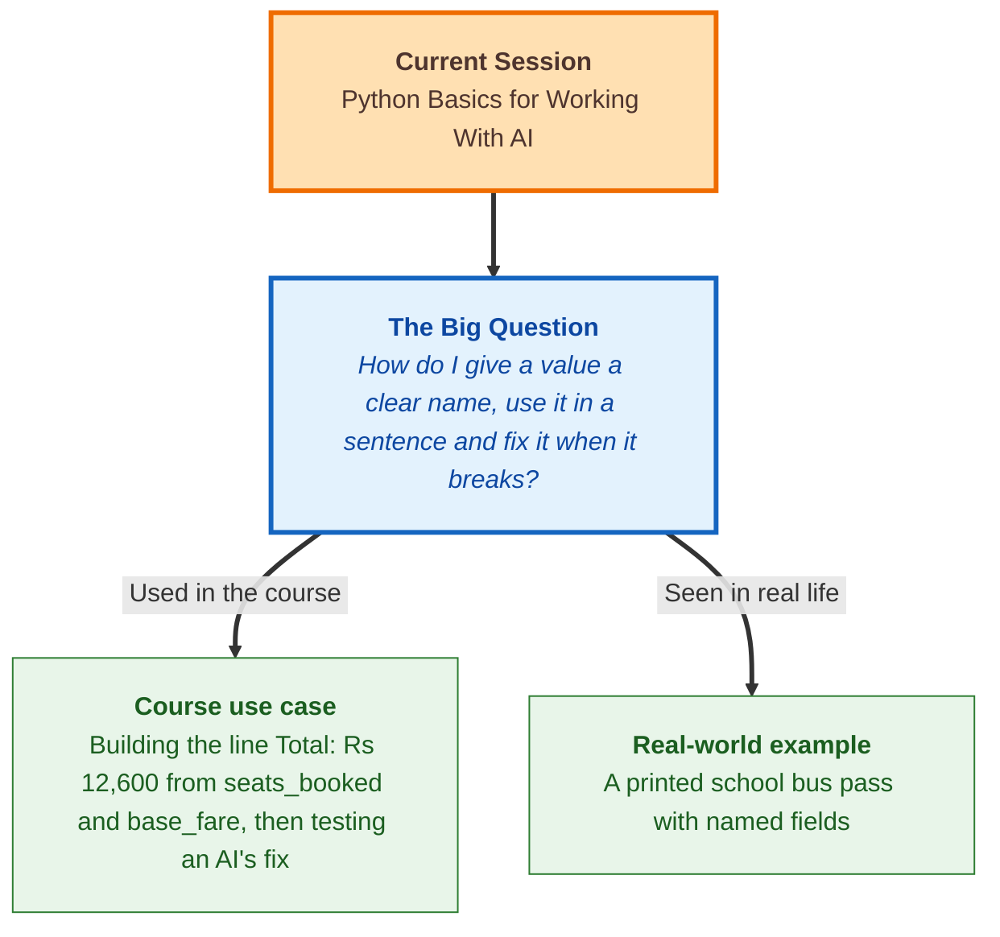

## <span style="color:#2F7DDE">Python Basics for Working With AI</span>

### <span style="color:#2F7DDE">Mental Map</span>



---

### <span style="color:#2F7DDE">What You'll Learn</span>

Have you ever wondered how a bus pass machine prints the right name and route on every card?

By the end of this session, you will be able to:

- <span style="color:#D9660B">**Name**</span> 4 fields on a bus pass so that a stranger can read them.
- <span style="color:#D9660B">**Interpret**</span> a printer note that says "field rout_number not found, line 4" and find the failing line.
- <span style="color:#D9660B">**Use**</span> blanks on the pass sentence to print "Riya, route 12, valid for November".
- <span style="color:#D9660B">**Check**</span> a friend's fix by printing one sample pass before you print 500.

> <span style="color:#2F7DDE">**Topics you will meet:**</span> Running a cell in Colab, variables, strings and f-strings, reading an error message, fixing an error with an AI tool and testing the fix before keeping it.
>
> Join the session to learn each of these in detail.

---

### <span style="color:#2F7DDE">Why You Are Learning This Topic</span>

A school office prints bus passes. Each pass has fields: student name, route number, month and fee.

The clerk, Meera, types a template with blanks. A machine fills each blank from a labelled field.

One day she types "rout_number", a spelling slip. The machine stops at line 4 with a note.

A <span style="color:#D9660B">**variable**</span> means a name that points to a value, like a field label pointing to what is written.

You will write short Python scripts with named values. You will read the notes Python gives when it stops.

> <span style="color:#2F7DDE">**Think about it:**</span> Why does a clear field label save Meera time on the next pass?

---

### <span style="color:#2F7DDE">The Bus Pass Puzzle</span>

Here is one pass and its fields.

| Field label | Value on the pass |
|:----------:|:----------:|
| student_name | Riya |
| route_number | 12 |
| month_name | November |
| fee_rs | 450 |

<span style="color:#D9660B">**What you want to happen:**</span>

- Each blank on the pass is filled from the right field.
- A wrong label gives a note that tells you the line.
- A friend's fix is tested on one sample pass first.

Here is how it might start. You do not need to understand it yet.

```python
student_name = "Riya"
print(f"Pass for {student_name}, route 12")
```

> <span style="color:#D9660B">**Wonder about this:**</span>
>
> - What would the pass say if you changed "Riya" to another name in line 1?
> - What would happen if line 2 asked for `studnt_name` instead?

---

### <span style="color:#2F7DDE">Think It Through</span>

There is no wrong first try. Keep your guesses for the session.

**1. Which label is easier to understand on a pass: `x` or `student_name`?**
Hint: Think of someone who has never seen the school office.

**2. The printer note says "field rout_number not found, line 4". Which line do you open first?**
Hint: The note already names the line.

**3. A friend relabels the field, and the pass now says "fee Rs 540". How do you check that fix?**
Hint: Compare it with the 450 on the fee list.

---

### <span style="color:#2F7DDE">One Question to Carry Into the Session</span>

> <span style="color:#2F7DDE">**How do you decide a fix is right and not only quiet?**</span>
>
> What would you measure before you accept it?
