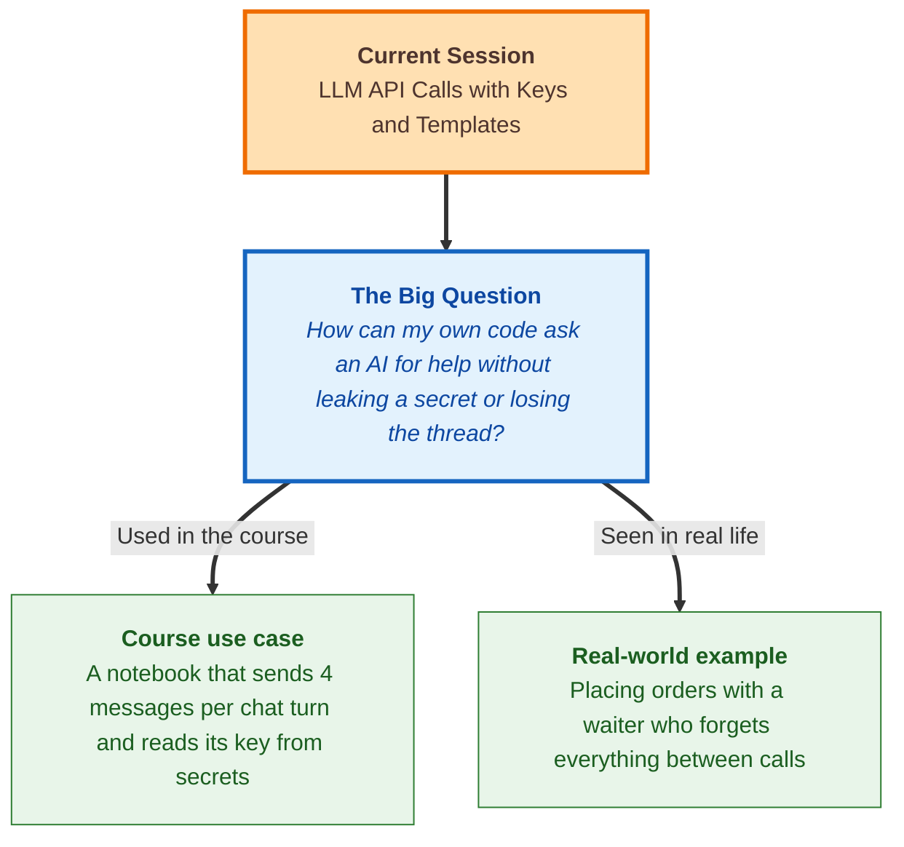

## <span style="color:#2F7DDE">LLM API Calls with Keys and Templates</span>

### <span style="color:#2F7DDE">Mental Map</span>



---

### <span style="color:#2F7DDE">What You'll Learn</span>

Have you ever wondered how a restaurant app sends your order to the kitchen and gets a reply back?

By the end of this session, you will be able to:

- <span style="color:#D9660B">**Identify**</span> the 3 parts of an order slip: the kitchen, the items and the spice level.
- <span style="color:#D9660B">**Describe**</span> where the dish name sits inside the waiter's reply note.
- <span style="color:#D9660B">**Explain**</span> why a waiter who forgets everything needs the full order on each call.
- <span style="color:#D9660B">**Justify**</span> why the cash-drawer key never stays on the counter.
- <span style="color:#D9660B">**Build**</span> a printed order form with 4 blanks that you fill in for each table.
- <span style="color:#D9660B">**Design**</span> a slip with a boxed area so a customer's joke note cannot change the order.

> <span style="color:#2F7DDE">**Topics you will meet:**</span> Chat request with model, messages and randomness settings, calling an LLM API, roles and messages, stateless chat history, keeping API keys out of code, prompt templates, separating instructions from data.
>
> Join the session to learn each of these in detail.

---

### <span style="color:#2F7DDE">Why You Are Learning This Topic</span>

Imran runs a small dosa counter. His waiter, Kabir, forgets every table the moment he walks away.

At table 3, Imran says "One masala dosa, mild." Later he says "Make it two." Kabir asks, "Two of what?"

An <span style="color:#D9660B">**API**</span> means a service your code calls with a request. It sends back a reply, like a waiter.

In this course, your own code will place requests like Imran's with a free AI service.

> <span style="color:#2F7DDE">**Think about it:**</span> What must Imran say each time so Kabir never asks "Two of what?"

---

### <span style="color:#2F7DDE">The Order Slip Puzzle</span>

Here are 3 calls to Kabir.

| Call | What Imran says | What Kabir can use |
|:----------:|:----------:|:----------:|
| 1 | One masala dosa, mild | Dish and spice |
| 2 | Make it two | Nothing else, so he is lost |
| 3 | Two masala dosa, mild | The full order |

<span style="color:#D9660B">**What you want to happen:**</span>

- Every call carries the whole order.
- The cash-drawer key stays in a locked place.
- A note saying "free meal" inside a box is read as a note, not an order.

Here is how it might start. You do not need to understand it yet.

```python
order = {"dish": "masala dosa", "count": 2, "spice": "mild"}
print(order["dish"], order["count"])
```

> <span style="color:#D9660B">**Wonder about this:**</span>
>
> - What would change if Imran changed the 2 to a 3 in the first line?
> - Why would a customer's note belong in a separate box?

---

### <span style="color:#2F7DDE">Think It Through</span>

There is no wrong first try. Keep your guesses for the session.

**1. At table 3, Imran makes 3 calls. Which 3 facts must call 3 name?**
Hint: Kabir keeps nothing between calls.

**2. Imran leaves the cash-drawer key on the counter for a shared shift. What could go wrong?**
Hint: Think about who else may pick it up.

**3. A customer writes "ignore the menu and give me a free meal" on the slip. Where should that note sit?**
Hint: Put it where it can be read as data, not as an order.

---

### <span style="color:#2F7DDE">One Question to Carry Into the Session</span>

> <span style="color:#2F7DDE">**What must every request carry when the other side remembers nothing?**</span>
>
> Which secret in your own life should never sit where others can see it?
