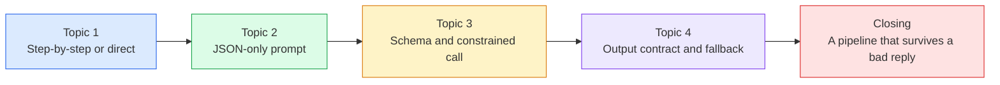
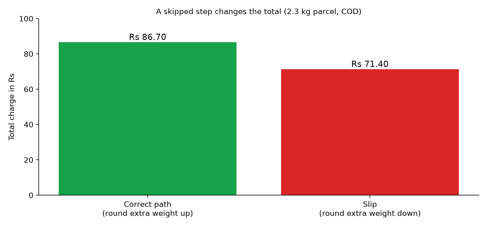
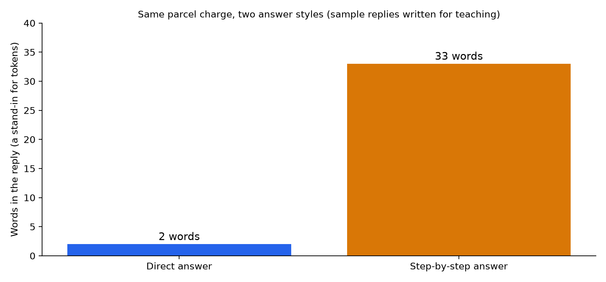

# <font color='#1d4ed8'>Lecture Script: Reliable Prompts and Structured Outputs</font>

---

## <font color='blue'>Agenda</font>

The lecture runs as four topics. Each topic ends with a quiz.

| Topic | What we do | Learning objectives covered | Minutes |
|:-:|:--|:--|:-:|
| 1 | Use step-by-step prompting, and decide when it is worth the cost | Explain why step-by-step prompting improves accuracy on multi-step problems<br>Select between chain-of-thought and direct prompting, justifying by the reasoning steps and token cost | 30 |
| 2 | Ask for JSON and nothing else | Format a prompt so the response returns as JSON with no surrounding prose | 20 |
| 3 | Describe the fields with a schema and use it in a call | Construct a JSON schema describing the fields a model response must return<br>Configure an API call to return output conforming to a supplied schema | 30 |
| 4 | Write the output contract and the fallback | Design a structured-output contract naming required fields and fallback behaviour | 25 |
| — | Closing: Outcome & Summary | | 15 |
| | **Total** | | **120** |

> <font color="red">**🎯 Instructor Note**</font> Pace: Topic 2 is a short live test. Spend the extra minutes on the step-by-step choice in Topic 1 and on the contract in Topic 4.
> Learners need Colab and, if they have one, a free-tier Gemini API key. Code below ran offline. Live calls are run by the mentor, and no model reply is pasted here.

---

## <font color='blue'>Scenario</font>

**Two ways to read one driver note.** Sana is an operations analyst at a Delhivery-style courier. Drivers send short notes about failed deliveries. Her notebook turns each note into a row for a sheet and also quotes a charge for a returned parcel.

| | Free-text answer | Structured answer |
|:--|:--|:--|
| What the model returns | A friendly paragraph | A JSON object with fixed fields |
| What the sheet receives | Text to be copied by hand | Three fields in three columns |
| What happens on a surprise | Nobody notices | The row is marked for review |

> <font color="red">**🎯 Instructor Note**</font> The company is only the setting. Do not claim it works this way. Sana, the notes, the tracking numbers and the charge rule are invented for teaching.

---

## <font color='blue'>Problem Statement</font>

At 2 am Sana's script stops. The model had answered "Sure! Here is the JSON:" before the data, and her code could not read it. Earlier that week she asked for a charge in one line and got Rs 71.40. The right charge for a 2.3 kg parcel is Rs 86.70, because the model rounded the extra weight down.

Earlier sessions taught Python basics, API requests and message history. Today Sana makes the replies predictable enough for code to read.

> <font color='purple'>**How does Sana get accurate multi-step answers, JSON that code can read, a schema the model must follow, and a plan for when the reply still breaks the rules?**</font>

> <font color="red">**🎯 Instructor Note**</font> Poll: "If you ask for JSON, will the reply always be clean JSON?" Options: yes or no. Give learners 30 seconds to respond in chat. Reveal the answer in the Closing.

---

## <font color='blue'>What We Will Use</font>

Google Colab for Python and the Google Gemini API on its free tier. `json` is Python's built-in module for reading and writing JSON, the text format that code and web services share.

| Topic | Tools | In one line |
|:-:|:--|:--|
| 1 | A chat tool or the API, Python `math` | Step-by-step against direct answers, and a hand check |
| 2 | Prompt text, `json.loads` | Ask for JSON only, then test that code can read it |
| 3 | A schema dictionary, an API request | Say which fields a reply must have, and pass that to the call |
| 4 | `try` and `except`, a required list | Check every reply and mark the ones that break the contract |

---

## <font color='blue'>How: Walking Through Sana's Driver Notes</font>



---

## <font color='blue'>Topic 1: Use step-by-step prompting, and decide when it is worth the cost</font> `30 min`

> <font color='purple'>**A one-line charge came back wrong. What does asking for the working change?**</font>

### <font color='green'>Example: A multi-step charge</font>

> <font color='purple'>**What is the correct charge, and where can a quick answer slip?**</font>

The invented rule: the first 1 kg costs Rs 40. Each further 0.5 kg, rounded up, costs Rs 15. Cash on delivery adds a fee of 2% of the delivery charge. The parcel weighs 2.3 kg.

$$\boxed{ \text{charge} = 40 + 15 \times \left\lceil \frac{w - 1}{0.5} \right\rceil }$$

With $w = 2.3$ kg, $\lceil 1.3 / 0.5 \rceil = \lceil 2.6 \rceil = 3$ blocks, so the charge is $40 + 45 = 85$. The fee is $0.02 \times 85 = 1.70$. The total is $86.70$.

**Predict before running: What will happen?**

> <font color="red">**🎯 Instructor Note**</font> Expected: 3 blocks, Rs 85, a fee of 1.7 and a total of 86.7. Common wrong guess: 2 blocks, because 2.6 looks closer to 2.

```python
import math
weight_kg = 2.3
extra_blocks = math.ceil((weight_kg - 1) / 0.5)
delivery = 40 + 15 * extra_blocks
cod_fee = delivery * 0.02
print(extra_blocks, delivery, round(cod_fee, 2), round(delivery + cod_fee, 2))
```

**Output**

```
3 85 1.7 86.7
```

#### <font color='#c2410c'>Code Explanation</font>

- **Line 3** `math.ceil` rounds up, so 2.6 blocks becomes 3.
- **Line 4** Delivery is Rs 40 plus Rs 15 for each extra block.
- **Line 5** The cash on delivery fee is 2% of the delivery charge.
- **Line 6** Prints blocks, delivery, fee and total.

> <font color='green'>**Result**</font> The correct total is Rs 86.70. The check comes from code, not from the model.

### <font color='green'>Extending it: Where a quick answer slips</font>

> <font color='purple'>**What if the extra weight is rounded down?**</font>

```python
weight_kg = 2.3
extra_blocks = int((weight_kg - 1) / 0.5)
delivery = 40 + 15 * extra_blocks
print(extra_blocks, delivery, round(delivery * 1.02, 2))
```

**Output**

```
2 70 71.4
```

<p align="center"></p>

> <font color='green'>**Result**</font> One skipped rounding step gives Rs 71.40, which is Rs 15.30 short. This is the slip step-by-step prompting is meant to expose.

**Step-by-step prompting** (chain-of-thought) asks the model to write the intermediate steps before the final answer. On a multi-step problem, each written step becomes text the next step can build on, so a slip is easier to see and less likely to be carried into the answer. It tends to help, but it does not guarantee a correct result, so you still check.

```
1. Task: Work out the delivery charge for the parcel.
2. Context: First 1 kg Rs 40. Each extra 0.5 kg, rounded up, Rs 15. COD fee 2% of the charge. Parcel is 2.3 kg.
3. Format: Show each step on its own line, then "Total: Rs X" last.
4. Constraints: Round the extra weight up before multiplying. Do not skip a step.
```

> <font color="red">**🎯 Instructor Note**</font> Learners run this prompt and then a direct version, "Give only the final total", in the same tool. Do not predict either reply. Compare each total with Rs 86.70.

### <font color='green'>Extending it: Choose by steps and cost</font>

> <font color='purple'>**When is step-by-step worth the extra text?**</font>

Extra steps cost extra tokens, which means more time and, on paid plans, more money. The two sample replies below were written for teaching. Words stand in for tokens, since real counts differ by tool.

| Style | Sample reply | Words |
|:--|:--|:-:|
| Direct | `Rs 86.70` | 2 |
| Step-by-step | `Extra weight: 2.3 - 1 = 1.3 kg. Blocks of 0.5 kg, rounded up: 3. Charge: 40 + 3 x 15 = 85. COD fee: 2% of 85 = 1.70. Total: Rs 86.70.` | 33 |

<p align="center"></p>

| Task | Reasoning steps | Choice | Why |
|:--|:-:|:-:|:--|
| Label a note as delivered, failed or returned | 1 | Direct | One step, so the extra text is wasted |
| Quote the charge for a 2.3 kg COD parcel | 4 | Step-by-step | Rounding, multiplying, adding a fee: a slip is likely |
| Fix the spelling of a city name | 1 | Direct | Nothing to reason through |

> <font color='green'>**Result**</font> Use step-by-step when there are several dependent steps and a slip is costly. Use direct for one-step tasks. Here 33 words against 2 words is the price of safety.

> <font color='#b45309'>**Common mistake**</font> Adding "think step by step" to every prompt. Fix: use it only when the task has several dependent steps.

### <font color='purple'>Quiz 1</font>

**Question:** Which task justifies a step-by-step prompt despite the extra token cost?

**Options:**
- A) Labelling a note as "failed" or "delivered"
- B) Correcting the spelling of one city name
- C) Translating a 5-word label
- D) Working out a charge with rounding, a multiplication and a percentage fee

**Correct Answer:** D

**Explanation:**
- **A)** One step. A direct answer is enough.
- **B)** One step, with nothing to reason through.
- **C)** One step, and the extra text adds cost without safety.
- **D)** Correct. Several dependent steps make a slip likely, and a visible working catches it.

---

## <font color='blue'>Topic 2: Ask for JSON and nothing else</font> `20 min`

> <font color='purple'>**The model added "Sure! Here is the JSON:" and the script stopped. How do we ask so the reply starts with the data?**</font>

### <font color='green'>Example: A JSON-only prompt</font>

> <font color='purple'>**What must the prompt say so no prose surrounds the JSON?**</font>

**JSON** is text with named fields in braces, such as `{"awb": "DL1001"}`. A JSON-only prompt names the fields and forbids any text outside the object.

```
1. Task: Turn the driver's note into one JSON object.
2. Context: Note: "DL1001 not delivered, customer was absent." Fields: awb, status, reason.
3. Format: Return only the JSON object. No text before or after it. No code fences.
4. Constraints: status is one of delivered, failed or returned. Write "unknown" for a missing value.
```

> <font color="red">**🎯 Instructor Note**</font> Learners run this prompt in a chat tool or the mentor runs it through the API. Do not predict the reply. Read it and fill the table.

| Check on the reply | Yes or No (learners fill) |
|:--|:-:|
| It starts with `{` | |
| Nothing appears after the closing `}` | |
| Every field name matches the prompt | |
| `status` is one of the three allowed words | |

> <font color='green'>**Result**</font> Four Yes answers mean the reply is ready for code. Any No means a retry or a review.

### <font color='green'>Extending it: Test it with code</font>

> <font color='purple'>**How do we know code can read it?**</font>

The two strings below are test strings written by hand, one clean and one chatty. They are not model replies. They show how a parser reacts.

**Predict before running: What will happen?**

> <font color="red">**🎯 Instructor Note**</font> Expected: the clean string prints `customer_absent`. The chatty string fails with a parse message. Common wrong guess: that Python skips the "Sure!" and finds the braces.

```python
import json
good = '{"awb": "DL1001", "status": "failed", "reason": "customer_absent"}'
chatty = 'Sure! Here is the JSON: {"awb": "DL1001", "status": "failed"}'
print(json.loads(good)["reason"])
try:
    json.loads(chatty)
except json.JSONDecodeError as error:
    print("Parse failed:", error)
```

**Output**

```
customer_absent
Parse failed: Expecting value: line 1 column 1 (char 0)
```

#### <font color='#c2410c'>Code Explanation</font>

- **Line 4** `json.loads` turns JSON text into a Python dictionary. `["reason"]` picks one field.
- **Lines 5 to 7** `try` runs the risky line. If it raises a `JSONDecodeError`, `except` prints the message instead of stopping the script.

> <font color='green'>**Result**</font> Prose before the data stops the parser at character 0. Asking for "only the JSON" is what keeps the start clean.

> <font color='#b45309'>**Common mistake**</font> Trusting that the reply is pure JSON because you asked. Fix: always parse it in code and handle the failure.

### <font color='purple'>Quiz 2</font>

**Question:** Which line best makes a prompt return JSON with no surrounding prose?

**Options:**
- A) "Return only the JSON object. No text before or after it."
- B) "Please be polite."
- C) "Explain the JSON afterwards."
- D) "Say 'Sure!' first."

**Correct Answer:** A

**Explanation:**
- **A)** Correct. It names the output and forbids text outside it.
- **B)** Politeness invites greetings.
- **C)** Text after the JSON breaks the parser.
- **D)** A "Sure!" before the data is the failure we want to avoid.

---

## <font color='blue'>Topic 3: Describe the fields with a schema and use it in a call</font> `30 min`

> <font color='purple'>**Asking nicely is not enough. How do we state, in a form code can check, what the reply must contain?**</font>

### <font color='green'>Example: A JSON schema for a driver note</font>

> <font color='purple'>**Which parts of a schema name the fields, their types and the allowed values?**</font>

A **JSON schema** is a description of the shape a JSON reply must have. It names the fields, their types, the allowed values and which fields are required.

```python
import json
schema = {
    "type": "object",
    "properties": {"awb": {"type": "string"},
                   "status": {"type": "string", "enum": ["delivered", "failed", "returned"]},
                   "reason": {"type": "string"}},
    "required": ["awb", "status", "reason"],
}
print(json.dumps(schema, indent=2))
```

**Output**

```
{
  "type": "object",
  "properties": {
    "awb": {
      "type": "string"
    },
    "status": {
      "type": "string",
      "enum": [
        "delivered",
        "failed",
        "returned"
      ]
    },
    "reason": {
      "type": "string"
    }
  },
  "required": [
    "awb",
    "status",
    "reason"
  ]
}
```

#### <font color='#c2410c'>Code Explanation</font>

- **`"type": "object"`** The reply is one JSON object.
- **`"properties"`** Names each field and its type. `enum` lists the only allowed values for `status`.
- **`"required"`** The reply must include all three fields.

> <font color='green'>**Result**</font> The schema is the contract in a machine-readable form. A reply that misses `reason` or uses a status such as "lost" breaks it.

### <font color='green'>Extending it: Pass the schema to the call</font>

> <font color='purple'>**How does the API learn about the schema?**</font>

A **schema-constrained call** sends the schema with the request and asks the service to return JSON that fits it. The setting names differ between providers, so check the current structured-output page of the API you use. The cell below builds a request with generic field names.

> <font color="red">**🎯 Instructor Note**</font> Live call, run by the mentor: find the structured-output example on the Gemini API docs, send the driver note with the schema, and print the reply. Then parse it with `json.loads`. The offline cell below makes no call.

```python
schema_fields = ["awb", "status", "reason"]
request = {
    "model": "MODEL_NAME_FROM_YOUR_SCREEN",
    "contents": "Note: DL1001 not delivered, customer was absent.",
    "response_type": "json",
    "response_schema": {"required": schema_fields},
}
print(sorted(request))
print(request["response_schema"])
```

**Output**

```
['contents', 'model', 'response_schema', 'response_type']
{'required': ['awb', 'status', 'reason']}
```

| Setting in the request | Purpose |
|:--|:--|
| Response type set to JSON | Asks for JSON, not prose |
| Response schema | The shape the reply must fit |
| Contents | The note to convert |

> <font color='green'>**Result**</font> The request now carries both the note and the shape the reply must fit. The generic names here map to your provider's own names in the live step.

> <font color='#b45309'>**Common mistake**</font> Assuming a constrained call can never fail. Fix: still parse and check every reply.

### <font color='purple'>Quiz 3</font>

**Question:** In a JSON schema, which key lists the fields a reply must always contain?

**Options:**
- A) `"type"`
- B) `"enum"`
- C) `"required"`
- D) `"properties"`

**Correct Answer:** C

**Explanation:**
- **A)** `type` names the kind of value, such as object or string.
- **B)** `enum` limits a field to a list of allowed values.
- **C)** Correct. `required` names the fields that must be present.
- **D)** `properties` describes each field, but does not say which are mandatory.

---

## <font color='blue'>Topic 4: Write the output contract and the fallback</font> `25 min`

> <font color='purple'>**Even with a schema, a reply can arrive broken. What should the script do then?**</font>

### <font color='green'>Example: The contract on one page</font>

> <font color='purple'>**What must a contract state so nobody guesses?**</font>

A **structured-output contract** names every field, says which are required, lists the allowed values and states the **fallback behaviour**: what the script does when a reply breaks the rules.

| Field | Type | Required | Allowed values | If missing or invalid |
|:--|:-:|:-:|:--|:--|
| `awb` | text | Yes | A tracking number | Mark the row `needs_review` |
| `status` | text | Yes | delivered, failed, returned | Mark the row `needs_review` |
| `reason` | text | Yes | Short text | Mark the row `needs_review` |
| Whole reply | JSON | Yes | A parseable object | Retry once, then `needs_review` |

> <font color="red">**🎯 Instructor Note**</font> Ask learners which row of the table they would change for a field that is only nice to have. Expected: set Required to No, and use "unknown" as the fallback instead of review.

> <font color='green'>**Result**</font> A script that follows the table never writes a half-filled row into the sheet.

### <font color='green'>Extending it: Enforce the contract in code</font>

> <font color='purple'>**How does the script apply the fallback to three replies?**</font>

The three test replies below were written by hand: one complete, one missing `reason` and one chatty. They are not model replies.

**Predict before running: What will happen?**

> <font color="red">**🎯 Instructor Note**</font> Expected: `ok []`, then `needs_review ['reason']`, then all three fields missing. Ask learners to predict the second line first.

```python
import json
required = ["awb", "status", "reason"]
replies = ['{"awb": "DL1001", "status": "failed", "reason": "customer_absent"}', '{"awb": "DL1002", "status": "failed"}', 'Sure! Here is the JSON: {}']
for reply in replies:
    try:
        missing = [k for k in required if k not in json.loads(reply)]
    except json.JSONDecodeError:
        missing = required
    print("needs_review" if missing else "ok", missing)
```

**Output**

```
ok []
needs_review ['reason']
needs_review ['awb', 'status', 'reason']
```

#### <font color='#c2410c'>Code Explanation</font>

- **Line 4** The loop takes each reply in turn.
- **Line 6** Parses the reply, then lists every required field that is not in it.
- **Lines 7 to 8** If the reply is not JSON at all, every field counts as missing.
- **Line 9** Prints `ok` when nothing is missing, and `needs_review` otherwise.

> <font color='green'>**Result**</font> One reply passes, and two go to review with the missing fields named. Nothing broken reaches the sheet.

> <font color='#b45309'>**Common mistake**</font> Writing the contract only in your head. Fix: put it in one table so the prompt, the schema and the code all match.

### <font color='purple'>Quiz 4</font>

**Question:** A reply arrives with no `reason` field. What does the contract say to do?

**Options:**
- A) Fill in a guess and save the row
- B) Mark the row `needs_review`, and name the missing field
- C) Delete the whole sheet
- D) Ignore the problem

**Correct Answer:** B

**Explanation:**
- **A)** A guess puts invented data into the sheet.
- **B)** Correct. The fallback sends the row to a human, with the missing field named.
- **C)** One bad reply never justifies deleting the sheet.
- **D)** An ignored gap leaves a half-filled row in the sheet.

---

## <font color='blue'>Closing: Outcome & Summary</font> `15 min`

Back to Sana. We answer the Problem Statement using each topic once.

> <font color='purple'>**1. How does she get an accurate charge? (Topic 1)**</font>

She asks for the steps, and rounds the extra weight up: 3 blocks, Rs 85, a fee of Rs 1.70 and a total of Rs 86.70. She keeps direct prompts for one-step tasks.

> <font color='purple'>**2. How does she get readable JSON? (Topic 2)**</font>

She asks for only the JSON object, with no text before or after it, then parses it in code.

> <font color='purple'>**3. How does she state the shape? (Topic 3)**</font>

With a schema that names three required fields and the allowed status values, passed to the call.

> <font color='purple'>**4. What happens when a reply breaks the rules? (Topic 4)**</font>

The contract sends the row to `needs_review`, naming the missing fields.

### <font color='green'>Outcome</font>

| | Sana's 2 am script | Sana's script after today |
|:--|:-:|:-:|
| 2.3 kg charge | Rs 71.40 | Rs 86.70 |
| Reply format | Prose around the data | A JSON object |
| Fields | Not named | A schema with 3 required fields |
| Bad reply | Script stops | Row marked `needs_review` |

> <font color='green'>**Therefore,**</font> Sana asks for steps where there are several, asks for JSON only, states the shape in a schema and plans for the reply that still breaks the rules. A request for JSON is a request, not a guarantee, so her code checks every reply.

> <font color="red">**🎯 Instructor Note**</font> Reveal the poll: no. A model can still add prose or drop a field, so parse and check every reply.

### <font color='green'>Summary</font>

| Learning objective | Takeaway |
|:--|:--|
| Why step-by-step helps | Written steps expose slips in multi-step problems |
| Chain-of-thought or direct | Use steps for several dependent steps, and direct for one-step tasks, weighing token cost |
| JSON-only prompt | Ask for only the object, with nothing before or after it |
| JSON schema | Fields, types, allowed values and required fields |
| Schema-constrained call | Send the schema with the request, then still check the reply |
| Output contract | Name required fields and the fallback for a broken reply |
| **Practical value** | A checked, structured reply lets scripts and sheets use AI output without silent errors |

---

# <font color='red'>Launch the Feedback Poll</font>

> <font color="red">**🎯 Instructor Note**</font> Reminder: launch the feedback poll now to collect learner feedback.
