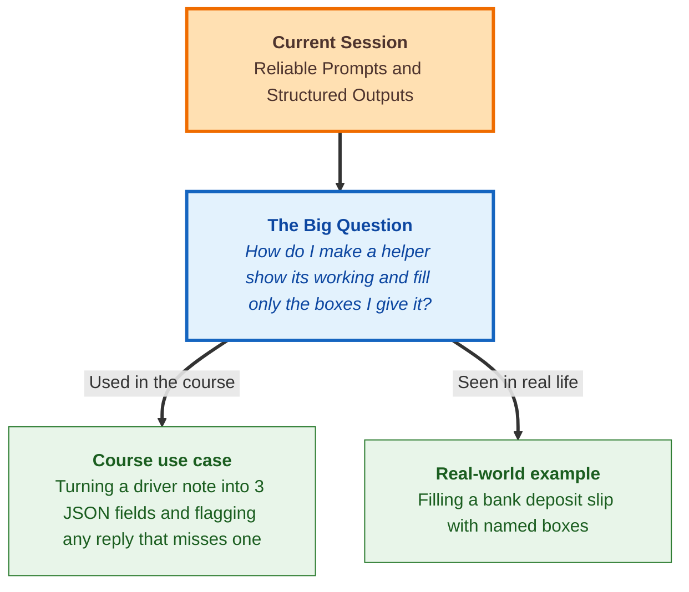

## <span style="color:#2F7DDE">Reliable Prompts and Structured Outputs</span>

### <span style="color:#2F7DDE">Mental Map</span>



---

### <span style="color:#2F7DDE">What You'll Learn</span>

Have you ever wondered why a bank clerk hands back a slip when one box is empty?

By the end of this session, you will be able to:

- <span style="color:#D9660B">**Explain**</span> why counting cash note by note is safer than guessing a total.
- <span style="color:#D9660B">**Apply**</span> a slip with set boxes so every form comes back in one shape.
- <span style="color:#D9660B">**Judge**</span> which jobs need a written working and which need only a quick answer.
- <span style="color:#D9660B">**Build**</span> a slip with 3 named boxes and a rule for each.
- <span style="color:#D9660B">**Write**</span> a request that asks for the boxes only, with no extra notes around them.
- <span style="color:#D9660B">**Design**</span> a rule sheet that names the required boxes and says what happens when one is empty.

> <span style="color:#2F7DDE">**Topics you will meet:**</span> Why step-by-step helps, choosing chain-of-thought, JSON-only prompts, JSON schema, schema-constrained calls, output contract and fallback.
>
> Join the session to learn each of these in detail.

---

### <span style="color:#2F7DDE">Why You Are Learning This Topic</span>

Vikram goes to the bank to deposit his shop's cash. He fills a deposit slip with 3 boxes: name, account number and amount.

He counts 4 notes of Rs 500, 7 notes of Rs 100 and 5 notes of Rs 50. He adds the total in his head and gets it wrong.

The clerk counts note by note, reaches Rs 2,950 and hands back the slip. The account number box is empty.

A <span style="color:#D9660B">**schema**</span> means the exact boxes a form must have, and the type of value each box takes.

You will give a chat tool a slip with named boxes. Then you will check what comes back.

> <span style="color:#2F7DDE">**Think about it:**</span> What did the clerk do that Vikram's head count did not?

---

### <span style="color:#2F7DDE">The Deposit Slip Puzzle</span>

Here is Vikram's cash and his slip.

| Notes | Number of notes | Value in Rs |
|:----------:|:----------:|:----------:|
| Rs 500 | 4 | 2,000 |
| Rs 100 | 7 | 700 |
| Rs 50 | 5 | 250 |
| Total | 16 | 2,950 |

<span style="color:#D9660B">**What you want to happen:**</span>

- The working is written line by line.
- The slip holds only the 3 boxes, nothing else.
- A slip with an empty box goes back to you with the box named.

Here is how it might start. You do not need to understand it yet.

```python
slip = {"name": "Vikram", "account": "004512", "amount": 2950}
print(slip["amount"])
```

> <span style="color:#D9660B">**Wonder about this:**</span>
>
> - Would writing the working help for a deposit of 1 note?
> - What should the clerk do when the account box is empty?

---

### <span style="color:#2F7DDE">Think It Through</span>

There is no wrong first try. Keep your guesses for the session.

**1. Vikram has 2 notes of Rs 500. Does he need written working for that total?**
Hint: Compare the effort of writing with the chance of a slip.

**2. The slip says "amount: about 3,000". Which rule of the slip does that break?**
Hint: The amount box takes a number.

**3. A slip arrives with no account number. What 2 facts should the rule sheet give next?**
Hint: One thing is who sees it, and one is what is named.

---

### <span style="color:#2F7DDE">One Question to Carry Into the Session</span>

> <span style="color:#2F7DDE">**How do you make a helper's answer easy for a machine to read and easy for you to trust?**</span>
>
> What would you write on the rule sheet before the first slip arrives?
