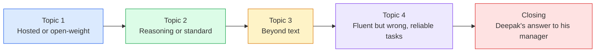
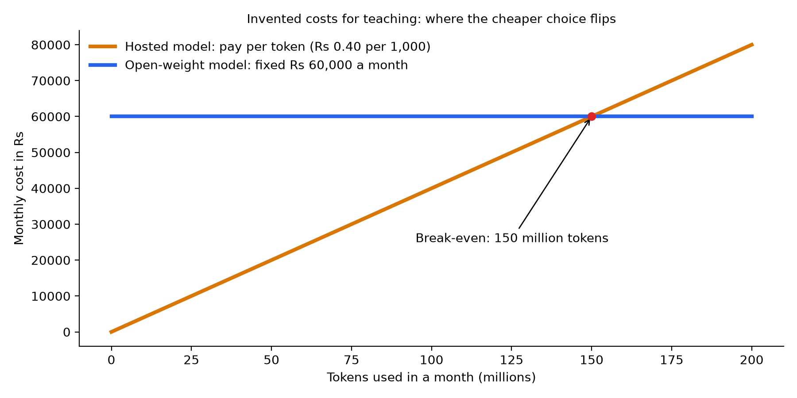
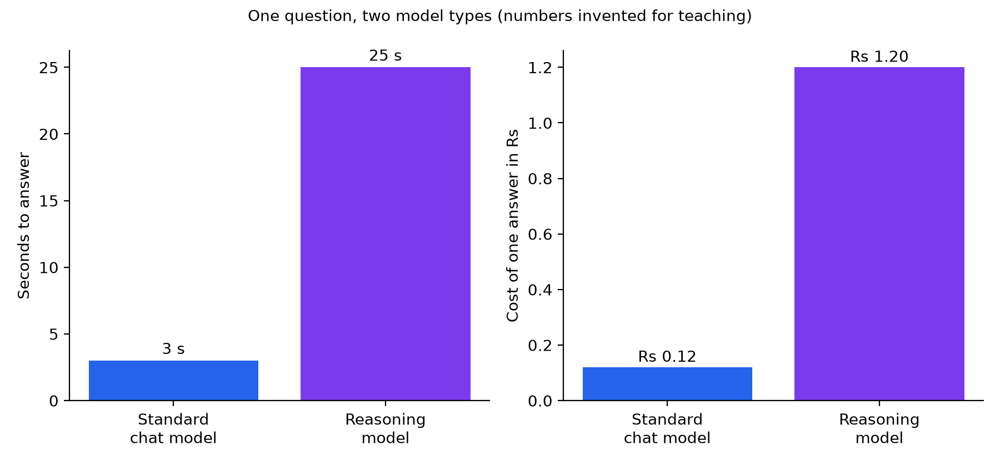

# Lecture Script: Where LLMs Work and Fail

---

## Agenda

The lecture runs as four topics. Each topic ends with a quiz.

| Topic | What we do | Learning objectives covered | Minutes |
|:-:|:--|:--|:-:|
| 1 | Choose between hosted and open-weight models | Compare open-weight and proprietary hosted models on cost, control and deployment | 30 |
| 2 | Choose between a reasoning model and a standard chat model | Compare a reasoning model with a standard chat model on latency, cost and task fit | 25 |
| 3 | See what a model can take in besides text | Describe the input types a multimodal model accepts beyond text | 20 |
| 4 | Find where fluent answers fail and sort tasks by reliability | Explain why a model can produce fluent text that is factually wrong Classify tasks as reliable or unreliable for a hosted LLM without external tools | 30 |
| — | Closing: Outcome & Summary | | 15 |
| | **Total** | | **120** |

> **🎯 Instructor Note** Pace: Topic 3 is a short concept with one live test. Spend the extra minutes on the cost and latency tables in Topics 1 and 2, and on the live checks in Topic 4.
> Learners need one free chat tool open: ChatGPT, Claude or Gemini. Model replies are never pasted here. All costs, times and token counts are invented for teaching and are not any vendor's prices.

---

## Scenario

**One pilot week.** Deepak leads customer support at a Zerodha-style stock-broking app. He ran a one-week pilot of an AI assistant and must tell his manager by Friday what to do next. The pilot used a single hosted model for every job, and three things stood out.

| What happened in the pilot | Where Deepak noticed it |
|:--|:--|
| A simple greeting took 25 seconds to answer | The chat log time stamps |
| A customer's screenshot of an error got no useful reply | A support ticket |
| The assistant quoted a fee for a "SilverTrade Plus" plan | A customer complaint |

> **🎯 Instructor Note** The company is only the setting. Do not claim it works this way. Deepak, the app, the fee and every cost, time and volume are invented for teaching. No real vendor price is used.

---

## Problem Statement

The fee in that last row does not exist. The customer asked the team to honour it, and the team spent a day tracing where the figure came from. Meanwhile the slow greeting and the unread screenshot made the assistant look unfit for the job.

Earlier sessions showed that a model predicts the next token, that its training data ends at a cutoff date and that an answer must be checked against a source. Today we use those ideas to decide where an LLM belongs and where it does not.

> **Which model type, which inputs and which tasks should Deepak give the assistant, and which jobs must stay with a person or a tool?**

> **🎯 Instructor Note** Poll: "Can a hosted LLM, with no search or code tool, be trusted to multiply two 5-digit numbers exactly?" Options: yes or no. Give learners 30 seconds to respond in chat. Reveal the answer in the Closing.

---

## What We Will Use

One free chat tool and a few invented numbers. Check each tool's current screen for what it accepts and what it can do.

| Topic | Ideas | In one line |
|:-:|:--|:--|
| 1 | Hosted model, open-weight model | Rent a model over the internet, or run one you control |
| 2 | Reasoning model, standard chat model | Spend more time and tokens on thinking, or answer fast |
| 3 | Multimodal input | Images, audio, video and documents as well as text |
| 4 | Fluent but wrong, reliable and unreliable tasks | Sort jobs by whether a checked answer is likely without outside tools |

---

## How: Walking Through Deepak's Five Questions

---

## Topic 1: Choose between hosted and open-weight models `30 min`

> **Deepak's pilot called a model over the internet. Is that the only way to get an LLM into a product?**

### Example: Two ways to run a model

> **How do a hosted model and an open-weight model differ on cost, control and deployment?**

A **hosted (proprietary) model** runs on the vendor's servers. You send requests to it over the internet and pay for use. An **open-weight model** has its trained weights published, so you can run it on your own computers or rented cloud machines. Licence terms differ by model, so read them.

| | Hosted proprietary model | Open-weight model |
|:--|:--|:--|
| Cost | Pay per use, no hardware to buy | Pay for machines and the people who run them, whether used or not |
| Control | The vendor decides updates and limits | You choose the version, can adjust it and can keep data on your own systems |
| Deployment | Quick: an account and a key | Slower: set up, secure and maintain servers yourself |

> **🎯 Instructor Note** Ask learners which row matters most for a broker's support data. Give learners 30 seconds to respond in chat. Many pick control, because customer data may need to stay inside the company.

> **Result** Hosted wins on speed to start and flexible cost. Open-weight wins on control and data location. Neither wins on every row.

### Extending it: Where the cheaper choice flips

> **At what volume does running your own model cost less?**

The numbers below are invented for teaching. A hosted model costs Rs 0.40 per 1,000 tokens. An open-weight setup costs Rs 60,000 a month in machines and upkeep, whatever the volume.

$$\text{hosted cost} = 0.40 \times \frac{\text{tokens}}{1000} \qquad \text{open-weight cost} = 60000$$

$$\boxed{ \text{break-even tokens} = \frac{60000}{0.40} \times 1000 = 150{,}000{,}000 }$$

| Monthly tokens | Hosted cost | Open-weight cost | Cheaper |
|:-:|:-:|:-:|:-:|
| 90 million | Rs 36,000 | Rs 60,000 | Hosted |
| 150 million | Rs 60,000 | Rs 60,000 | Equal |
| 180 million | Rs 72,000 | Rs 60,000 | Open-weight |

> **Result** Below 150 million tokens a month, hosted costs less. Above it, the fixed open-weight cost is lower. Cost is one row of the decision, so control and deployment still count.

> **Common mistake** Treating open-weight as free. Fix: count machines, staff time and security.

### Quiz 1

**Question:** A team needs customer data to stay on its own servers and wants to choose the model version. Which option fits best?

**Options:**
- A) A hosted proprietary model, because it needs no setup
- B) A hosted model, because it is always cheaper
- C) An open-weight model run on the team's own machines
- D) Neither, since a model cannot be run on a company's servers

**Correct Answer:** C

**Explanation:**
- **A)** Easy setup does not keep data on your own servers.
- **B)** It is not always cheaper. Above the break-even volume, a fixed-cost setup can cost less.
- **C)** Correct. You control the version and where the data sits, in return for running it yourself.
- **D)** Open-weight models can be run on a company's own or rented machines.

---

## Topic 2: Choose between a reasoning model and a standard chat model `25 min`

> **The slow answer to a greeting came from a model built to think hard. When is that the right model?**

### Example: Latency and cost of one answer

> **How do a reasoning model and a standard chat model differ in time and cost?**

A **standard chat model** answers directly. A **reasoning model** spends extra effort working through a problem before the final answer, which usually means more tokens and more time.

> **🎯 Instructor Note** The figures are invented for teaching. Do not quote them as real. Many services bill the reasoning tokens as output, so tell learners to check the current pricing page.

| For one support question | Standard chat model | Reasoning model |
|:--|:-:|:-:|
| Time to answer | 3 s | 25 s |
| Tokens produced, including working | 300 | 3,000 |
| Cost at Rs 0.40 per 1,000 tokens | Rs 0.12 | Rs 1.20 |

$$\frac{25}{3} \approx 8.3 \text{ times slower} \qquad \frac{1.20}{0.12} = 10 \text{ times the cost}$$

> **Result** In this invented example, the reasoning model is about 8.3 times slower and 10 times costlier per answer.

### Extending it: Match the model to the task

> **Which model fits which support job?**

> **🎯 Instructor Note** Ask learners to type S for standard or R for reasoning for each row before you reveal the column. Give learners 30 seconds to respond in chat.

| Support job | Better fit | Why |
|:--|:-:|:--|
| Greet a customer and ask what they need | Standard | One step, so speed matters |
| Rewrite a reply in a friendlier tone | Standard | A quick language task |
| Work out a customer's charge over several rules and a fee | Reasoning | Several dependent steps |
| Plan the order in which to resolve 6 linked tickets | Reasoning | Planning with constraints |

> **Result** Reasoning models earn their cost on multi-step logic and planning. For quick language tasks, standard is faster and cheaper.

> **Common mistake** Choosing the most capable model for every job. Fix: match the model to the number of reasoning steps the task needs.

### Quiz 2

**Question:** Which task is the best fit for a reasoning model, accepting its higher latency and cost?

**Options:**
- A) Saying "Hello, how can I help?"
- B) Planning the order for resolving 6 linked tickets under 4 rules
- C) Fixing a typo in one word
- D) Rewriting one sentence more politely

**Correct Answer:** B

**Explanation:**
- **A)** A greeting needs no working, so speed matters more.
- **B)** Correct. Several linked steps and rules benefit from extra working.
- **C)** A typo fix is one step.
- **D)** A tone rewrite is a quick language task.

---

## Topic 3: See what a model can take in besides text `20 min`

> **Customers send screenshots and voice notes, not only text. What can a model take in?**

### Example: Inputs beyond text

> **Which input types does a multimodal model accept besides text?**

A **multimodal** model accepts more than one kind of input. Besides text, that can be images, audio, video and documents such as PDFs. Which kinds a tool accepts depends on the tool and its plan, so check its current screen.

| Input type | A support example |
|:--|:--|
| Image | A screenshot of an order screen showing an error |
| Audio | A voice note from a customer |
| Video | A short screen recording of the problem |
| Document | A PDF statement sent as an attachment |

> **Result** Four non-text inputs: images, audio, video and documents. A multimodal model reads them in the same chat as the text.

### Extending it: Test one input live

> **Does your own tool accept an image, and does it read it correctly?**

> **🎯 Instructor Note** Learners upload an image they own that holds no private data, for example a photo of a printed menu or a handwritten shopping list. They ask the tool to list the items and check the list against the image. Do not predict the reply.

| Check (learners fill) | Yes or No |
|:--|:-:|
| The tool accepted the image | |
| Every item in the image was listed | |
| No item was added that is not in the image | |

> **Result** A model can read an image and still add a line that is not there. Check the reading against the image, as you check a text answer against its source.

> **Common mistake** Uploading a real customer screenshot to a public chatbot. Fix: use invented or public images, as in the earlier session on what never to share.

### Quiz 3

**Question:** Which list holds only input types a multimodal model can accept besides text?

**Options:**
- A) Spreadsheet formulas only
- B) Images, audio, video and documents
- C) Passwords and card numbers
- D) Keyboards and mice

**Correct Answer:** B

**Explanation:**
- **A)** A formula is text, not another input type.
- **B)** Correct. Images, audio, video and documents are the common non-text inputs.
- **C)** These are data to protect, not input types.
- **D)** These are devices, not input types.

---

## Topic 4: Find where fluent answers fail and sort tasks by reliability `30 min`

> **A model can see, hear and reason. Why did it still invent a plan that does not exist?**

### Example: Fluent but wrong

> **Why can a model write a smooth sentence that is false?**

A model produces the next token that fits the text so far. Nothing in that process checks the sentence against the world. Four situations make a false line more likely:

| Cause | In Deepak's pilot |
|:--|:--|
| The text sounds plausible, so it is a likely next token | "Plan charges Rs 12 per order" looks like a brokerage line |
| The fact was never in training, or came after the cutoff | A plan the model has never seen |
| The fact lives in your private records | A customer's real fee or balance |
| Exact numbers and rare facts are weak spots | A fee figure stated with confidence |

> **🎯 Instructor Note** Live check: learners ask their tool, "What does the SilverTrade Plus plan charge per order?" The plan is invented. Read the real reply and ask whether it admitted the gap or invented a figure.

> **Result** A tool that invents a figure for a plan that does not exist is showing a fluent but wrong answer. A tool that says it cannot find the plan is behaving safely.

#### Logic Explanation

- Fluency comes from predicting plausible text. Truth would need a lookup or a check that plain generation does not do.
- Supplying the source text, as in the earlier session on documents, moves the answer from memory to evidence.

### Extending it: Reliable or unreliable without outside tools

> **Which support jobs can a hosted model do on its own, and which need a tool or a person?**

Here, "without external tools" means no web search, no code run and no database. We call a task **reliable** when a checked answer is likely, and **unreliable** when the model has no way to know the answer or to compute it exactly.

> **🎯 Instructor Note** Ask learners to type R or U for each row before you reveal the column. Give learners 30 seconds to respond in chat.

| Task | Class | Why |
|:--|:-:|:--|
| Rewrite a reply in simpler words | Reliable | The facts are in the text you gave |
| Summarise a pasted support note | Reliable | The source is in the chat |
| Label 10 pasted tickets with 3 given categories | Reliable | A clear rule and the text in view |
| State today's share price | Unreliable | It needs live data |
| Look up a customer's account balance | Unreliable | The model cannot reach private records |
| Multiply 48,372 by 9,614 exactly | Unreliable | Exact long arithmetic is a weak spot |
| Quote the page number of a rule from memory | Unreliable | Citations are often invented |

> **🎯 Instructor Note** Live check: learners ask the tool to multiply 48,372 by 9,614 without any code feature. The correct product is 465,048,408. Compare the reply digit by digit.

> **Result** Reliable tasks have the facts in the chat and a rule to follow. Unreliable tasks need live data, private records, exact arithmetic or sources. Give those to a tool or a person.

> **Common mistake** Calling a task reliable because the first answer looked right. Fix: judge by whether the model has what it needs, then check anyway.

### Quiz 4

**Question:** Which task is unreliable for a hosted LLM with no external tools?

**Options:**
- A) Summarising a note pasted into the chat
- B) Rewriting a paragraph in simpler words
- C) Labelling pasted tickets with three given categories
- D) Reading out a customer's current account balance

**Correct Answer:** D

**Explanation:**
- **A)** The source text is in the chat, so a checked summary is likely.
- **B)** The facts are in the text you supplied.
- **C)** A clear rule and visible text make this reliable.
- **D)** Correct. The model has no access to private records, so any figure would be invented.

---

## Closing: Outcome & Summary `15 min`

Back to Deepak. We answer the Problem Statement using each topic once.

> **1. Hosted or open-weight? (Topic 1)**

Hosted to start quickly at low volume, since 90 million tokens costs Rs 36,000 against Rs 60,000. Open-weight if data must stay in-house or volume passes 150 million tokens.

> **2. Reasoning or standard? (Topic 2)**

Standard for greetings and rewrites. Reasoning for multi-step charges and planning, accepting 8.3 times the time and 10 times the cost.

> **3. Which inputs? (Topic 3)**

A multimodal model can read screenshots, voice notes, video and PDFs, and its readings are checked against the original.

> **4. Which jobs alone? (Topic 4)**

Rewriting, summarising pasted text and labelling go to the assistant. Prices, balances, exact arithmetic and citations go to a tool or a person.

### Outcome

| | Deepak's pilot | Deepak's plan |
|:--|:--|:--|
| Model type | One hosted model for all jobs | Chosen by volume, data and control |
| Reasoning model | Used for greetings | Used for multi-step jobs only |
| Inputs | Text only | Screenshots and voice notes, checked |
| Fees and balances | Stated by the model | Looked up in the real system |

> **Therefore,** Deepak matches the model type to cost, control and deployment, uses a reasoning model only for multi-step work, checks what a multimodal model reads, and keeps facts, balances and exact arithmetic out of an unaided model's hands.

> **🎯 Instructor Note** Reveal the poll: no. Exact long multiplication is a weak spot for a model without a code or calculator tool, so use one.

### Summary

| Learning objective | Takeaway |
|:--|:--|
| Hosted and open-weight | Hosted is quick and pay-per-use. Open-weight gives control and moves the cost to your machines |
| Reasoning and standard | Reasoning costs more time and tokens, and suits multi-step tasks |
| Multimodal inputs | Images, audio, video and documents as well as text |
| Fluent but wrong | A plausible-sounding line is not a checked fact |
| Reliable and unreliable tasks | Reliable when the facts are in the chat. Unreliable when live data, private records or exact arithmetic are needed |
| **Practical value** | Knowing where an LLM works and fails lets you pick the right model and put a check where it matters |

---

# Launch the Feedback Poll

> **🎯 Instructor Note** Reminder: launch the feedback poll now to collect learner feedback.
