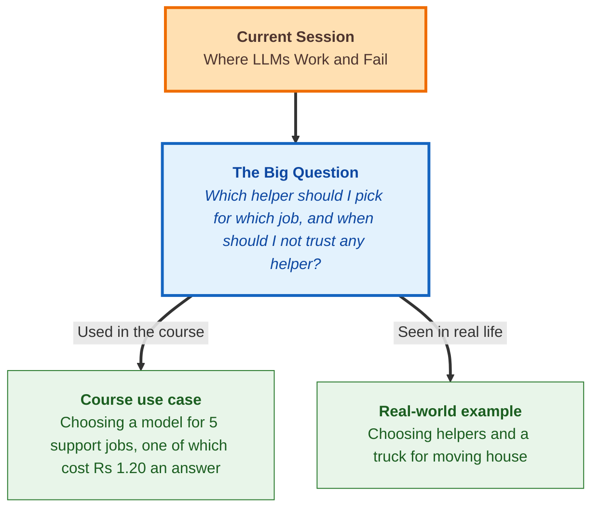

## Where LLMs Work and Fail

### Mental Map

---

### What You'll Learn

Have you ever wondered why a confident helper can still give you a wrong address?

By the end of this session, you will be able to:

- **Describe** the 3 ways a helper can take in a job: written notes, photos and voice notes.
- **Explain** why a helper who sounds sure can still send you to the wrong floor.
- **Classify** 6 moving-day jobs as safe to hand over or in need of a check.
- **Compare** renting a truck for Rs 3,000 a trip with owning one for Rs 20,000 a month.
- **Differentiate** a careful packer from a quick packer by time, cost and the job.

> **Topics you will meet:** Hosted vs open models, reasoning models, multimodal inputs, fluent but wrong answers, reliable vs unreliable tasks.
>
> Join the session to learn each of these in detail.

---

### Why You Are Learning This Topic

Nikhil is moving to a new flat on Saturday. He needs a truck, packers and someone to give directions.

His helper Ravi says, "The flat is on the 3rd floor." He sounds sure. The flat is on the 5th, and the movers carry boxes up the wrong stairs.

A **fluent but wrong answer** means a reply that sounds smooth and sure but is false.

You will learn to match a model to a job. You will also spot jobs it should not do alone.

> **Think about it:** What could Nikhil have asked Ravi before trusting "3rd floor"?

---

### The Moving Day Puzzle

Here are Nikhil's choices for Saturday.

| Choice | Option A | Option B |
|:----------:|:----------:|:----------:|
| Truck | Rent: Rs 3,000 a trip | Own: Rs 20,000 a month |
| Packer | Careful: 4 hours, Rs 800 | Quick: 1 hour, Rs 200 |
| Directions | Ravi from memory: "3rd floor" | Photo of the building board |

**What you want to happen:**

- The truck choice depends on the number of trips you make.
- The packer choice depends on the job: fragile glass or old books.
- Directions come from a photo, not from memory.

> **Wonder about this:**
>
> - At what number of trips a month does owning the truck cost less?
> - Which job on moving day would you never leave to Ravi's memory?

---

### Think It Through

There is no wrong first try. Keep your guesses for the session.

**1. Nikhil makes 2 trips this month. Which truck option costs less?**
Hint: Compare 2 × 3,000 with 20,000.

**2. Which packer should wrap the glass, and which should pack the old books?**
Hint: Match the care needed to the time and cost.

**3. Ravi quotes the rent of the new flat from memory. How could Nikhil check it?**
Hint: Look for a paper or a photo that holds the number.

---

### One Question to Carry Into the Session

> **How do you decide which jobs a smooth-talking helper can do alone?**
>
> What would you ask the helper to show before you trust it?
