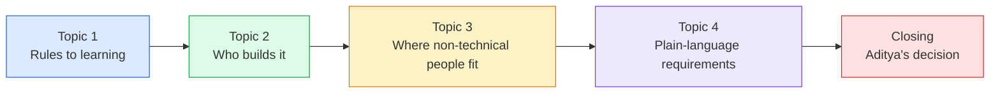
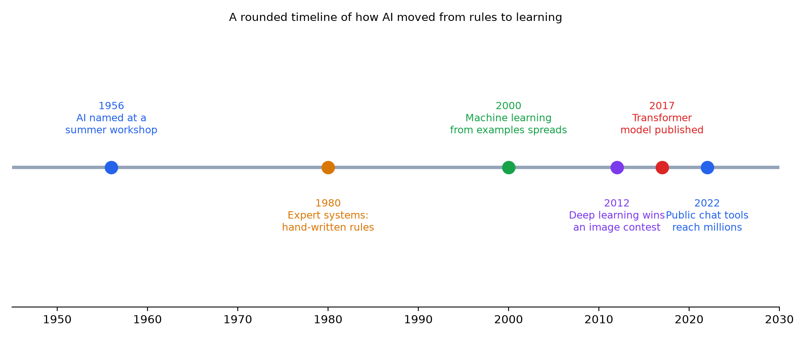
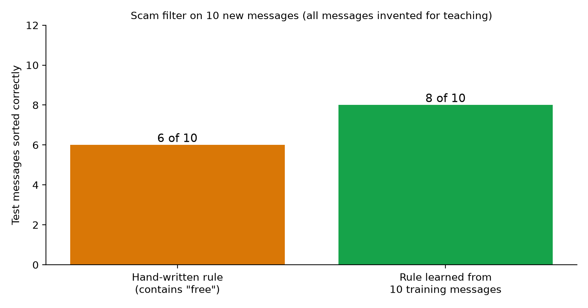

# Lecture Script: Careers in AI: Who Does What

---

## Agenda

The lecture runs as four topics. Each topic ends with a quiz.

| Topic | What we do | Learning objectives covered | Minutes |
|:-:|:--|:--|:-:|
| 1 | See how AI moved from hand-written rules to learning from examples | Explain how AI moved from following hand-written rules to learning from examples | 30 |
| 2 | Meet the people who build an AI product | List the roles that build and run an AI product and what each does | 25 |
| 3 | Find where non-technical people fit | The same roles list, applied to the roles that need no coding | 20 |
| 4 | Read a job posting in plain language | Rewrite an AI job posting as a plain-language list of requirements | 30 |
| — | Closing: Outcome & Summary | | 15 |
| | **Total** | | **120** |

> **🎯 Instructor Note** Pace: Topic 3 extends the roles list from Topic 2, so keep it brisk. Spend the extra minutes on the rule-versus-learned example in Topic 1 and on the posting rewrite in Topic 4.
> No software is needed. Learners need paper or a notes app. All messages, postings and counts are invented for teaching.

---

## Scenario

**A conversation at lunch.** Neha works on the trust team of a Dream11-style fantasy cricket app. The team is building a filter that catches scam messages in match chats. At a family lunch, her cousin Aditya, a commerce student, asks her two questions: "Is AI just millions of rules that someone typed?" and "Do I need to code to work on a team like yours?" He also holds up his phone with a posting for an "AI Product Associate", full of jargon.

> **🎯 Instructor Note** The company is only the setting. Do not claim it works this way. Neha, Aditya, the filter, the chat messages and the posting are invented for teaching. No real job posting or hiring practice is described.

---

## Problem Statement

Aditya has two wrong ideas. He thinks AI means programmers typing a rule for every case, and that every AI job needs coding. He closes the posting without reading it and tells Neha, "That is not for people like me." Neha knows that her own team includes people who label examples, check answers and write for users.

Earlier sessions showed how a chat tool predicts text, how to prompt it and where it fails. Today we look at the people behind such tools and at how to read a job posting.

> **How did AI move from hand-written rules to learning from examples, who builds and runs an AI product, where does someone like Aditya fit, and what does the posting really ask for?**

> **🎯 Instructor Note** Poll: "Does every job on an AI product team need coding?" Options: yes or no. Give learners 30 seconds to respond in chat. Reveal the answer in the Closing.

---

## What We Will Use

No software today. We use tables, one rounded timeline and one small worked example.

| Topic | Ideas | In one line |
|:-:|:--|:--|
| 1 | Hand-written rules, learning from examples | A rule is written by a person. A learned rule is found from labelled examples |
| 2 | Roles that build and run | Product, data, model, application and operations roles |
| 3 | Non-technical roles | Domain, labelling, testing, rules and support roles |
| 4 | A job posting | Turn jargon into a plain list of requirements |

---

## How: Walking Through Aditya's Posting

---

## Topic 1: See how AI moved from hand-written rules to learning from examples `30 min`

> **Aditya thinks AI is millions of rules typed by hand. Was it always built that way?**

### Example: A rounded timeline

> **What changed between the first AI programs and today's chat tools?**

Early AI programs followed **hand-written rules**: a person wrote each if-this-then-that step. Later systems used **machine learning**: they found their own rules from labelled **examples**. The years below are rounded.

| Period | How the system got its rules |
|:--|:--|
| Around 1980 | Experts and programmers wrote the rules by hand |
| From around 2000 | Programs learned rules from many labelled examples |
| After 2012 | Larger learned models, called deep learning, handled images and speech well |
| After 2017 | The transformer design led to the language models behind chat tools |

> **Result** The shift is from "a person writes every rule" to "a program finds the rule from examples". The examples became the new raw material.

### Extending it: A rule versus a learned rule

> **Which sorts scam chat messages better, a hand-written rule or a rule found from examples?**

> **🎯 Instructor Note** All 20 messages are invented for teaching. The counts were worked out by a separate check. Ask learners to predict which side wins before you show the result. Give learners 30 seconds to respond in chat.

The **hand-written rule** says: a message is a scam if it contains the word "free". The **learned rule** comes from 10 training messages (5 scam, 5 fine). It keeps each word that appears in at least 2 scam messages and in no fine message. The words it found are: click, now, offer, otp, send, your.

Both rules face 10 new messages. S means scam and H means fine.

| # | New message | True | Hand-written rule | Learned rule |
|:-:|:--|:-:|:-:|:-:|
| 1 | Free coins claim now | S | S, right | S, right |
| 2 | Send OTP to get your prize | S | H, wrong | S, right |
| 3 | Win cash prize click link | S | H, wrong | S, right |
| 4 | Offer for you send OTP now | S | H, wrong | S, right |
| 5 | Free gift click here | S | S, right | S, right |
| 6 | Free tips for tonight match | H | S, wrong | H, right |
| 7 | Is the match at 7 pm | H | H, right | H, right |
| 8 | Good luck with your team | H | H, right | S, wrong |
| 9 | Will you win today | H | H, right | H, right |
| 10 | Send me your team name | H | H, right | S, wrong |

$$\text{hand-written: } \frac{6}{10} = 60\% \qquad \text{learned: } \frac{8}{10} = 80\%$$

> **Result** The learned rule did better on these 10 messages, but it also made two mistakes. It treated "your" as a scam word, because "your" appeared in two scam messages and no fine ones. Learned rules are only as good as their examples.

> **Common mistake** Thinking that a learned rule is always right. Fix: it reflects its examples, so people check it on new messages.

### Quiz 1

**Question:** Which statement describes the move from hand-written rules to learning from examples?

**Options:**
- A) Programmers stopped writing any code
- B) The program finds its own rules from labelled examples instead of a person writing every rule
- C) Computers started using electricity
- D) The rules became longer, but a person still wrote each one

**Correct Answer:** B

**Explanation:**
- **A)** People still write the code that trains and runs the systems.
- **B)** Correct. The rules come from patterns in labelled examples.
- **C)** Computers always used electricity. That is not the shift.
- **D)** The point is that the rule was found from data, not typed by a person.

---

## Topic 2: Meet the people who build an AI product `25 min`

> **A filter like this needs examples, models, an app and someone to keep it running. Who does each job?**

### Example: Roles on the scam-filter team

> **Which roles build and run an AI product, and what does each do?**

Job titles differ between companies. The work below is what matters.

| Role | What the role does | In the scam filter |
|:--|:--|:--|
| Product manager | Decides what to build, for whom, and how success is measured | Sets the goal: fewer scam messages reach users |
| Data engineer | Builds the pipelines that collect, clean and store data | Gathers chat messages safely |
| Data scientist or analyst | Explores the data, chooses measures and tests ideas | Checks which words signal a scam |
| Machine learning engineer | Trains, tests and packages models | Trains the learned rule from labelled examples |
| AI application engineer | Builds the app around the model, calls model services and writes prompts | Connects the filter to the chat screen |
| MLOps or platform engineer | Deploys the model, watches it and keeps it running | Alerts the team when accuracy drops |

> **🎯 Instructor Note** Ask learners which role they would ask when the filter flags a fine message as a scam. Give learners 30 seconds to respond in chat. Expected: the data scientist or the machine learning engineer, then the product manager.

> **Result** Six roles cover the build and the run: set the goal, collect data, study it, train the model, build the app and keep it running.

#### Logic Explanation

- The work moves in a line: goal, data, model, app, running system.
- In a small team, one person may hold two of these roles. In a large team, each role has several people.

### Extending it: Match the task to the role

> **Who owns each task?**

> **🎯 Instructor Note** Ask learners to type a role for each task before you reveal the column.

| Task | Role |
|:--|:--|
| "Decide that the goal is to cut scam chats by half" | Product manager |
| "Remove duplicate messages from the stored data" | Data engineer |
| "Train the model on 1,000 labelled messages" | Machine learning engineer |
| "Page the team at 2 am when the filter stops working" | MLOps or platform engineer |

> **Result** A task belongs to the role whose work it is, not to whoever is available.

### Quiz 2

**Question:** Which role trains, tests and packages the model?

**Options:**
- A) Product manager
- B) Data engineer
- C) Support agent
- D) Machine learning engineer

**Correct Answer:** D

**Explanation:**
- **A)** The product manager sets the goal and the measure of success.
- **B)** The data engineer builds the data pipelines.
- **C)** A support agent helps users and escalates problems.
- **D)** Correct. This role trains, tests and packages models.

---

## Topic 3: Find where non-technical people fit `20 min`

> **Aditya cannot code. Which parts of the filter's team need no coding at all?**

### Example: Roles that need no coding

> **Which roles on the same team are not built on programming skills?**

The roles below continue the list from Topic 2. Each is part of building and running the same product.

| Role | What the role does | In the scam filter |
|:--|:--|:--|
| Domain expert | Knows the business and its rules | Says what a real scam looks like in fantasy cricket |
| Data labeller | Marks each example with the right answer | Tags 1,000 messages as scam or fine |
| Tester or evaluator | Checks outputs against a checklist | Reviews 100 filter decisions a week |
| Legal, privacy and compliance | Makes sure data use follows the rules | Checks that chats are used lawfully |
| Support and operations | Helps users and escalates problems | Handles users whose messages were wrongly blocked |

> **Result** Five roles need judgement and care, not code. Without labellers and evaluators, the learned rule has no examples to learn from and no check.

### Extending it: Where would Aditya's skills fit?

> **Which role fits a commerce student who writes clearly and checks details?**

> **🎯 Instructor Note** Ask learners to type one role that fits Aditya and one skill that supports it. Give learners 30 seconds to respond in chat. Several answers are valid.

| Aditya's strength | Roles that fit |
|:--|:--|
| Checks details and finds errors | Tester or evaluator |
| Understands money and rules | Domain expert, compliance |
| Writes clearly for users | Support, product assistant |
| Organises work and explains progress | Product assistant or associate |

> **Result** A non-coder can hold a real role on an AI team. The test is what the role needs, not whether it has "AI" in the name.

> **Common mistake** Assuming that no coding means no technical understanding. Fix: these roles still need to know what the model can and cannot do.

### Quiz 3

**Question:** Which role on an AI product team marks each example with the right answer so a model can learn from it?

**Options:**
- A) Data labeller
- B) MLOps engineer
- C) Legal and compliance officer
- D) Support agent

**Correct Answer:** A

**Explanation:**
- **A)** Correct. A labeller tags examples, and no coding is needed.
- **B)** The MLOps engineer deploys and monitors the system.
- **C)** Legal and compliance check that data use follows the rules.
- **D)** Support helps users and escalates problems.

---

## Topic 4: Read a job posting in plain language `30 min`

> **Aditya stopped at the jargon. What does the posting actually ask for?**

### Example: Decode the posting

> **How do we turn jargon into a plain list of requirements?**

> **🎯 Instructor Note** The posting below is invented for teaching. Do not present it as a real company's ad. Ask learners to circle the 3 phrases they find hardest.

> **AI Product Associate.** Leverage LLM capabilities to drive cross-functional roadmaps. Define evaluation harnesses and KPIs for generative AI features. Partner with engineers to iterate on prompts. Synthesise stakeholder requirements. **Requirements:** 2+ years in product or analytics; familiarity with Python and SQL; excellent communication; exposure to responsible AI.

Use three steps. First, find each action word. Second, replace each jargon phrase with plain words. Third, split the list into must have and nice to have.

| Jargon in the posting | In plain words |
|:--|:--|
| Leverage LLM capabilities | Use a chat-style AI tool to do the work |
| Cross-functional roadmaps | Plans that involve several teams |
| Evaluation harnesses and KPIs | Tests and numbers that show whether the feature works |
| Iterate on prompts | Try, check and improve the instructions given to the AI |
| Synthesise stakeholder requirements | Collect what each team needs and summarise it |
| Exposure to responsible AI | Knows about privacy and fairness basics |

> **Result** The posting is mostly: plan work with other teams, test AI features, improve prompts and summarise needs.

### Extending it: The plain-language requirements list

> **What is the list of requirements after the rewrite?**

| Must have | Nice to have |
|:--|:--|
| 2 or more years in product or data analysis work | Basic Python |
| Can write a clear prompt and check an AI answer | Basic SQL |
| Can explain progress to people who are not technical | Knowledge of privacy and fairness basics |
| Can plan work with several teams | |

> **🎯 Instructor Note** Learners now rewrite one real posting of their own choice, from a public job site, using the three steps. They bring back one jargon phrase and its plain version. Give learners 30 seconds to respond in chat.

> **Result** A plain list lets you compare your skills with the role. Aditya can tick the must-haves he already meets and plan to learn the nice-to-haves.

> **Common mistake** Reading "familiarity with" as "expert in". Fix: ask which items are must have and which are nice to have, and apply anyway if you meet most.

### Quiz 4

**Question:** Which line is the best plain-language rewrite of "Iterate on prompts"?

**Options:**
- A) Write code to train models
- B) Run the company
- C) Try, check and improve the instructions given to the AI
- D) Read research papers

**Correct Answer:** C

**Explanation:**
- **A)** Training models is a different job.
- **B)** The phrase does not mean running the company.
- **C)** Correct. A prompt is the instruction given to the AI, and iterating means trying, checking and improving it.
- **D)** The phrase does not mention research papers.

---

## Closing: Outcome & Summary `15 min`

Back to Aditya. We answer the Problem Statement using each topic once.

> **1. How did AI get here? (Topic 1)**

It moved from rules typed by hand around 1980 to rules learned from labelled examples. On our 10 test messages, the learned rule got 8 right against 6 for the hand-written rule, and it still made 2 mistakes.

> **2. Who builds and runs it? (Topic 2)**

A product manager, data engineer, data scientist or analyst, machine learning engineer, AI application engineer and MLOps engineer.

> **3. Where does he fit? (Topic 3)**

Domain expert, data labeller, tester or evaluator, legal and compliance, and support roles need judgement and care, not code.

> **4. What does the posting ask? (Topic 4)**

Four must-haves and three nice-to-haves, once the jargon is rewritten in plain words.

### Outcome

| | Aditya's first reading | Aditya's reading after today |
|:--|:--|:--|
| What AI is | Millions of hand-typed rules | Rules found from examples, checked by people |
| Who builds it | Programmers only | Technical and non-technical roles |
| The posting | Jargon, so he skips it | 4 must-haves, 3 nice-to-haves |
| Her decision | Do not apply | Apply, and say which must-haves he meets |

> **Therefore,** AI moved from hand-written rules to rules learned from examples. An AI product needs build roles, run roles and non-technical roles. Rewriting a posting in plain words shows Aditya which requirements he already meets, so he can apply.

> **🎯 Instructor Note** Reveal the poll: no. Labellers, evaluators, domain experts, compliance and support roles need no coding.

### Summary

| Learning objective | Takeaway |
|:--|:--|
| How AI got here | From rules written by people to rules learned from labelled examples |
| Roles that build and run | Product, data, model, application and operations roles each own part of the work |
| Where non-technical people fit | Domain, labelling, testing, compliance and support roles |
| Plain-language posting | Find the actions, replace jargon, split must have from nice to have |
| **Practical value** | Knowing who does what helps you choose a role and read a posting with confidence |

---

# Launch the Feedback Poll

> **🎯 Instructor Note** Reminder: launch the feedback poll now to collect learner feedback.
