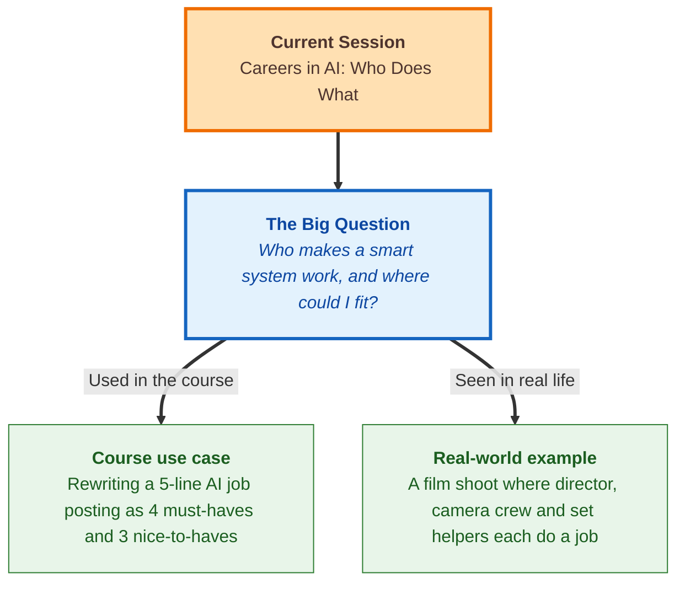

## Careers in AI: Who Does What

### Mental Map

---

### What You'll Learn

Have you ever wondered how a crew learns from past shoots instead of following one fixed plan?

By the end of this session, you will be able to:

- **List** 4 people a film crew needs on shoot day and what each one does.
- **Identify** the crew jobs that need no camera or coding skill.
- **Explain** how a planner moved from a notebook of fixed rules to patterns found in old shoot logs.
- **Write** a plain version of a crew notice full of long words.

> **Topics you will meet:** How AI got here, who builds it, where non-technical people fit, reading an AI job posting as plain-language requirements.
>
> Join the session to learn each of these in detail.

---

### Why You Are Learning This Topic

Mehul joins a film unit as a trainee. The old planner kept a notebook of 20 fixed rules, such as "Always shoot outdoor scenes before noon."

The new planner studies 100 past shoot logs instead. She finds that rain delays cluster in July and August, and she builds her schedule from that.

Mehul also reads a crew notice with long words. He thinks only camera people can apply for the job.

A **role** means a named job with a clear set of tasks inside a team.

You will see the same idea in AI teams and in the job posts they write.

> **Think about it:** Which planner would adjust faster when the shoot moves to a new city?

---

### The Film Shoot Puzzle

Here are the two planners and the crew on shoot day.

| Item | Old way | New way |
|:----------:|:----------:|:----------:|
| Planner | 20 fixed rules in a notebook | Patterns found in 100 shoot logs |
| Sound | Notes levels on paper | Records levels in an app |
| Notice | "Liaise with stakeholders to optimise schedule adherence" | "Work with the director and crew so each day ends on time" |

**What you want to happen:**

- Each person on shoot day has a clear job.
- You can tell which jobs need no camera.
- You can turn the long-word notice into plain words.

> **Wonder about this:**
>
> - Who updates the planner's schedule when a new location is added?
> - Which words in the notice could you replace with simpler ones?

---

### Think It Through

There is no wrong first try. Keep your guesses for the session.

**1. Name 3 jobs on the shoot that do not need an actor.**
Hint: Think about the clapperboard, the lights and the lunch.

**2. The new planner finds a pattern in 100 logs. What did the old planner rely on instead?**
Hint: Look at the notebook.

**3. Rewrite "Liaise with stakeholders to optimise schedule adherence" in 12 plain words.**
Hint: Say who works with whom, and for what.

---

### One Question to Carry Into the Session

> **Which jobs around a smart system would you enjoy, and which of them need no coding?**
>
> What would you ask a hiring team to explain in plain words?
